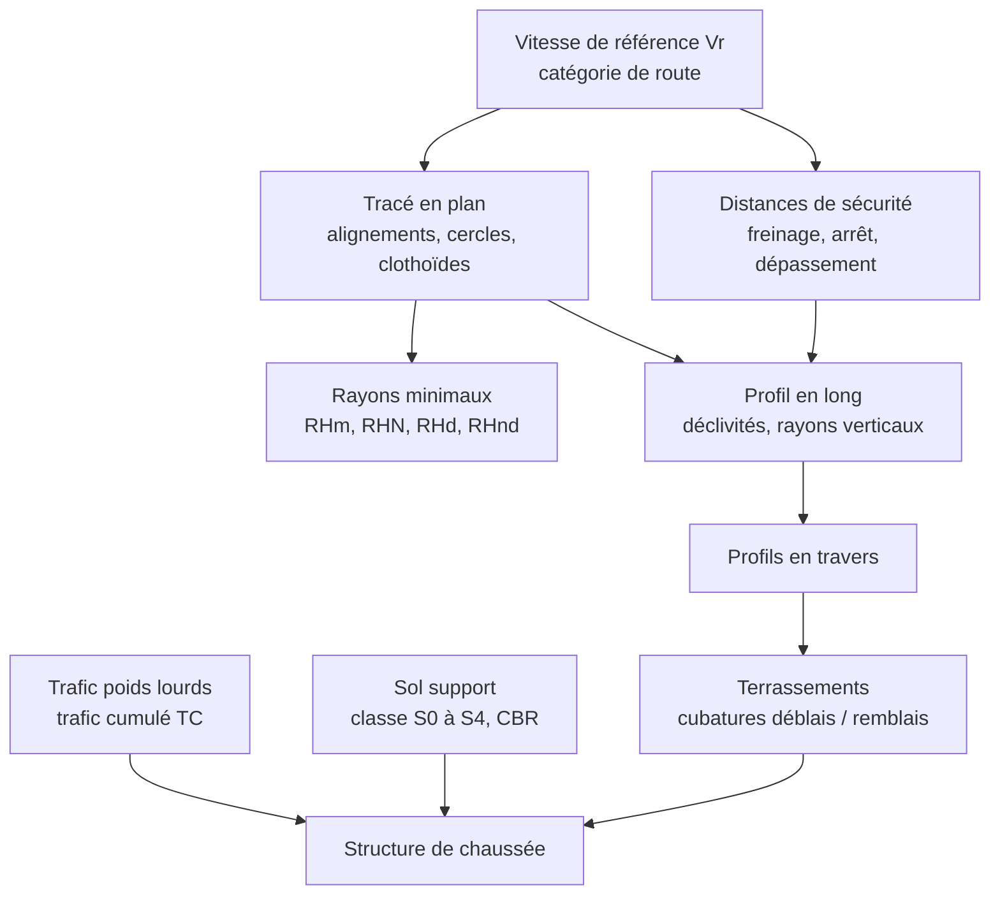

# Routes

Cours complet de Routes, basé sur le cours « COURS ROUTE 2GCV » et les « EXERCICES ROUTES 2GCV ». Les passages marqués **[Complément]** ne viennent pas du cours.

## Fichiers

| Fichier | Contenu |
| --- | --- |
| [cours.md](cours.md) | Les 9 chapitres : définitions, formules, exemples chiffrés |
| [formulaire.md](formulaire.md) | Toutes les formules sur une page |
| [exercices-corriges.md](exercices-corriges.md) | Exercices types avec correction détaillée |

## Vue d'ensemble

Un projet routier suit toujours le même chemin : on fixe la vitesse, on en déduit la géométrie, puis on dimensionne la chaussée avec le trafic et le sol.

## Plan du cours

1. Marché routier et étapes d'un chantier
2. Tracé routier : terminologie, tracé en plan, rayons, surlargeur
3. Raccordements circulaires
4. Paramètres fondamentaux : distances de freinage, d'arrêt, de dépassement
5. Trafic routier : trafic cumulé, classes, capacité
6. Clothoïde et dévers
7. Profil en long et profil en travers
8. Structure de chaussée et dimensionnement
9. Terrassements [Complément]
