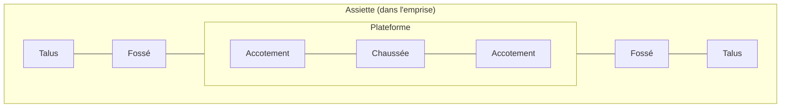
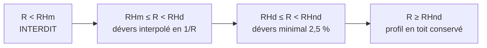
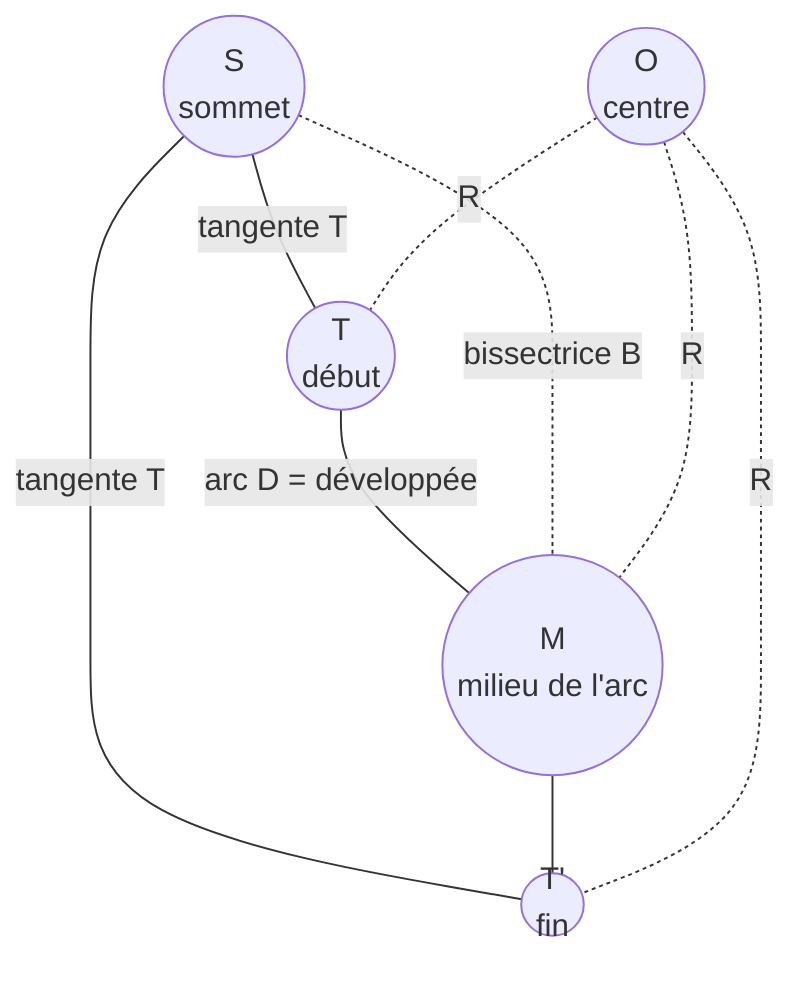
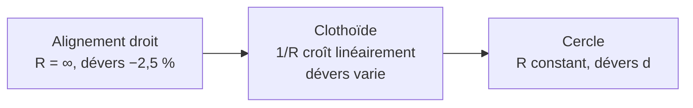
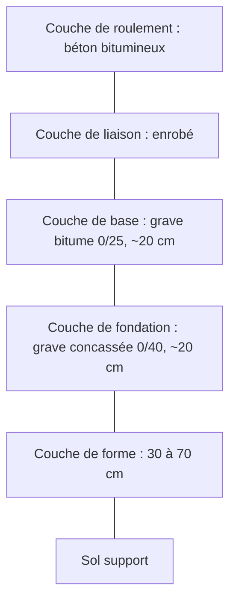

# Cours de Routes

[← Retour au sommaire](README.md)

Les passages marqués **[Complément]** ne viennent pas du cours d'origine : ils ajoutent des explications ou comblent un manque. À vérifier avec l'enseignant.

---

## Chapitre 1. Marché routier et étapes d'un chantier

Un chantier routier va de l'appel d'offres à la signalisation, en 11 étapes.

### Le marché

- Le **maître d'ouvrage** (État, collectivité, société d'autoroutes) lance un appel d'offres.
- Le **Dossier de Consultation des Entreprises (DCE)** décrit les travaux. Les entreprises répondent avec leurs moyens, leurs méthodes et un prix.
- Le choix se fait par **analyse multicritère** : qualité technique, délais, environnement et prix.

### Les 11 étapes du chantier

| Étape | Ce qu'on fait |
| --- | --- |
| 1. Préparation | Planning, matériel, commandes de matériaux, équipes |
| 2. Libération des emprises | Clôtures, démolitions, déboisement, installations de chantier |
| 3. Déplacement des réseaux | Gaz, eau, téléphone, électricité, irrigation |
| 4. Déviations | Maintenir la circulation sur les voies coupées |
| 5. Terrassements | Décapage de la terre végétale, déblais, remblais en couches de 30 à 50 cm compactées, réglage à la niveleuse. Partie supérieure (PST) souvent traitée à la chaux sur 0,35 m |
| 6. Dépôts et emprunts | Stocker l'excédent de terre, ou en prendre en carrière |
| 7. Assainissement | Fossés, caniveaux, descentes d'eau, avaloirs, bassins de rétention, drainage |
| 8. Couche de forme | 30 à 70 cm, souvent en sol du site traité |
| 9. Couches de chaussée | Fondation, base, liaison, roulement |
| 10. Aménagements paysagers | Engazonnement des talus, plantations |
| 11. Signalisation | Marquage au sol, panneaux, glissières |

### Le matériel de terrassement

| Engin | Usage |
| --- | --- |
| Pelle hydraulique, bulldozer | Extraction en sol meuble |
| Ripper | Défoncer un sol compact |
| Explosifs | Sols rocheux |
| Camion-benne, dumper | Transport |
| Scraper (décapeuse) | Extrait, charge et transporte seul, tranches jusqu'à 50 cm |
| Compacteur à pieds de mouton, à pneus, vibrant | Compactage |
| Niveleuse (grader) | Réglage final |
| Finisseur | Mise en œuvre des enrobés à environ 150 °C |

**[Complément]** En Tunisie, le maître d'ouvrage des routes classées est le Ministère de l'Équipement (Direction Générale des Ponts et Chaussées).

---

## Chapitre 2. Tracé routier

Le tracé en plan est la vue de dessus de l'axe de la route : des alignements droits raccordés par des arcs de cercle et des clothoïdes. Sa géométrie découle de la vitesse de référence Vr.

### Terminologie

| Terme | Définition |
| --- | --- |
| Chaussée | Surface revêtue où circulent les véhicules |
| Accotements | Bandes latérales : butée des couches, arrêt d'urgence |
| Plateforme | Chaussée + accotements (+ terre-plein central) |
| Fossés | Recueillent les eaux de la plateforme |
| Dévers | Pente transversale : évacue l'eau, compense la force centrifuge en courbe |
| Assiette | Surface occupée : plateforme, fossés, talus |
| Emprise | Terrain affecté à la route, limite du domaine public |

Types de chaussée : **souple** (non liée ou bitumineuse), **semi-rigide** (surface bitumineuse sur assise traitée au liant hydraulique), **rigide** (dalle en béton).

### Catégories de routes

Trois catégories (R, T, L) et sept sous-catégories : R60, R80, T80, T100, L80, L100, L120. Le nombre est la vitesse de référence en km/h.

### Règles d'un bon tracé

- Suivre le terrain naturel pour limiter les terrassements.
- Limiter les franchissements d'oueds et respecter la cote des plus hautes eaux.
- Éviter les zones instables, les dunes et les propriétés privées.
- Garder les alignements droits entre 40 % et 60 % de la longueur totale.
- Se raccorder au réseau existant.

### Longueur des alignements droits

Entre deux courbes de même sens, l'alignement dure entre 5 et 60 secondes à la vitesse Vr (v en m/s) :

$$L_{min} = 5\,v \qquad L_{max} = 60\,v$$

Exemple : Vr = 80 km/h = 22,22 m/s donne Lmin = 111 m et Lmax = 1333 m.

### Les rayons en plan

En courbe, la force centrifuge pousse le véhicule vers l'extérieur. Le frottement transversal $f_t$ et le dévers $d$ la compensent :

$$R = \frac{V^2}{127\,(f_t + d)} \qquad (V \text{ en km/h},\ R \text{ en m})$$

| Rayon | Définition | Exemple Vr = 80 km/h |
| --- | --- | --- |
| RHm, minimal absolu | Au dévers maximal | ft = 0,13, d = 7 % : 6400 / (127 × 0,20) = **252 m** |
| RHN, minimal normal | Permet de rouler à Vr + 20 km/h | V = 100, ft = 0,13, d = 5 % : **437 m** |
| RHd, au dévers minimal | Au-delà, dévers de 2,5 % | 6400 / (127 × 0,05) = **1008 m** |
| RHnd, non déversé | Au-delà, profil en toit | 6400 / (127 × 0,035) = **1440 m** |

**[Complément]** Les formules du cours sont des images illisibles ; celles-ci sont les formules usuelles de la norme B40.

Règles : jamais de rayon inférieur à RHm ; autant que possible des rayons ≥ RHN ; un RHm doit être encadré par des RHN.

### Surlargeur

Un véhicule long balaye en courbe une bande plus large que son gabarit. On élargit chaque voie de :

$$S = \frac{L^2}{2R} \qquad (L \approx 10\ \text{m})$$

Exemple : R = 100 m donne S = 0,50 m par voie.

---

## Chapitre 3. Raccordements circulaires

Un raccordement circulaire simple est un arc de cercle TT' tangent à deux alignements qui se coupent au sommet S.

| Symbole | Signification |
| --- | --- |
| A | Angle au sommet entre les alignements |
| α | Demi-angle au centre : α = (200 − A) / 2 en grades |
| T | Tangente ST = ST' |
| B | Bissectrice : distance de S au milieu de l'arc |
| D | Développée : longueur de l'arc |
| c | Corde TT' |
| f | Flèche : du milieu de la corde au milieu de l'arc |

### Formules

$$T = R\tan\alpha \qquad B = R\left(\frac{1}{\cos\alpha}-1\right) \qquad D = \frac{\pi R\,(2\alpha)}{200}$$

$$c = 2R\sin\alpha \qquad f = R\,(1-\cos\alpha)$$

### Exemple du cours (vérifié)

R = 250 m, A = 180 gr, donc α = 10 gr.

- T = 250 × tan(10 gr) = **39,60 m**
- B = 250 × (1 / cos(10 gr) − 1) = **3,12 m**
- D = π × 250 × 20 / 200 = **78,54 m**

### Cas particuliers

- **Point de passage imposé** : on calcule R pour que l'arc passe par un point P.
- **Sommet inaccessible** : on place A et B sur les alignements, on mesure AB et les angles α et β, on résout le triangle ASB. L'angle entre alignements vaut γ = 200 − α − β (grades).
- **Raccordement composé** : deux arcs R1 et R2 tangents entre eux, centres du même côté (courbe en C).

---

## Chapitre 4. Paramètres fondamentaux

La vitesse fixe toutes les distances de sécurité. À 80 km/h, il faut environ 108 m pour s'arrêter.

### Distance de freinage

Le théorème de l'énergie cinétique donne $\frac{1}{2}mv^2 = f\,m\,g\,d$, d'où (V en km/h) :

$$d_f = \frac{0{,}004\,V^2}{f} \qquad (f \approx 0{,}4)$$

En déclivité i : remplacer f par (f ± i), + en montée.

### Distance d'arrêt

$$d_1 = \frac{0{,}004\,V^2}{f} + 0{,}55\,V \quad (V \le 100) \qquad d_1 = \frac{0{,}004\,V^2}{f} + 0{,}50\,V \quad (V > 100)$$

En courbe serrée (R < 5V) : $d_2 = \frac{0{,}005\,V^2}{f} + 0{,}55\,V$.

**Exemple** : V = 80 km/h, f = 0,4. Freinage 64 m, réaction 44 m, **d1 = 108 m**. En courbe, **d2 = 124 m**.

### Espacement entre deux véhicules

$$e = v\,\theta + l \qquad (\theta = 0{,}75\ \text{s},\ l = 8\ \text{m})$$

### Distance de visibilité de dépassement

- Minimale : 4 V (7 à 8 s). À 80 km/h : 320 m.
- Normale : 6 V (11 à 12 s). À 80 km/h : 480 m.

### Normes

ICTAAL (autoroutes), ICTAVRU (voies rapides urbaines), ICGRRC (rase campagne), REFT (faible trafic), norme tunisienne B40.

---

## Chapitre 5. Trafic routier

Seuls les poids lourds comptent pour dimensionner une chaussée. On calcule leur nombre cumulé sur la durée de service.

- Roue de voiture : environ 0,2 MPa. Roue de camion : environ 0,66 MPa.
- Poids lourd de référence : essieu avant 60 kN + essieu arrière jumelé 130 kN.
- Essieux équivalents : $NE = N \times CAM$ (CAM = agressivité moyenne).
- Répartition : 90 % des PL sur la voie de droite (2 voies), 80 % / 20 % (3 voies).

| Catégorie | Exemples | Durée de service |
| --- | --- | --- |
| VRS, réseau structurant | Autoroutes, voies rapides | 30 ans |
| VRNS, non structurant | Autres routes | 20 ans |

### Trafic cumulé

$$TC = 365 \times N \times r \times \left(d + \frac{t\,d\,(d-1)}{2}\right)$$

N : PL/jour/sens à la mise en service sur la voie la plus chargée ; d : durée (ans) ; t : croissance linéaire ; r : répartition transversale.

**Exemple du cours (vérifié)** : N = 2000, t = 4 %, d = 30, r = 0,9. C = 47,4 et **TC = 31,14 millions**, classe TC6₃₀.

> **[Complément] Erreur dans l'exemple 2 du cours.** Son résultat (11,826 millions) correspond à un calcul sans croissance. Avec t = 4 %, on trouve 18,69 millions.

### [Complément] Capacité et largeur de chaussée

$$Q_{idéal} = \frac{1000\,V}{d} \quad (\text{véh/h par voie})$$

1. Convertir le débit réel en UVP (1 poids lourd ≈ 2 à 3 UVP).
2. Nombre de voies = débit réel / capacité d'une voie, arrondi au-dessus.
3. Largeur = nombre de voies × 3,50 m (3,00 à 3,25 m en ville).

Exemple : V = 50 km/h, d = 20 m, Q = **2500 véh/h par voie**.

---

## Chapitre 6. La clothoïde

La clothoïde s'intercale entre une droite et un cercle pour que la courbure et le dévers changent progressivement.

$$R \times L = A^2$$

| Symbole | Signification |
| --- | --- |
| KA, KE | Origine et extrémité de la clothoïde |
| ΔR | Ripage entre l'alignement et le cercle |
| τ | Angle des tangentes en KE |
| X, Y | Coordonnées de KE |

**[Complément]** Approximations sans tables (L/R petit) :

$$\tau = \frac{L}{2R} \qquad \Delta R \approx \frac{L^2}{24R} \qquad X \approx L - \frac{L^3}{40R^2} \qquad Y \approx \frac{L^2}{6R}$$

Exemple : R = 300 m, L = 80 m. A = 155 m, τ = 0,133 rad = 8,5 gr, ΔR = 0,89 m, Y = 3,56 m.

Conditions sur L : **optique** (τ ≥ 3°, soit L ≥ R/9), **confort dynamique**, **gauchissement** (variation douce du dévers).

**[Complément]** Dévers le long de la clothoïde : $d(x) = P_m + (P_M - P_m)\,\frac{x}{L}$.

---

## Chapitre 7. Profil en long et profil en travers

Le profil en long donne l'altitude de l'axe ; le profil en travers donne une coupe perpendiculaire. Ensemble, ils fixent les terrassements.

### Profil en long

Segments de droite (rampes et pentes) raccordés par des paraboles. La ligne du projet est la **ligne rouge**.

| Limite | Valeur | Raison |
| --- | --- | --- |
| Déclivité minimale | Éviter < 1 %, surtout < 0,5 % | Écoulement des eaux |
| Déclivité maximale | Éviter > 8 % | Freinage, poids lourds |

Coordination : R vertical > 6 × R horizontal.

### Raccordements verticaux

- **Confort** (accélération ≤ g/40) : $R_v \ge 0{,}315\,V^2$. À 80 km/h : 2016 m.
- **Visibilité au sommet** [Complément] : $R_v = \dfrac{d^2}{2(\sqrt{h_1}+\sqrt{h_2})^2}$, avec h1 = 1,10 m (œil) et h2 = 0,15 m (obstacle). Pour d = 108 m : Rv ≈ 2830 m.

### Profil en travers

Coupe vue vers la fin du projet. Sert à trouver les entrées en terre, l'assiette, l'emprise et les cubatures. Échelle 1/100 à 1/200, identique en x et en y.

---

## Chapitre 8. Structure de chaussée

Fondation + base = **assise**. Couche de forme + sol support = **plateforme support**.

| Type | Constitution |
| --- | --- |
| Souple | BB mince (< 15 cm) sur GNT, 30 à 60 cm au total |
| Bitumineuse épaisse | Assise traitée au bitume, 15 à 40 cm |
| Mixte | Base bitumineuse sur fondation au liant hydraulique |
| Semi-rigide | Surface bitumineuse sur MTLH, 20 à 50 cm |
| Structure inverse | Bitumineux sur GNT sur MTLH (autoroutes) |
| Rigide | Dalle béton > 12 cm |

### Classes de sol support

| Classe | CBR | Module E (MPa) |
| --- | --- | --- |
| S0 | > 40 | > 200 |
| S1 | 25 – 40 | 125 – 200 |
| S2 | 10 – 25 | 50 – 125 |
| S3 | 5 – 10 | 25 – 50 |
| S4 | < 5 | à améliorer |

$E \approx 5 \times CBR$ (MPa).

### Méthode CBR

$$e = \frac{100 + \sqrt{P}\left(75 + 50\log\frac{N}{10}\right)}{I + 5} \qquad (e \text{ en cm})$$

$$e = a_1 e_1 + a_2 e_2 + a_3 e_3$$

| Matériau | a |
| --- | --- |
| Béton bitumineux | 2 |
| Grave-ciment, grave-laitier | 1,5 |
| Grave-bitume | 1,2 à 1,7 |
| Grave concassée | 1,0 |
| Grave roulée, tout-venant | 0,75 |
| Tuf | 0,6 |
| Sable | 0,5 |

**[Complément] Exemple** : P = 6,5 t, N = 300 PL/j, I = 8. e = **36,9 cm** équivalents. Avec 5 cm de BB (×2) et 15 cm de grave concassée (×1), il reste 11,9 cm, soit **16 cm** de tout-venant (÷0,75).

---

## Chapitre 9. Terrassements [Complément]

Le cours s'arrête au titre de ce chapitre ; contenu habituel ci-dessous.

- **Déblai** : on enlève du terrain (ligne rouge sous le terrain naturel). **Remblai** : on en ajoute.
- Talus : 3/2 en remblai, 1/1 en déblai meuble.

### Cubatures (moyenne des aires)

$$V = \frac{S_1 + S_2}{2} \times d$$

Exemple : S1 = 24 m², S2 = 18 m², d = 25 m, V = **525 m³**.

### Foisonnement

Le sol extrait gonfle : coefficient 1,10 à 1,25 (sol meuble), 1,40 à 1,60 (rocher). 525 m³ × 1,25 = 656 m³ à transporter, environ 55 camions de 12 m³.

### Mouvement des terres

La courbe des volumes cumulés (épure de Brückner ou de Lalanne) montre où prendre et où mettre les terres. Excédents → dépôts ; manques → emprunts.

### Contrôle du compactage

Au moins 95 % de l'optimum Proctor modifié en remblai, 98 % en couche de forme.
