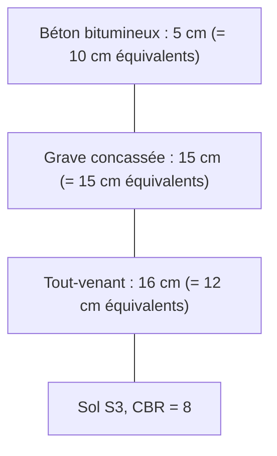

# Exercices corrigés de Routes

[← Retour au sommaire](README.md)

L'exercice 1 reprend l'exercice 1 du fichier « EXERCICES ROUTES 2GCV », et l'exercice 4 s'inspire de son exercice 7. Les autres sont des exercices types. Tous les calculs ont été vérifiés numériquement.

---

## Exercice 1. Tracé en plan à partir des gisements

On veut tracer une route A → B → C → D. On donne :

| Côté | Gisement | Longueur |
| --- | --- | --- |
| AB | 75 gr | 400 m |
| BC | 150 gr | 300 m |
| CD | 80 gr | 350 m |

Rayons : R_B = 125 m, R_C = 75 m. Calculer les éléments des deux raccordements, la longueur de l'axe et les coordonnées des sommets (A à l'origine).

### Correction

**1. Coordonnées des sommets.** Avec le gisement G mesuré depuis le nord, dans le sens horaire :

$$\Delta X = L\sin G \qquad \Delta Y = L\cos G$$

**2. Angles.** La déviation en un sommet est la différence des gisements ; c'est l'angle au centre 2α.

- En B : 2α = 150 − 75 = 75 gr, donc α = 37,5 gr. Angle au sommet A = 200 − 75 = 125 gr.
- En C : 2α = |80 − 150| = 70 gr, donc α = 35 gr. La route tourne dans l'autre sens.

**3. Éléments des raccordements.**

| Élément | En B (R = 125 m, α = 37,5 gr) | En C (R = 75 m, α = 35 gr) |
| --- | --- | --- |
| Tangente T = R tan α | 83,52 m | 45,96 m |
| Bissectrice B | 25,34 m | 12,96 m |
| Développée D | 147,26 m | 82,47 m |
| Corde c | 138,89 m | 78,37 m |
| Flèche f | 21,07 m | 11,05 m |

**4. Longueur de l'axe.** On retire les tangentes des alignements et on ajoute les arcs.

| Tronçon | Longueur |
| --- | --- |
| Alignement A → T_B | 400 − 83,52 = 316,48 m |
| Arc en B | 147,26 m |
| Alignement entre B et C | 300 − 83,52 − 45,96 = 170,52 m |
| Arc en C | 82,47 m |
| Alignement T'_C → D | 350 − 45,96 = 304,04 m |
| **Total** | **1020,76 m** |

L'axe raccordé (1020,76 m) est plus court que la polygonale (1050 m) : l'arc coupe le virage.

**5. Vérification de la règle des 5 secondes** (courbes de sens contraires, donc non obligatoire ici) : à 60 km/h, Lmin = 5 × 16,67 = 83 m. L'alignement entre B et C (170,52 m) la respecte.

---

## Exercice 2. Distances de sécurité

Une route de catégorie R80 a une courbe de rayon 300 m. f = 0,4.

1. Calculer la distance d'arrêt en alignement.
2. La distance d'arrêt en courbe doit-elle être prise en compte ?
3. Calculer les distances de visibilité de dépassement.

### Correction

1. $d_1 = 0{,}004 \times 80^2 / 0{,}4 + 0{,}55 \times 80 = 64 + 44 = 108\ \text{m}$.
2. On compare R à 5V = 400. Ici R = 300 < 400 : oui. $d_2 = 0{,}005 \times 6400 / 0{,}4 + 44 = 80 + 44 = 124\ \text{m}$.
3. Minimale 4 × 80 = **320 m** ; normale 6 × 80 = **480 m**.

---

## Exercice 3. Trafic cumulé

Une route VRNS à 2 × 1 voie reçoit à sa mise en service 1200 poids lourds par jour sur la voie la plus chargée. Croissance linéaire 2 %, durée de service 20 ans, r = 0,9.

### Correction

$$C = d + \frac{t\,d(d-1)}{2} = 20 + \frac{0{,}02 \times 20 \times 19}{2} = 23{,}8$$

$$TC = 365 \times 1200 \times 23{,}8 \times 0{,}9 = 9{,}38 \times 10^6\ \text{PL}$$

Sur 20 ans, la chaussée verra passer environ **9,4 millions** de poids lourds.

---

## Exercice 4. Dimensionnement CBR

Sol support de classe S3 (I = 8). Trafic : 300 PL/jour/sens à l'horizon. Charge par roue 6,5 t. Matériaux disponibles : béton bitumineux, grave concassée, tout-venant.

### Correction

**1. Épaisseur équivalente.**

$$e = \frac{100 + \sqrt{6{,}5}\,(75 + 50\log 30)}{8 + 5} = \frac{100 + 2{,}55 \times 148{,}9}{13} = 36{,}9\ \text{cm}$$

**2. Répartition.** On fixe 5 cm de béton bitumineux (a = 2) et 15 cm de grave concassée (a = 1) :

$$5 \times 2 + 15 \times 1 = 25\ \text{cm équivalents}$$

Il reste 36,9 − 25 = 11,9 cm, à couvrir en tout-venant (a = 0,75) : 11,9 / 0,75 = 15,9 cm, arrondi à **16 cm**.

Épaisseur réelle totale : 36 cm, pour 37 cm équivalents.

---

## Exercice 5. Cubatures

Deux profils en travers distants de 25 m ont 24 m² et 18 m² de déblai. Coefficient de foisonnement 1,25. Camions de 12 m³.

### Correction

- Volume en place : $V = \frac{24 + 18}{2} \times 25 = 525\ \text{m}^3$.
- Volume foisonné : 525 × 1,25 = 656 m³.
- Nombre de camions : 656 / 12 = 54,7, soit **55 rotations**.
