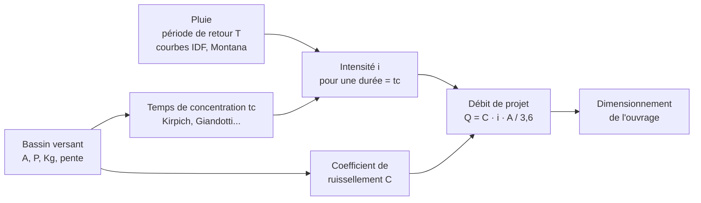

# Hydrologie

Cours complet d'hydrologie de surface, basé sur le cours « Hydrologie pour ingénieur en génie civil » (ESSAT Gabès, 41 pages) et les « EXERCICES HYDROLOGIE 2GCV ». Les passages marqués **[Complément]** ne viennent pas du cours.

## Fichiers

| Fichier | Contenu |
| --- | --- |
| [cours.md](cours.md) | Les 4 chapitres : cycle de l'eau, bassin versant, pluie, débits |
| [exercices-corriges.md](exercices-corriges.md) | Examen type sur 20 points avec correction détaillée |
| [video-kling.md](video-kling.md) | Script d'une vidéo de 6 minutes et prompts Kling |

## La question de l'hydrologie pour l'ingénieur

Quel débit l'ouvrage (dalot, pont, fossé, retenue) doit-il laisser passer ? Tout le cours sert à répondre à cette question.

## Plan du cours

1. Introduction à l'hydrologie de surface
2. Cycle et bilan hydrologiques
3. Le bassin versant
4. Pluviométrie, temps de concentration et débits de crue
