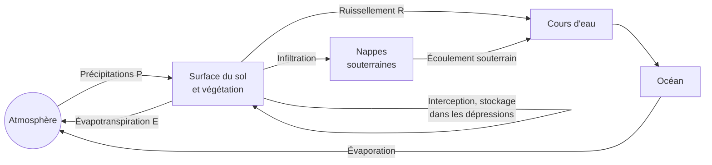
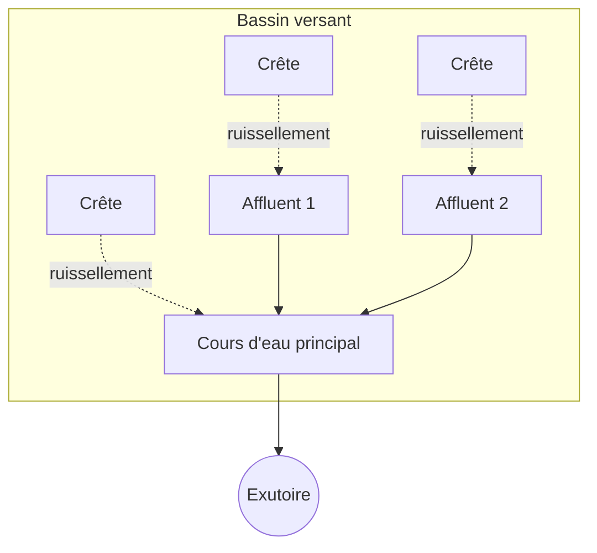
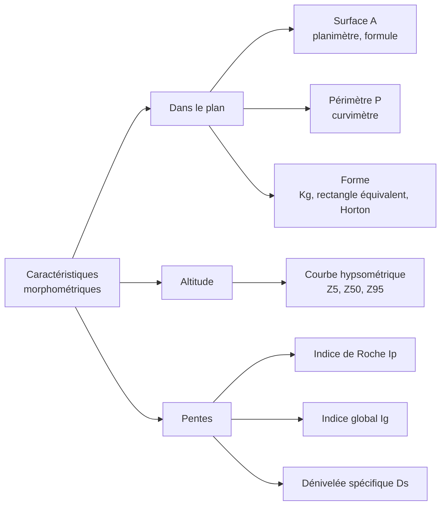
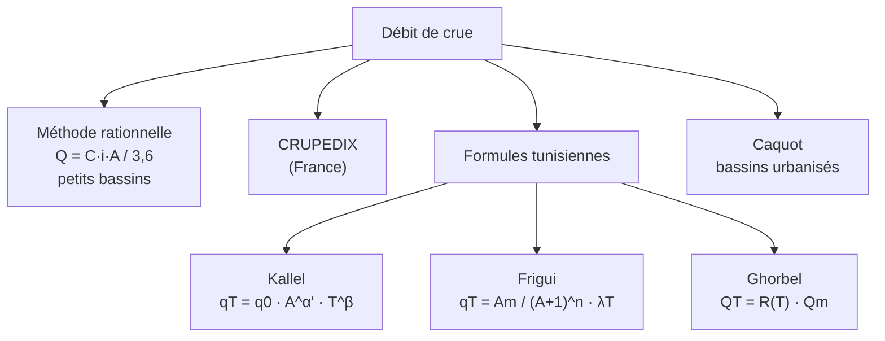
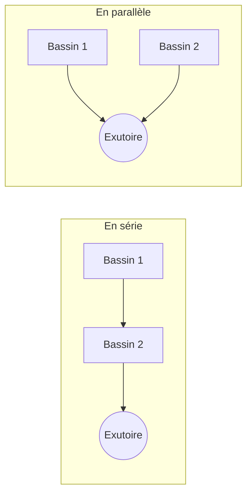

# Cours d'hydrologie

[← Retour au sommaire](README.md)

Les passages marqués **[Complément]** ne viennent pas du cours d'origine.

---

## Chapitre 1. Introduction à l'hydrologie de surface

L'hydrologie étudie le cycle de l'eau et estime ses flux. L'hydrologie de surface traite des écoulements à la surface des continents : elle prévoit ou prédétermine des débits et des volumes.

Au sens large, l'hydrologie regroupe :

- la **climatologie** : précipitations, retour à l'atmosphère ;
- l'**hydrologie de surface** : écoulements à la surface ;
- l'**hydrodynamique des milieux non saturés** : infiltration, évaporation depuis le sol ;
- l'**hydrodynamique souterraine** : écoulements dans les nappes.

### Sciences utilisées

| Science | Application |
| --- | --- |
| Météorologie et climatologie | Étude des pluies |
| Géologie, géographie, pédologie | Comportement hydrologique du bassin |
| Hydraulique | Mesure des écoulements à surface libre |
| Statistique | Traitement des données |
| Calcul numérique | Propagation de crue, modélisation |
| Informatique | Calculs et stockage des données |

### Domaines d'application

Irrigation et drainage, eau potable et industrielle, lutte contre la pollution (débits d'étiage), énergie hydraulique, transport solide, navigation, loisirs, et **protection contre les crues**, qui concerne directement l'ingénieur génie civil.

### Méthodes de travail

Au début, chaque problème avait sa station de mesure. Puis on a constitué des **réseaux** de stations, des **études systématiques** (crues, étiages sur toutes les stations) et des **régionalisations** qui permettent d'estimer les débits d'un bassin non jaugé.

---

## Chapitre 2. Cycle et bilan hydrologiques

### Le cycle de l'eau

L'eau existe sous trois états : solide (neige, glace), liquide et gazeux (vapeur). Le cycle hydrologique est l'ensemble de ses transformations et transferts, moteur : l'énergie solaire.

| Composante | Définition |
| --- | --- |
| Précipitations | Eaux météoriques liquides (pluie, averse) ou solides (neige, grêle) |
| Évaporation | Passage de l'eau liquide à la vapeur |
| Transpiration | Évaporation par les plantes |
| Évapotranspiration réelle (ETR) | Évaporation du sol + transpiration réellement observées |
| Évapotranspiration potentielle (ETP) | Valeur maximale si l'eau ne manquait pas |
| Interception | Pluie retenue par la végétation |
| Infiltration | Eau qui pénètre dans le sol |
| Percolation | Infiltration profonde vers la nappe |
| Ruissellement | Écoulement de surface vers les cours d'eau |

### Répartition des eaux

À l'échelle du globe, 96,5 % de l'eau est océanique. L'eau douce ne représente qu'environ 2,5 %, dont 69 % dans les glaciers et 30 % dans les nappes. Les eaux de surface (lacs, rivières) sont une toute petite partie. Les temps de renouvellement vont de 8 jours (eau atmosphérique) à 2500 ans (océans).

### Le bilan hydrologique

Sur un bassin et pour une période donnée, ce qui entre égale ce qui sort plus ce qui est stocké :

$$P + S = R + E + (S \pm \Delta S)$$

Forme simplifiée : $I - O = \Delta S$ (entrées − sorties = variation de stock).

Sur une année hydrologique, pour un bassin imperméable, $\Delta S \approx 0$. On définit le **déficit d'écoulement** :

$$D = P - R$$

**Formule de Turc** (P en mm, T température moyenne annuelle en °C) :

$$D = \frac{P}{\sqrt{0{,}9 + \dfrac{P^2}{L^2}}} \qquad L = 300 + 25\,T + 0{,}05\,T^3$$

**Formule de Coutagne** :

$$D = P - m\,P^2 \qquad m = \frac{1}{0{,}8 + 0{,}14\,T}$$

**[Complément] Exemple Turc.** P = 400 mm, T = 19 °C. L = 300 + 475 + 343 = 1118. D = 400 / √(0,9 + 0,128) = 400 / 1,014 = **394 mm**. Presque toute la pluie s'évapore : il ne ruisselle qu'environ 6 mm par an, typique d'un climat semi-aride.

---

## Chapitre 3. Le bassin versant

Le bassin versant est la surface dont toutes les eaux convergent vers un même point du cours d'eau, l'**exutoire**. Il est limité par la **ligne de partage des eaux** (lignes de crête).

### Délimitation

On trace la ligne de crête sur la carte topographique, perpendiculairement aux courbes de niveau, en passant par les points hauts. Aujourd'hui, on le fait aussi sur un MNT avec un logiciel SIG.

### Les caractéristiques morphologiques

#### Coefficient de ruissellement

$$C_r = \frac{\text{hauteur d'eau ruisselée}}{\text{hauteur d'eau précipitée}}$$

Faible (0,1 à 0,2) pour les bois et cultures, élevé (0,7 à 0,9) pour les routes et les roches.

#### Surface

Mesurée au planimètre, numériquement (SIG), ou par la formule des coordonnées (polygone de sommets $(x_i, y_i)$) :

$$A = \frac{1}{2}\left|\sum_{i=1}^{n}(x_i\,y_{i+1} - x_{i+1}\,y_i)\right|$$

#### Coefficient de Gravelius (compacité)

$$K_G = \frac{P}{2\sqrt{\pi A}} \approx 0{,}28\,\frac{P}{\sqrt{A}}$$

| Kg | Forme | Réponse aux pluies |
| --- | --- | --- |
| 1,0 à 1,15 | Ramassée, presque ronde | Crue rapide et forte |
| 1,15 à 1,5 | Intermédiaire | |
| 1,5 à 1,8 | Allongée | Crue plus lente et étalée |

#### Rectangle équivalent

Rectangle de même surface et même périmètre que le bassin : P = 2(L + l) et A = L × l.

$$L = \frac{K_G\sqrt{A}}{1{,}12}\left(1 + \sqrt{1 - \left(\frac{1{,}12}{K_G}\right)^2}\right) \qquad l = \frac{K_G\sqrt{A}}{1{,}12}\left(1 - \sqrt{1 - \left(\frac{1{,}12}{K_G}\right)^2}\right)$$

#### Indice de forme de Horton

$$K_H = \frac{A}{L^2}$$

KH < 1 : bassin allongé ; KH > 1 : bassin ramassé.

#### Coefficient d'allongement (noté à la main dans le cours)

$$M = \frac{L}{\sqrt{A}}$$

L étant le plus long cheminement hydraulique.

#### Courbe hypsométrique

Elle donne, pour chaque altitude, le pourcentage de la surface du bassin situé au-dessus. On en lit Z5 %, Z50 % (altitude médiane) et Z95 %.

- Courbe convexe en haut : **bassin jeune**, surface importante en altitude.
- Courbe concave : **vieux bassin**, plaine.
- Courbe en S : bassin « mature ».

Altitude moyenne :

$$H_{moy} = \frac{\sum A_i\,h_i}{A}$$

#### Dénivelée et indices de pente

$$D = Z_{5\%} - Z_{95\%}$$

| Indice | Formule | Remarque |
| --- | --- | --- |
| Pente moyenne | $I = \dfrac{D_t}{L}$ | Peu utilisée |
| Indice de pente de Roche | $I_p = \dfrac{1}{\sqrt{L}}\sum\sqrt{a_i\,d_i}$ | Long à évaluer |
| Indice de pente globale | $I_g = \dfrac{D}{L}$ | Simple, le plus utilisé |
| Dénivelée spécifique | $D_s = I_g\sqrt{A}$ | Indépendante de la surface |

Relation : $I_g \approx 0{,}8\,I_p^2$.

| Relief (ORSTOM) | Ig |
| --- | --- |
| Très faible | < 0,002 |
| Faible | 0,002 – 0,005 |
| Assez faible | 0,005 – 0,01 |
| Modéré | 0,01 – 0,02 |
| Assez fort | 0,02 – 0,05 |
| Fort | 0,05 – 0,1 |
| Très fort | > 0,1 |

---

## Chapitre 4. Pluviométrie et débits

### Mesure des précipitations

- **Pluviomètre** : cône collecteur, entonnoir, réservoir, éprouvette graduée. Lecture manuelle, une ou deux fois par jour.
- **Pluviographe** : enregistrement continu (à augets basculeurs, à pesée, à flotteur). Donne l'intensité et la durée de chaque averse.

### Présentation des mesures

- **Hyétogramme** : hauteur de pluie par intervalle de temps (histogramme).
- **Courbe des hauteurs cumulées** (courbe de masse).
- **Isohyètes** : courbes d'égale pluviométrie sur une carte.

### Intensité et période de retour

L'intensité moyenne d'une averse est $i = \Delta h / \Delta t$ (mm/h).

La **période de retour** T d'un événement est l'inverse de sa probabilité annuelle de dépassement :

$$T = \frac{1}{1 - F(x)}$$

Une pluie décennale (T = 10 ans) a 10 % de chances d'être dépassée chaque année.

**[Complément]** Probabilité qu'un événement de période T soit dépassé au moins une fois en n années : $1 - (1 - 1/T)^n$. Pour T = 50 ans et n = 20 ans : 33 %.

### Courbes Intensité-Durée-Fréquence (IDF)

Pour une même période de retour, l'intensité diminue quand la durée augmente. Pour une même durée, l'intensité augmente avec la période de retour.

**Formule de Montana** :

$$i = a\,t^{b} \qquad (b < 0)$$

**Formule de Talbot** :

$$i = \frac{A}{B + t}$$

a, b, A, B sont des constantes locales qui dépendent de la station et de la période de retour.

> **Remarque du cours** : la durée utilisée pour calculer l'intensité est le **temps de concentration tc**.

### Temps de concentration

C'est le temps mis par la goutte tombée au point le plus éloigné pour atteindre l'exutoire. Quand la pluie dure tc, tout le bassin contribue.

| Formule | Expression | Unités |
| --- | --- | --- |
| Kirpich | $t_c = 0{,}0195\,L^{0{,}77}\,I^{-0{,}385}$ | tc min, L m, I m/m |
| Giandotti | $t_c = \dfrac{4\sqrt{A} + 1{,}5\,L}{0{,}8\sqrt{H_{moy} - H_{min}}}$ | tc h, A km², L km, H m |
| Passini | $t_c = 0{,}14\,\dfrac{(S\,L)^{1/3}}{\sqrt{P}}$ | |
| Ventura | $t_c = 7{,}62\,\sqrt{S/P}$ | |
| Turazza | $t_c = 65{,}5\,\sqrt{S}$ | S en km² |
| Sheaffe et Geyer (urbain) | $t_c = \dfrac{1{,}4}{0{,}8}\,L^{0{,}24}\,P^{-0{,}16}\,C^{-0{,}26}$ | |

> Les formules de Passini, Ventura et Sheaffe-Geyer ont été lues sur un scan peu lisible : vérifier les exposants dans le cours papier.

**Exemple du cours** : plus long chemin 4059 m, dénivelée 51 m (pente 0,013), surface 558,9 ha. Kirpich 63 min, Giandotti 164 min, Ventura 161 min, Passini 165 min, Turazza 160 min, CEMAGREF 79 min. Le cours retient **160 min**.

### Méthodes de calcul des débits de crue

#### Méthode rationnelle

$$Q = \frac{C\,i\,A}{3{,}6} \qquad (Q\ \text{m}^3/\text{s},\ i\ \text{mm/h},\ A\ \text{km}^2)$$

Le cours l'écrit aussi $Q = \frac{1}{3600}\,C\,i\,S$ (Q en l/s, S en m², i en mm/h), avec un coefficient correcteur Ka selon la surface :

| Surface (km²) | ≤ 25 | 25 – 50 | 50 – 100 | 100 – 150 | 150 – 250 |
| --- | --- | --- | --- | --- | --- |
| Ka | 1 | 0,95 | 0,9 | 0,85 | 0,8 |

#### CRUPEDIX

$$Q_{10} = A^{0{,}8} \times \left(\frac{P_{10}}{80}\right)^2 \times R$$

Q10 : débit décennal (m³/s) ; P10 : pluie journalière décennale (mm) ; R : coefficient régional (0,13 à 1,75).

#### Formule de Kallel (Tunisie)

$$q_T = q_0\,A^{\alpha'}\,T^{\beta} \qquad Q_T = q_T \times A$$

| Zone | q0 | α' | β |
| --- | --- | --- | --- |
| Tunisie du Nord et Cap-Bon (A > 50 km²) | 5,5 | 0,5 | 0,41 |
| Noyau de la Dorsale (A > 200 km²) | 2,6 | 0,81 | 0,41 |
| Centre et Sahel (T = 10 ou 20 ans) | 14,3 | 0,5 | 0,41 |
| Centre et Sahel (T = 50 ou 100 ans) | 24,7 | 0,5 | 0,41 |
| Tunisie méridionale (A > 200 km²) | 12,35 | 0,5 | 0,41 |

Valable pour A > 100 km² ; erreur souvent < 20 %, parfois jusqu'à 100 %.

#### Formule de Frigui (Tunisie)

$$q_T = \frac{A_m}{(A + 1)^n}\,\lambda_T$$

| Région | Am | n |
| --- | --- | --- |
| Extrême Nord | 26,2 | 0,47 |
| Medjerdah | 53,5 | 0,53 |
| Cap-Bon et Meliane | 38,4 | 0,44 |
| Centre et Sud | 76,7 | 0,44 |

λT pour le Centre et Sud : 0,13 (T = 2 ans), 0,48 (10), 0,70 (25), 0,88 (50), 1 (100).

#### Méthode de Ghorbel (Tunisie)

$R_{T,Q} = Q_T / Q_m$, rapport du débit de période T au débit moyen des maxima annuels.

- Zone I : $R = 1{,}33\log T + 0{,}46$
- Zone II : $R = 1{,}07\,T^{0{,}4} - 0{,}71$
- Zone III : $R = 1{,}47\,T^{0{,}4} - 1{,}35$

$Q_m = 2{,}86\,A^{0{,}6}$ pour les oueds de la Dorsale (pente > 5,5 %).

#### Méthode superficielle de Caquot (bassins urbanisés)

$$Q = m \cdot k \cdot C^{\mu}\,I^{\alpha}\,S^{\beta}$$

avec, à partir des paramètres de Montana a et b :

$$\alpha = \frac{-0{,}41\,b}{1 + 0{,}287\,b} \quad \mu = \frac{1}{1 + 0{,}287\,b} \quad \beta = \frac{0{,}507\,b + 0{,}95}{1 + 0{,}287\,b} \quad k = \left(\frac{a}{6{,}6}\,0{,}5^{b}\right)^{\mu}$$

$$m = \left(\frac{M}{2}\right)^{\frac{0{,}84\,b}{1 + 0{,}287\,b}} \qquad M = \frac{L}{\sqrt{A}}$$

### Assemblage de bassins versants

| Paramètre équivalent | En série | En parallèle |
| --- | --- | --- |
| Surface | $A_{eq} = \sum A_j$ | $A_{eq} = \sum A_j$ |
| Coefficient de ruissellement | $C_{eq} = \dfrac{\sum C_j A_j}{\sum A_j}$ | $C_{eq} = \dfrac{\sum C_j A_j}{\sum A_j}$ |
| Pente | $I_{eq} = \left(\dfrac{\sum L_j}{\sum L_j/\sqrt{I_j}}\right)^2$ | $I_{eq} = \dfrac{\sum I_j Q_j}{\sum Q_j}$ |
| Allongement | $M_{eq} = \dfrac{\sum L_j}{\sqrt{\sum A_j}}$ | $M_{eq} = \dfrac{L(Q_{max})}{\sqrt{\sum A_j}}$ |
