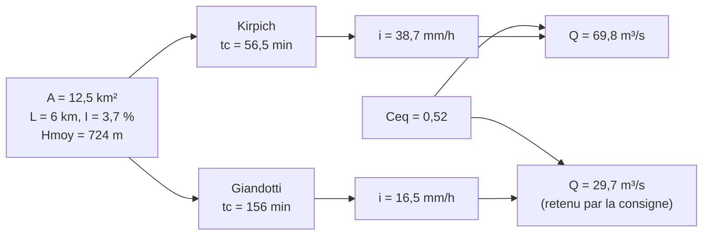
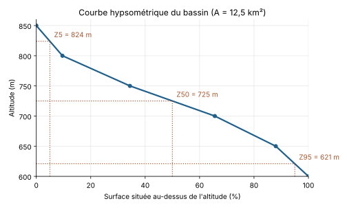

# Examen type d'hydrologie et correction

[← Retour au sommaire](README.md)

Durée 1 h 30, calculatrice autorisée. Barème sur 20 points. Données inventées sur le modèle des exercices du cours. Calculs vérifiés numériquement.

---

## Sujet

### Exercice 1. Questions de cours (4 points)

1. Définir un bassin versant et son exutoire. (1 pt)
2. Écrire le bilan hydrologique et nommer chaque terme. Que devient-il sur une année si l'on néglige la variation de stock ? (1 pt)
3. Une pluie a une période de retour T = 50 ans. Probabilité d'être dépassée une année donnée ? Au moins une fois en 20 ans ? (1 pt)
4. Que représente le temps de concentration, et pourquoi prend-on une pluie de durée tc ? (1 pt)

### Exercice 2. Caractéristiques d'un bassin versant (8 points)

Bassin du centre tunisien : A = 12,5 km², P = 17,2 km. Cours d'eau principal de 6,0 km, de 820 m à 600 m (exutoire).

| Tranche d'altitude (m) | Surface (km²) |
| --- | --- |
| 800 – 850 | 1,2 |
| 750 – 800 | 3,1 |
| 700 – 750 | 3,9 |
| 650 – 700 | 2,8 |
| 600 – 650 | 1,5 |

1. Coefficient de Gravelius et forme du bassin. (1,5 pt)
2. Rectangle équivalent, avec vérification. (2 pts)
3. Altitude moyenne. (1 pt)
4. Courbe hypsométrique, Z5 %, Z50 %, Z95 %. (2 pts)
5. Indice de pente globale et pente du cours d'eau. (1,5 pt)

### Exercice 3. Débit de projet (8 points)

Ouvrage à l'exutoire, période de retour 50 ans. Sous-bassins : 30 % (C = 0,4), 20 % (C = 0,5), 50 % (C = 0,6). Montana T = 50 ans : a = 1145, b = −0,84 (i en mm/h, t en min).

1. Coefficient de ruissellement équivalent. (1,5 pt)
2. tc par Kirpich. (1,5 pt)
3. tc par Giandotti. (1,5 pt)
4. Avec le tc le plus grand, intensité de projet. (1,5 pt)
5. Débit par la méthode rationnelle ; refaire avec l'autre tc et commenter. (2 pts)

---

## Correction

> **Résultat** : Q ≈ 30 m³/s avec tc = 156 min (Giandotti), et ≈ 70 m³/s avec tc = 56,5 min (Kirpich).

### Exercice 1

1. Surface dont toutes les eaux de ruissellement convergent vers un même point du cours d'eau, l'exutoire. Limitée par la ligne de partage des eaux.
2. P = R + E + ΔS. Sur un an, ΔS ≈ 0, donc P = R + E et le déficit d'écoulement D = P − R = E.
3. 1/50 = **2 %** par an. Sur 20 ans : 1 − 0,98²⁰ = 1 − 0,668 = **33 %**. « 50 ans » ne veut pas dire « une fois tous les 50 ans exactement ».
4. Temps mis par l'eau tombée au point le plus éloigné pour atteindre l'exutoire. Une pluie de durée tc fait contribuer tout le bassin en même temps : plus longue, elle est moins intense ; plus courte, tout le bassin ne contribue pas. C'est la durée qui donne le débit maximal.

### Exercice 2

**1. Gravelius**

$$K_G = 0{,}28 \times \frac{17{,}2}{\sqrt{12{,}5}} = 1{,}36$$

Entre 1,15 et 1,5 : forme intermédiaire, plutôt allongée.

**2. Rectangle équivalent**

$$\frac{K_G\sqrt{A}}{1{,}12} = \frac{1{,}36 \times 3{,}536}{1{,}12} = 4{,}30\ \text{km} \qquad \sqrt{1 - (1{,}12/1{,}36)^2} = 0{,}569$$

L = 4,30 × 1,569 = **6,75 km** et l = 4,30 × 0,431 = **1,85 km**.

Vérification : L × l = 12,5 km² = A et 2(L + l) = 17,2 km = P.

**3. Altitude moyenne**

$$H_{moy} = \frac{1{,}2 \times 825 + 3{,}1 \times 775 + 3{,}9 \times 725 + 2{,}8 \times 675 + 1{,}5 \times 625}{12{,}5} = \frac{9047{,}5}{12{,}5} = 723{,}8\ \text{m}$$

**4. Courbe hypsométrique**

| Altitude (m) | Surface au-dessus (km²) | Surface au-dessus (%) |
| --- | --- | --- |
| 850 | 0 | 0 |
| 800 | 1,2 | 9,6 |
| 750 | 4,3 | 34,4 |
| 700 | 8,2 | 65,6 |
| 650 | 11,0 | 88,0 |
| 600 | 12,5 | 100 |

Interpolation linéaire :

- Z5 % : 0,625 km² dans la tranche 800–850. Z5 = 850 − (0,625 / 1,2) × 50 = **824 m**.
- Z50 % : 6,25 km², tranche 700–750 (4,3 déjà au-dessus). Z50 = 750 − (1,95 / 3,9) × 50 = **725 m**.
- Z95 % : 11,875 km², tranche 600–650 (11,0 au-dessus). Z95 = 650 − (0,875 / 1,5) × 50 = **621 m**.

**5. Pentes**

$$D = 824 - 621 = 203\ \text{m} \qquad I_g = \frac{203}{6{,}75} = 30\ \text{m/km} = 0{,}030$$

Relief assez fort (0,02 < Ig < 0,05). Pente du cours d'eau : (820 − 600) / 6000 = 0,0367, soit 3,7 %.

### Exercice 3

**1.** $C_{eq} = 0{,}3 \times 0{,}4 + 0{,}2 \times 0{,}5 + 0{,}5 \times 0{,}6 = 0{,}52$

**2. Kirpich**

$$t_c = 0{,}0195 \times 6000^{0{,}77} \times 0{,}0367^{-0{,}385} = 0{,}0195 \times 811{,}3 \times 3{,}57 = 56{,}5\ \text{min}$$

**3. Giandotti**

$$t_c = \frac{4\sqrt{12{,}5} + 1{,}5 \times 6}{0{,}8\sqrt{723{,}8 - 600}} = \frac{23{,}14}{8{,}90} = 2{,}60\ \text{h} = 156\ \text{min}$$

**4.** $i = 1145 \times 156^{-0{,}84} = 16{,}5\ \text{mm/h}$

**5.**

$$Q = \frac{0{,}52 \times 16{,}5 \times 12{,}5}{3{,}6} = 29{,}7\ \text{m}^3/\text{s}$$

Avec Kirpich : i = 38,7 mm/h et Q = **69,8 m³/s**, plus du double.

Commentaire : un tc court donne une pluie plus intense, donc un débit plus fort. Retenir le tc le plus grand est la consigne du cours, mais ce n'est pas le choix le plus prudent. En pratique, on compare les méthodes, on écarte celles hors de leur domaine de validité, et on vérifie avec une formule régionale tunisienne (Kallel, Frigui, Ghorbel).
