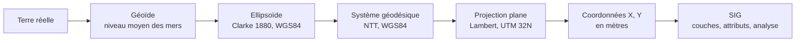

# SIG et cartographie

Cours de SIG, géodésie et cartographie, basé sur le cours « COURS SIG+CARTO 3GCV » (ESSAT Gabès). Les passages marqués **[Complément]** ne viennent pas du cours.

## Fichiers

| Fichier | Contenu |
| --- | --- |
| [cours.md](cours.md) | Les 3 chapitres : notions de SIG, géodésie et cartographie, systèmes géodésiques en Tunisie |
| [exercices-corriges.md](exercices-corriges.md) | Exercices types avec correction détaillée |

## Vue d'ensemble

Pour mettre une donnée dans un SIG, il faut savoir où elle est. Pour savoir où elle est, il faut un modèle de la Terre (ellipsoïde), un système géodésique et une projection plane.

## Plan du cours

1. SIG : notions fondamentales (définitions, 5 A, données, vecteur et raster, applications)
2. Géodésie et cartographie (géoïde, ellipsoïde, coordonnées, projections)
3. Les systèmes géodésiques en Tunisie (Postel, Lambert Nord et Sud, UTM, NTT, WGS84)

## Ressources citées par le cours

- Cartes de Tunisie : https://brahimjaziri.jimdofree.com/biblioth%C3%A8que-de-t%C3%A9l%C3%A9chargement/
- Systèmes de coordonnées en Tunisie : https://fr.scribd.com/document/731499990/Systeme-de-Coordonnees-en-Tunisie
- Vidéos (en arabe) : conversion UTM sous ArcGIS Pro, Civil 3D, Google Earth (liens dans le cours original).
