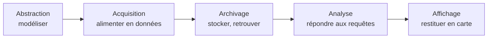
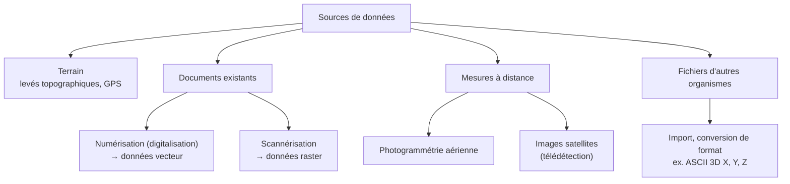
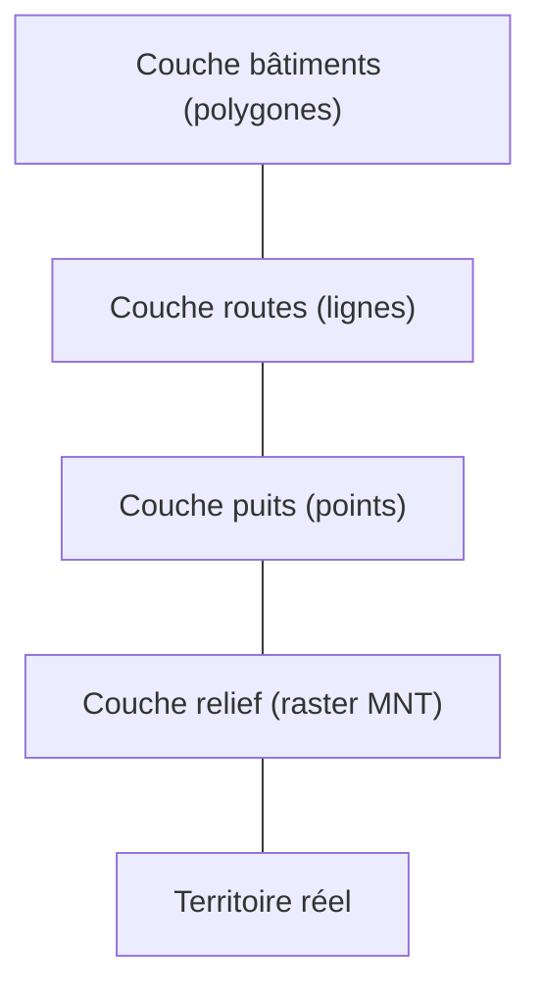
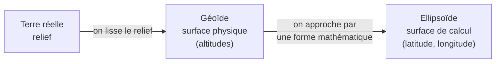
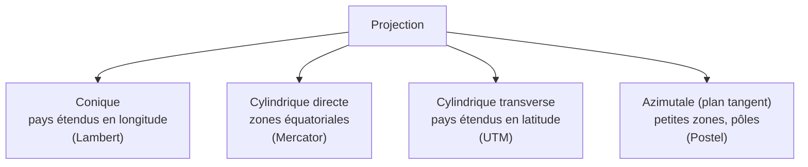
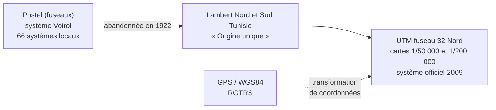
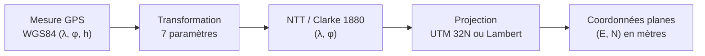

# Cours de SIG et cartographie

[← Retour au sommaire](README.md)

## Sommaire

1. [SIG : notions fondamentales](#chapitre-1-sig--notions-fondamentales)
2. [Géodésie et cartographie](#chapitre-2-géodésie-et-cartographie)
3. [Les systèmes géodésiques en Tunisie](#chapitre-3-les-systèmes-géodésiques-en-tunisie)

---

## Chapitre 1. SIG : notions fondamentales

### 1.1 Définition

Un **système d'information géographique (SIG)** est un système informatique qui permet, à partir de diverses sources, de rassembler, organiser, gérer, analyser, combiner et présenter des informations **localisées géographiquement**. C'est une base de données dont chaque objet a une position dans l'espace.

Il comprend du matériel, des logiciels, des données, des méthodes et des utilisateurs. Il sert à la gestion de l'espace et à l'aide à la décision.

### 1.2 Les cinq questions d'un SIG

| Question | Ce qu'on cherche | Exemple (échangeur routier) |
| --- | --- | --- |
| **Où ?** | La répartition spatiale d'un objet | Où se trouve l'échangeur ? |
| **Quoi ?** | Ce qu'il y a à un endroit | Que trouve-t-on autour ? |
| **Comment ?** | Les relations entre objets (analyse spatiale) | Comment la circulation est-elle organisée ? |
| **Quand ?** | L'évolution dans le temps (analyse temporelle) | Depuis quand la bretelle est-elle en service ? |
| **Et si ?** | La simulation d'un scénario | Si l'autoroute s'élargit, qui habite à moins de 300 m ? |

### 1.3 Les 5 A

L'**analyse** est le cœur du SIG : c'est elle qui le distingue d'un simple logiciel de dessin.

### 1.4 Fonctionnalités

Un SIG complet permet de :

- placer les objets dans un système de référence et les convertir d'un système à un autre ;
- **superposer** deux cartes de sources différentes et corriger la moins fiable ;
- extraire les objets situés à une distance donnée d'une route ou d'un lac (**zone tampon**, *buffer*) ;
- extraire les objets situés dans un périmètre donné (**sélection spatiale**) ;
- **fusionner** les objets ayant une caractéristique commune ;
- calculer **l'itinéraire le plus court** sur un réseau.

### 1.5 Acquisition des données

Les données sont **multi-sources** : de qualités, précisions et étendues différentes.

- **Numérisation** : on suit les contours d'un plan calé en coordonnées avec un curseur sur une table à digitaliser (précision de l'ordre du dixième de millimètre). Aujourd'hui on numérise surtout à l'écran sur une image calée.
- **Scannérisation** : plus rapide, mais donne une image (raster) qu'il faut ensuite géoréférencer.
- **Photogrammétrie** : cartes à moyenne échelle et plans à grande échelle à partir de photos aériennes.
- **Télédétection** : images satellites.
- **Import** : on récupère des données existantes et on les convertit au format, aux unités et à la projection voulus.

### 1.6 Les trois informations d'un objet

Pour qu'un objet soit utilisable dans un SIG, il faut connaître :

1. sa **position** (coordonnées) ;
2. sa **topologie** (ses relations avec les autres objets : adjacence, connexion, inclusion) ;
3. ses **attributs** (ce qu'il est).

**Données spatiales** : localisation, forme, taille. Trois formes de base :

| Forme | Dimension | Exemples |
| --- | --- | --- |
| Point | 0 | Puits, borne, arbre |
| Ligne | 1 | Route, conduite, oued |
| Polygone | 2 | Parcelle, bassin versant, commune |

**Données associées** :

- de **classification** : la catégorie (limite administrative, conduite d'eau…), qui définit souvent la **couche** ;
- d'**identification** : le nom ou le numéro de l'objet (n° de parcelle, de vanne) ;
- **attributaires** : les informations propres à l'objet (propriétaire, diamètre de la conduite).

On les range dans une **table attributaire** : une ligne par objet, une colonne par attribut, reliées à la géométrie par l'identifiant.

| ID | Type | Diamètre (mm) | Matériau | Année |
| --- | --- | --- | --- | --- |
| C-012 | Conduite AEP | 200 | Fonte | 2008 |
| C-013 | Conduite AEP | 150 | PEHD | 2015 |

### 1.7 Mode vecteur et mode raster

On décompose le territoire en **couches thématiques** superposées (relief, routes, bâtiments, parcelles…).

| | Mode vecteur | Mode raster |
| --- | --- | --- |
| Principe | Objets décrits par des coordonnées (points, lignes, polygones) | Grille de cellules (pixels), une valeur par cellule |
| Obtenu par | Numérisation, levés, GPS | Scanner, satellite, photo |
| Avantages | Précis, léger, idéal pour points et lignes, extraction et changement de coordonnées faciles | Structure simple, idéal pour les phénomènes continus (altitude, pluie, occupation du sol), superposition facile |
| Inconvénients | Structure plus complexe, mal adapté aux phénomènes continus | Fichiers lourds, précision limitée par la taille du pixel, aspect « en escalier » |

**[Complément]** Taille d'un raster : nombre de lignes × nombre de colonnes = (longueur / résolution) × (largeur / résolution). Diviser la résolution par 2 multiplie le nombre de cellules par 4.

### 1.8 Applications

| Grandes échelles | Échelles moyennes et petites |
| --- | --- |
| Cadastre, calcul de surfaces | Études d'impact (école, centre commercial) |
| Urbanisme (plan d'aménagement) | Études routières et autoroutières |
| Transports, signalisation | Prévention des risques (inondation) |
| Réseaux : assainissement, AEP, gaz, électricité | Ressources naturelles, géologie, climat, hydrographie |
| Espaces verts, patrimoine | |
| Topographie, travaux publics | |

**Lien avec les autres matières** : en hydrologie, le SIG délimite automatiquement un bassin versant à partir d'un MNT et calcule A, P et la courbe hypsométrique. En routes, il sert à choisir le tracé (pentes, zones inondables, parcelles touchées).

### 1.9 Logiciels

Le cours cite Geoconcept, ArcView, ArcGIS et MapInfo. **[Complément]** **QGIS** est gratuit, libre et très utilisé : c'est le meilleur choix pour s'entraîner.

Critères de choix : coût, ergonomie, formation nécessaire, outils d'analyse, échange de données, compatibilité des formats.

---

## Chapitre 2. Géodésie et cartographie

### 2.1 Définitions

| Terme | Définition |
| --- | --- |
| **Topométrie** | Techniques de mesure pour obtenir les éléments d'un plan à grande échelle (mesures sur le terrain puis calculs au bureau) |
| **Topographie** | Représentation graphique ou numérique d'une surface terrestre |
| **Géodésie** | Science de la forme de la Terre, et techniques pour positionner les points géodésiques et repères de nivellement |
| **Cartographie** | Ensemble des opérations pour élaborer des cartes et plans |

**[Complément]** Classement usuel des documents selon l'échelle :

| Échelle | Document | Usage |
| --- | --- | --- |
| 1/200 à 1/2000 | Plan | Projet d'exécution, cadastre urbain |
| 1/5000 à 1/25 000 | Carte à grande échelle | Avant-projet, étude de tracé |
| 1/50 000 à 1/100 000 | Carte topographique | Bassin versant, étude régionale |
| 1/200 000 et moins | Carte à petite échelle | Planification nationale |

Une échelle 1/E signifie que 1 cm sur la carte représente E cm sur le terrain. Une « grande » échelle a un petit E (1/1000 est plus grande que 1/50 000).

### 2.2 Le géoïde

La Terre n'est pas une sphère : elle est aplatie aux pôles (environ 11 km de moins que le rayon moyen de 6 367 km) et renflée à l'équateur.

Le **géoïde** est la surface des mers au repos prolongée sous les continents. C'est une surface **équipotentielle** de la pesanteur : en tout point, elle est perpendiculaire à la verticale (fil à plomb). Elle n'est pas régulière, car la masse de la Terre est mal répartie (bosses au-dessus des volcans, creux au-dessus des fosses). Les **altitudes** sont mesurées par rapport au géoïde.

### 2.3 L'ellipsoïde de révolution

Le géoïde est trop irrégulier pour faire des calculs. On l'approche par un **ellipsoïde de révolution** : une ellipse qui tourne autour de l'axe des pôles.

- a : demi-grand axe (rayon équatorial) ;
- b : demi-petit axe (rayon polaire) ;
- aplatissement : $f = \dfrac{a - b}{a}$ ;
- **[Complément]** excentricité : $e^2 = \dfrac{a^2 - b^2}{a^2} = 2f - f^2$.

Un **méridien** est une ellipse (plan contenant l'axe des pôles). Un **parallèle** est un cercle (plan perpendiculaire à l'axe).

Chaque pays choisit l'ellipsoïde le plus proche de son géoïde local :

| Ellipsoïde | a (m) | 1/f | Utilisé par |
| --- | --- | --- | --- |
| Clarke 1880 (IGN) | 6 378 249,2 | 293,466 | NTF (France), NTT et Lambert (Tunisie) |
| Hayford 1909 (international) | 6 378 388 | 297 | ED50 (Europe 50, UTM militaire) |
| IAG GRS 80 | 6 378 137 | 298,257 222 | Systèmes modernes (RGF93) |
| WGS 84 | 6 378 137 | 298,257 223 563 | GPS |

### 2.4 Systèmes de coordonnées

**Géocentrique (X, Y, Z)** : origine au centre des masses de la Terre, OZ sur l'axe de rotation, plan OXZ dans le méridien origine. C'est le système du GPS.

**Géographique (λ, φ, h)** :

- **longitude λ** : angle entre le méridien du lieu et le méridien origine (Greenwich), de 0 à 180° Est ou Ouest ;
- **latitude φ** : angle entre la normale à l'ellipsoïde et le plan de l'équateur, de 0 à 90° Nord ou Sud ;
- **hauteur ellipsoïdale h** : distance au-dessus de l'ellipsoïde, le long de la normale.

**[Complément]** Altitude et hauteur ne sont pas la même chose : H (altitude, au-dessus du géoïde) = h (hauteur GPS, au-dessus de l'ellipsoïde) − N (ondulation du géoïde). En Tunisie, N vaut quelques dizaines de mètres : on ne peut pas prendre la hauteur GPS comme altitude.

**Unités d'angle** : en topographie on utilise souvent le **grade** : 400 gr = 360°, donc 1 gr = 0,9° et 1° = 1,111 gr.

### 2.5 Système géodésique

Un système géodésique est défini par :

1. un **ellipsoïde** proche du géoïde local ;
2. un **système de représentation plane** ;
3. un **point fondamental**, où la normale à l'ellipsoïde est confondue avec la verticale (sauf pour un système géocentrique, qui n'en a pas).

### 2.6 Représentation plane et déformations

On ne peut pas aplatir un ellipsoïde sans le déformer (pensez à une peau d'orange). Une **projection** est une correspondance entre un point M (λ, φ) de l'ellipsoïde et un point m (E, N) du plan.

**Module linéaire** : rapport entre une petite longueur sur le plan et la longueur correspondante sur l'ellipsoïde.

$$m = \frac{ds_{plan}}{ds_{ellipsoïde}}$$

**Altération linéaire** : $\varepsilon = m - 1$, souvent exprimée en cm/km. Par exemple m = 0,9996 donne ε = −0,0004, soit −40 cm/km : une distance de 1 km sur le terrain mesure 99,96 cm de moins sur le plan.

### 2.7 Types de projections

| Propriété | Ce qui est conservé | Exemple |
| --- | --- | --- |
| **Conforme** | Les angles (m ne dépend pas de la direction) | Lambert, UTM |
| **Équivalente** | Les surfaces | Cartes statistiques |
| **Aphylactique** | Rien exactement, compromis | Cartes du monde |

Une projection ne peut pas être à la fois conforme et équivalente.

| Surface de projection | Forme | Bien représenté près de | Exemple |
| --- | --- | --- | --- |
| **Cône** tangent à un parallèle | Parallèles = arcs de cercles concentriques, méridiens = droites concourantes | Le parallèle de tangence | Lambert |
| **Cylindre** tangent à l'équateur | Méridiens et parallèles = droites | L'équateur | Mercator |
| **Cylindre transverse** tangent à un méridien | | Le méridien central | UTM |

---

## Chapitre 3. Les systèmes géodésiques en Tunisie

### 3.1 Le système national (arrêté du 10 février 2009)

| Élément | Choix officiel |
| --- | --- |
| Système géodésique | **Nouvelle Triangulation Tunisienne (NTT)** |
| Ellipsoïde | **Clarke 1880 (français)** |
| Projection cartographique | **UTM fuseau 32 Nord** |
| Altitudes | Orthométriques (au-dessus du niveau moyen de la mer) |
| Repère fondamental de nivellement | **Bâb Bhar, Tunis**, altitude 7,000 m |

L'organisme national est l'**OTC** (Office de la Topographie et du Cadastre).

### 3.2 Évolution des représentations planes

### 3.3 Représentation de Postel (fuseaux)

- Utilisée dans le système géodésique **Voirol** pour la triangulation, encore pour d'anciens dossiers d'immatriculation foncière.
- La Tunisie est découpée en **6 fuseaux** de 0,5 gr en longitude, chacun en **11 quadrilatères** de 0,5 gr en latitude : **66 systèmes** de coordonnées.
- Chaque quadrilatère est assimilé au plan tangent à l'ellipsoïde en son centre (λ0, φ0).
- Inconvénient : un point au bord de deux quadrilatères a deux jeux de coordonnées. Abandonnée en 1922.

### 3.4 Représentation Lambert Tunisie

**Lambert** = projection **conique, conforme et directe** :

- conique : on utilise des coordonnées polaires (R, Ω) ; les parallèles deviennent des arcs de cercles concentriques et les méridiens des droites concourantes ;
- conforme : les angles sont conservés ;
- directe : R et Ω ne dépendent que de (φ, λ).

Pour limiter les déformations, deux zones :

| Zone | Latitudes couvertes | Parallèle origine **[Complément]** |
| --- | --- | --- |
| **Lambert Nord Tunisie** | 37,5 gr à 42,5 gr (33,75° à 38,25° N) | 40 gr (36° N) |
| **Lambert Sud Tunisie** | 34,5 gr à 39,5 gr (31,05° à 35,55° N) | 37 gr (33,3° N) |

Les deux zones se recouvrent entre 37,5 et 39,5 gr. À l'OTC, on parle d'« Origine unique ».

**Formules** (cours) :

- R = R(φ) dépend de la **latitude isométrique** L(φ) ;
- Ω = n (λ − λ0), n étant une constante de la projection ;
- avec l'axe OY sur l'image du méridien origine (vers le Nord) et OX vers l'Est, R0 étant le rayon de l'image du parallèle origine :

$$X = R\sin\Omega \qquad Y = R_0 - R\cos\Omega$$

- On applique ensuite un **facteur d'échelle k** et une **translation** (constantes X0, Y0) pour avoir des coordonnées positives : ce sont les **coordonnées translatées**.
- Les techniciens du foncier utilisent aussi les **coordonnées STT** (Service Topographique Tunisien), avec des axes décalés.
- **Convergence des méridiens γ** : angle entre le nord du quadrillage (axe Y) et le nord géographique au point M. Il est nul sur le méridien origine.

### 3.5 Représentation UTM

**Universal Transverse Mercator** : projection **cylindrique transverse conforme**.

- La Terre est divisée en **60 fuseaux de 6°** de longitude, numérotés de 1 à 60 vers l'Est depuis 180° W.
- Dans chaque fuseau, le cylindre touche le **méridien central** : l'axe Y (Nord) est ce méridien, l'axe X (Est) est l'équateur.
- **Toute la Tunisie est dans le fuseau 32**, de méridien central **9° Est**.

**[Complément]** Constantes UTM :

| Constante | Valeur |
| --- | --- |
| Facteur d'échelle sur le méridien central | k0 = 0,9996 |
| Abscisse du méridien central (fausse abscisse) | E0 = 500 000 m |
| Ordonnée de l'équateur (hémisphère Nord) | N0 = 0 m |
| Numéro de fuseau | n = partie entière de (λ + 180)/6, plus 1 |

Le facteur d'échelle vaut 0,9996 sur le méridien central (−40 cm/km) et augmente quand on s'en éloigne : il vaut 1 à environ 180 km du méridien central, puis dépasse 1. On l'approche par :

$$k \approx k_0\left(1 + \frac{(E - 500\,000)^2}{2R^2}\right) \qquad R \approx 6\,371\ \text{km}$$

Une coordonnée UTM s'écrit par exemple : **32N, E = 612 350 m, N = 3 745 200 m** (N est la distance à l'équateur, environ 3 750 km pour le sud tunisien).

### 3.6 NTT, géodésie spatiale et WGS84

- **Géodésie spatiale** : depuis les années 1980, on positionne les points géodésiques par satellites, d'abord par effet **Doppler**, puis par **GPS** (au moins 4 satellites visibles partout et à tout instant).
- **WGS84** : système géocentrique lié au GPS. Origine au centre des masses de la Terre, OZ sur l'axe de rotation (défini par le BIH en 1984,0). Ellipsoïde WGS84 : a = 6 378 137,00 m, 1/f = 298,257 223 563.
- **RGTRS** : Réseau GPS Tunisien de Référence Spatiale, qui relie les mesures GPS au système national.

**[Complément]** Pour passer de WGS84 (GPS) à la NTT (carte), on applique une **transformation à 7 paramètres** : 3 translations (tx, ty, tz), 3 rotations (rx, ry, rz) et un facteur d'échelle k. Les écarts entre les deux systèmes atteignent plusieurs centaines de mètres : oublier la transformation est une erreur classique.

### 3.7 À retenir

- Altitude ≠ hauteur GPS : H = h − N.
- Lambert = conique ; UTM = cylindrique transverse ; les deux sont conformes.
- Tunisie : NTT, Clarke 1880, UTM 32 Nord, méridien central 9° E, nivellement à Bâb Bhar (7 m).
- Toujours vérifier le système de coordonnées d'une couche avant de la superposer à une autre dans un SIG.
