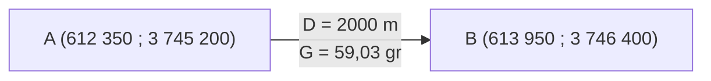
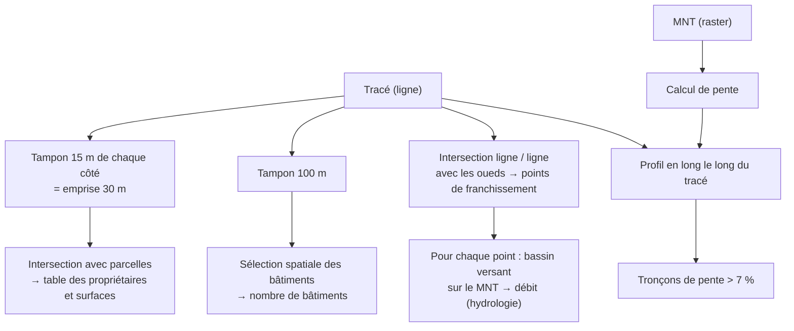

# Exercices corrigés de SIG et cartographie

[← Retour au sommaire](README.md)

Exercices types construits sur le cours (le cours ne contient pas d'exercices chiffrés). Calculs vérifiés numériquement.

---

## Exercice 1. Questions de cours

1. Citer les 5 A d'un SIG.
2. Différence entre mode vecteur et mode raster ? Lequel pour un MNT, lequel pour un réseau d'assainissement ?
3. Différence entre géoïde et ellipsoïde ?
4. Quel est le système de référence officiel en Tunisie ?

### Correction

1. Abstraction, Acquisition, Archivage, Analyse, Affichage.
2. Vecteur : objets décrits par des coordonnées (points, lignes, polygones). Raster : grille de cellules avec une valeur par cellule. MNT (altitude continue) → **raster**. Réseau d'assainissement (conduites, regards) → **vecteur**.
3. Le géoïde est la surface physique du niveau moyen des mers (irrégulière, référence des altitudes). L'ellipsoïde est une surface mathématique qui l'approche (référence des latitudes et longitudes, surface de calcul).
4. NTT, ellipsoïde de Clarke 1880, projection UTM fuseau 32 Nord, altitudes orthométriques rattachées au repère de Bâb Bhar (7,000 m).

---

## Exercice 2. Ellipsoïde de Clarke 1880

a = 6 378 249,2 m et b = 6 356 515,0 m. Calculer l'aplatissement f, 1/f et e².

### Correction

$$f = \frac{a - b}{a} = \frac{21\,734{,}2}{6\,378\,249{,}2} = 0{,}003\,407\,5 \qquad \frac{1}{f} = 293{,}47$$

$$e^2 = 2f - f^2 = 0{,}006\,803\,5$$

On retrouve bien 1/f = 293,466 du tableau du cours. Pour WGS84 (1/f = 298,26), l'ellipsoïde est un peu moins aplati.

---

## Exercice 3. Conversions d'angles et fuseau UTM

1. Convertir 36,8° en grades et 33° 52′ 30″ en degrés décimaux.
2. Djerba est vers λ = 10,9° E, Tabarka vers λ = 8,8° E. Dans quel fuseau UTM sont-elles ?

### Correction

1. 36,8 / 0,9 = **40,89 gr** (zone Lambert Nord, proche du parallèle origine 40 gr). 33 + 52/60 + 30/3600 = **33,875°**.
2. Fuseau = partie entière de (λ + 180)/6, plus 1 :
   - Djerba : (10,9 + 180)/6 = 31,82 → 31 + 1 = **32** ;
   - Tabarka : (8,8 + 180)/6 = 31,47 → 31 + 1 = **32**.

   Le fuseau 32 va de 6° E à 12° E et couvre toute la Tunisie.

---

## Exercice 4. Distance et gisement en UTM

Deux points en UTM 32N : A (612 350 ; 3 745 200) et B (613 950 ; 3 746 400).

1. Distance AB sur le plan et gisement de AB.
2. Longueur de AB sur une carte au 1/25 000.

### Correction

1. ΔE = 1 600 m, ΔN = 1 200 m.

$$D = \sqrt{1600^2 + 1200^2} = 2000\ \text{m} \qquad G = \arctan\frac{\Delta E}{\Delta N} = \arctan\frac{1600}{1200} = 53{,}13° = 59{,}03\ \text{gr}$$

   ΔE et ΔN sont positifs : le gisement est dans le premier quadrant (Nord-Est), pas de correction.

2. 2000 m = 200 000 cm ; 200 000 / 25 000 = **8 cm**.

---

## Exercice 5. Altération linéaire UTM

Le facteur d'échelle UTM vaut k ≈ 0,9996 (1 + E′²/(2R²)) avec E′ = E − 500 000 et R = 6 371 km. Calculer k et l'altération en cm/km pour E′ = 0, 100 km et 250 km. Commenter.

### Correction

| E′ (km) | k | Altération (cm/km) |
| --- | --- | --- |
| 0 | 0,999 600 | −40,0 |
| 100 | 0,999 723 | −27,7 |
| 180 | 1,000 000 | 0 |
| 250 | 1,000 370 | +37,0 |

Altération = (k − 1) × 100 000 cm/km.

Commentaire : sur le méridien central, les distances du plan sont trop courtes de 40 cm/km ; vers 180 km la projection est exacte ; plus loin elles sont trop longues. Pour un projet routier de plusieurs kilomètres, il faut corriger les distances mesurées sur le terrain avant de les comparer aux distances calculées en coordonnées.

---

## Exercice 6. Surface sur une carte et taille d'un raster

1. Sur une carte au 1/25 000, une parcelle rectangulaire mesure 8 cm × 3,5 cm. Surface réelle en hectares ?
2. On veut un MNT de cette zone élargie à 10 km × 8 km avec une résolution de 5 m. Combien de cellules ? Taille si chaque cellule fait 4 octets ?

### Correction

1. 8 cm → 2 000 m ; 3,5 cm → 875 m. S = 2 000 × 875 = 1 750 000 m² = **175 ha** = 1,75 km².

   Attention : les surfaces se convertissent avec le carré de l'échelle (1 cm² sur la carte = 25 000² cm² = 6,25 ha).

2. (10 000 / 5) × (8 000 / 5) = 2 000 × 1 600 = **3,2 millions de cellules**, soit 3,2 × 10⁶ × 4 = **12,8 Mo**. Avec une résolution de 2,5 m, on aurait 4 fois plus : 51,2 Mo.

---

## Exercice 7. Analyse SIG d'un projet de route

On veut construire une route de contournement. On dispose des couches : tracé projeté (ligne), parcelles (polygones, avec propriétaire), bâtiments (polygones), oueds (lignes), MNT (raster). Décrire les opérations SIG pour :

1. lister les parcelles à exproprier (emprise de 30 m) ;
2. compter les bâtiments à moins de 100 m de la route ;
3. repérer les points de franchissement d'oueds (ouvrages hydrauliques) ;
4. trouver les tronçons de pente supérieure à 7 %.

### Correction

1. **Zone tampon** de 15 m autour du tracé, puis **intersection** avec la couche parcelles : on obtient pour chaque parcelle la surface prise et le propriétaire.
2. **Zone tampon** de 100 m, puis **sélection spatiale** des bâtiments contenus ou touchés.
3. **Intersection** entre la ligne du tracé et les lignes des oueds : chaque point est un ouvrage à dimensionner (voir [l'hydrologie](../02-hydrologie/cours.md)).
4. Calcul de la **pente** sur le MNT, ou **profil en long** extrait du MNT le long du tracé, puis sélection des tronçons où la déclivité dépasse 7 % (valeur à comparer aux déclivités maximales du cours de [Routes](../01-routes/cours.md)).

Préalable indispensable : toutes les couches doivent être dans le **même système de coordonnées** (par exemple UTM 32N), sinon elles ne se superposent pas.
