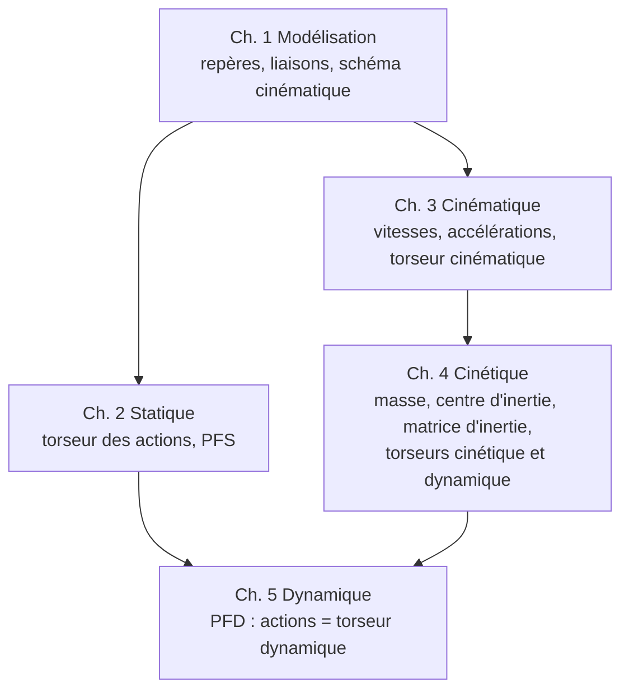

# Mécanique des solides

Cours de mécanique générale des solides indéformables, basé sur le polycopié « Mécanique des solides GC » (5 chapitres). Les passages marqués **[Complément]** ne viennent pas du cours.

## Fichiers

| Fichier | Contenu |
| --- | --- |
| [cours.md](cours.md) | Les 5 chapitres : modélisation, statique, cinématique, cinétique, dynamique |
| [formulaire.md](formulaire.md) | Torseurs des liaisons, formules clés, moments d'inertie usuels |
| [exercices-corriges.md](exercices-corriges.md) | Exercices types avec correction détaillée |

## Vue d'ensemble

Toute la mécanique des solides tient en un outil, le **torseur**, et en deux principes : la statique (le solide est immobile) et la dynamique (il bouge).

Pour l'ingénieur génie civil, la statique est la base directe de la RDM (réactions d'appui, efforts dans les structures). Voir [06-rdm](../06-rdm/README.md).
