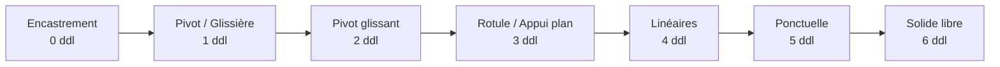
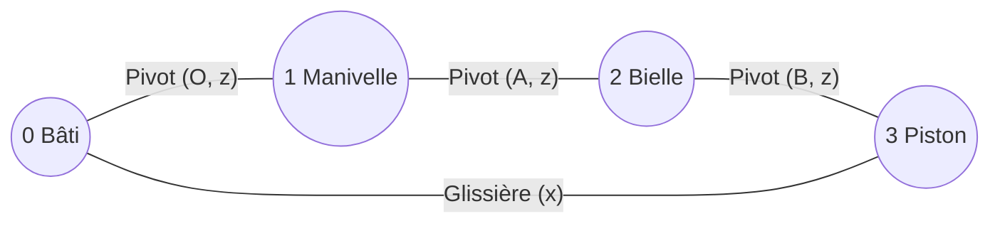
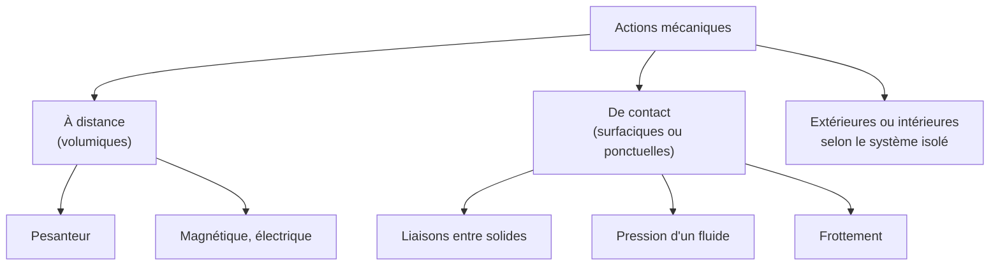
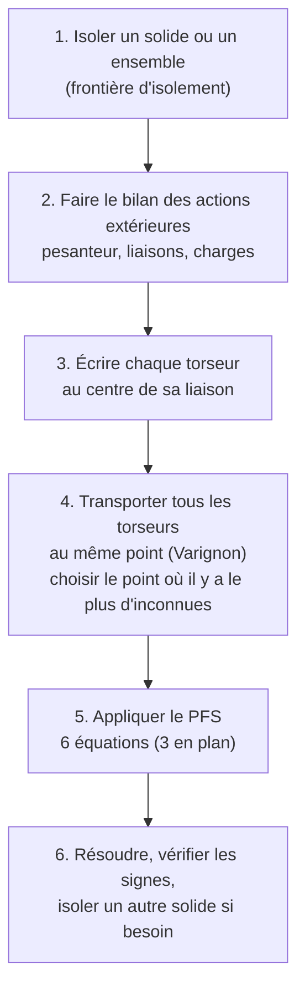
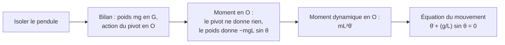

# Cours de mécanique des solides

[← Retour au sommaire](README.md)

Notations : les vecteurs sont en gras ou avec une flèche ; $\{\mathcal{T}\}$ désigne un torseur ; $R_0$ est le repère de référence (galiléen).

## Sommaire

1. [Modélisation et paramétrage](#chapitre-1-modélisation-et-paramétrage-des-systèmes-mécaniques)
2. [Actions mécaniques et statique](#chapitre-2-actions-mécaniques-et-statique)
3. [Cinématique](#chapitre-3-cinématique-du-solide)
4. [Cinétique](#chapitre-4-cinétique)
5. [Dynamique](#chapitre-5-dynamique)

---

## Rappel : les torseurs

Le torseur est l'outil de tout le cours. Un torseur en un point A est un couple de vecteurs :

$$\{\mathcal{T}\}_A = \begin{Bmatrix} \vec{R} \\ \vec{M}_A \end{Bmatrix}$$

- $\vec{R}$ : la **résultante**, la même en tout point ;
- $\vec{M}_A$ : le **moment** en A, qui change avec le point.

**Formule de transport (relation de Varignon)**, à connaître par cœur :

$$\vec{M}_B = \vec{M}_A + \vec{BA} \wedge \vec{R}$$

Moyen mnémotechnique : « BABAR » : $\vec{M}_B = \vec{M}_A + \vec{BA}\wedge\vec{R}$.

| Torseur particulier | Forme | Signification |
| --- | --- | --- |
| Glisseur | $\vec{R} \ne \vec{0}$ et il existe un point où $\vec{M} = \vec{0}$ | Une force seule |
| Couple | $\vec{R} = \vec{0}$ | Le moment est le même partout |
| Torseur nul | $\vec{R} = \vec{0}$ et $\vec{M} = \vec{0}$ | Équilibre |

**Comoment** de deux torseurs (sert pour la puissance) : $\{\mathcal{T}_1\}\otimes\{\mathcal{T}_2\} = \vec{R}_1\cdot\vec{M}_{2,A} + \vec{R}_2\cdot\vec{M}_{1,A}$, indépendant du point A.

---

## Chapitre 1. Modélisation et paramétrage des systèmes mécaniques

Un **système mécanique** (mécanisme) est un ensemble de pièces reliées par des liaisons pour réaliser une fonction. Pour l'étudier, on le modélise.

### 1.1 Solide indéformable

Un solide est **indéformable** si la distance entre deux quelconques de ses points reste constante au cours du temps. C'est une idéalisation : en RDM on étudiera justement les petites déformations.

### 1.2 Position d'un solide

On attache au solide S un repère $R_S$ (origine O_S, base liée). La position de S dans $R_0$ est connue si on connaît :

1. la **position de l'origine** O_S (3 paramètres) ;
2. l'**orientation de la base** (3 angles).

Soit **6 paramètres** au plus : un solide libre a **6 degrés de liberté**.

**Coordonnées de l'origine** :

| Système | Paramètres | Vecteur position |
| --- | --- | --- |
| Cartésiennes | x, y, z | $\vec{OM} = x\vec{x} + y\vec{y} + z\vec{z}$ |
| Cylindriques | r, θ, z | $\vec{OM} = r\vec{u}_r + z\vec{z}$ |
| Sphériques | r, θ, φ | $\vec{OM} = r\vec{u}_r$ |

**Orientation** : on utilise en général les **angles d'Euler** : précession ψ (autour de $\vec{z}_0$), nutation θ (autour de la ligne des nœuds $\vec{u}$), rotation propre φ (autour de $\vec{z}$). Chaque rotation se représente par une **figure de changement de base** (deux bases planes tournées d'un angle).

### 1.3 Liaisons normalisées

Un **degré de liberté (ddl)** est un mouvement indépendant possible : 3 translations (Tx, Ty, Tz) et 3 rotations (Rx, Ry, Rz). Une liaison entre deux solides supprime certains ddl.

ddl de la liaison + inconnues statiques transmises = 6.

| Liaison | ddl | Translations | Rotations | Exemple |
| --- | --- | --- | --- | --- |
| Encastrement | 0 | — | — | Poteau scellé dans une fondation |
| Pivot d'axe (A, x) | 1 | — | Rx | Charnière de porte |
| Glissière d'axe x | 1 | Tx | — | Tiroir |
| Hélicoïdale d'axe x | 1 | Tx liée à Rx | | Vis-écrou |
| Pivot glissant d'axe (A, x) | 2 | Tx | Rx | Tige de vérin |
| Rotule (sphérique) de centre A | 3 | — | Rx, Ry, Rz | Rotule d'attelage |
| Appui plan de normale z | 3 | Tx, Ty | Rz | Objet posé sur une table |
| Linéaire annulaire (sphère-cylindre) | 4 | Tx | Rx, Ry, Rz | |
| Linéaire rectiligne (cylindre-plan) | 4 | Tx, Ty | Rx, Rz | Rouleau sur un plan |
| Ponctuelle (sphère-plan) de normale z | 5 | Tx, Ty | Rx, Ry, Rz | Bille sur un plan |

Chaque liaison est définie dans un **repère local** lié à sa géométrie (axe, normale, centre).

**[Complément] En génie civil** (problèmes plans), on retrouve ces liaisons sous forme d'appuis :

| Appui plan | Liaison équivalente | ddl dans le plan | Réactions |
| --- | --- | --- | --- |
| Appui simple (rouleau) | Ponctuelle / linéaire | 2 | 1 force perpendiculaire à l'appui |
| Articulation (rotule) | Pivot | 1 | 2 forces (X, Y) |
| Encastrement | Encastrement | 0 | 2 forces + 1 moment |

### 1.4 Paramétrage d'un mécanisme

- **Translation** : paramétrée par une longueur, ex. $\vec{O_0O_1} = \lambda\,\vec{x}_0$.
- **Rotation** : paramétrée par un angle, ex. $\theta = (\vec{x}_0, \vec{x}_1)$ autour de $\vec{z}_0 = \vec{z}_1$, avec la figure de changement de base :

$$\vec{x}_1 = \cos\theta\,\vec{x}_0 + \sin\theta\,\vec{y}_0 \qquad \vec{y}_1 = -\sin\theta\,\vec{x}_0 + \cos\theta\,\vec{y}_0$$

### 1.5 Schéma cinématique et graphe de liaisons

- **Classe d'équivalence** : groupe de pièces sans mouvement relatif entre elles (on les regroupe en un seul solide).
- **Graphe de liaisons** : un cercle par classe d'équivalence, un trait par liaison (nom + axe ou centre).
- **Schéma cinématique** : dessin du mécanisme avec les symboles normalisés des liaisons.

Exemple : système bielle-manivelle (moteur, pompe).

Le graphe forme une **chaîne fermée** (boucle) : on peut écrire une fermeture géométrique.

### 1.6 Loi entrée-sortie

La **loi entrée-sortie** relie le paramètre d'entrée (souvent un angle moteur) au paramètre de sortie. On l'obtient par une **fermeture géométrique** : la somme des vecteurs le long de la boucle est nulle.

Bielle-manivelle : $\vec{OA} + \vec{AB} + \vec{BO} = \vec{0}$, avec OA = r, AB = L, θ l'angle de la manivelle et x = OB la position du piston. En projetant :

$$x = r\cos\theta + \sqrt{L^2 - r^2\sin^2\theta}$$

---

## Chapitre 2. Actions mécaniques et statique

### 2.1 Notion d'action mécanique

Une **action mécanique** est tout ce qui peut maintenir un corps au repos, le mettre en mouvement ou le déformer.

### 2.2 Force, moment, torseur d'action

- **Force** : vecteur lié (point d'application, direction, sens, intensité en N).
- **Moment** d'une force $\vec{F}$ appliquée en A, par rapport à un point B : $\vec{M}_B(\vec{F}) = \vec{BA}\wedge\vec{F}$ (en N·m).
- En plan : M = ± F × d, d = bras de levier (distance de B à la ligne d'action de F).

Une action mécanique de 1 sur 2 se modélise par un **torseur des actions mécaniques** :

$$\{\mathcal{T}(1\to2)\}_A = \begin{Bmatrix} \vec{R}(1\to2) \\ \vec{M}_A(1\to2) \end{Bmatrix} = \begin{Bmatrix} X & L \\ Y & M \\ Z & N \end{Bmatrix}_{A,(\vec{x},\vec{y},\vec{z})}$$

### 2.3 Action à distance : la pesanteur

Pour un solide de masse m et de centre de gravité G :

$$\{\mathcal{T}(\text{pes}\to S)\}_G = \begin{Bmatrix} -mg\,\vec{z} \\ \vec{0} \end{Bmatrix}$$

C'est un glisseur dont l'axe passe par G.

### 2.4 Actions de contact et frottement (lois de Coulomb)

Au point de contact I, l'action de 1 sur 2 a une composante normale N et une composante tangentielle T.

- **Adhérence** (pas de glissement) : $T \le f\,N$.
- **Glissement** : $T = f\,N$, et T s'oppose à la vitesse de glissement.
- f = **coefficient de frottement** ; φ = angle de frottement, $\tan\varphi = f$. La force de contact reste à l'intérieur du **cône de frottement** de demi-angle φ.

| Matériaux | f (ordre de grandeur) **[Complément]** |
| --- | --- |
| Acier / acier | 0,15 à 0,2 |
| Pneu / route sèche | 0,6 à 0,8 |
| Pneu / route mouillée | 0,3 à 0,4 |
| Béton / sol | 0,5 à 0,6 |

Le f ≈ 0,4 du cours de [Routes](../01-routes/cours.md) (distance de freinage) vient de là.

### 2.5 Torseurs des liaisons parfaites

Une liaison **parfaite** (sans frottement) transmet des efforts uniquement dans les directions où elle bloque un mouvement. Règle : **un ddl de translation ⇒ composante de force nulle ; un ddl de rotation ⇒ composante de moment nulle**.

| Liaison | Torseur transmissible au centre de la liaison |
| --- | --- |
| Encastrement | $\begin{Bmatrix} X & L \\ Y & M \\ Z & N \end{Bmatrix}$ (6 inconnues) |
| Pivot d'axe x | $\begin{Bmatrix} X & 0 \\ Y & M \\ Z & N \end{Bmatrix}$ (5) |
| Glissière d'axe x | $\begin{Bmatrix} 0 & L \\ Y & M \\ Z & N \end{Bmatrix}$ (5) |
| Pivot glissant d'axe x | $\begin{Bmatrix} 0 & 0 \\ Y & M \\ Z & N \end{Bmatrix}$ (4) |
| Rotule | $\begin{Bmatrix} X & 0 \\ Y & 0 \\ Z & 0 \end{Bmatrix}$ (3) |
| Appui plan de normale z | $\begin{Bmatrix} 0 & L \\ 0 & M \\ Z & 0 \end{Bmatrix}$ (3) |
| Ponctuelle de normale z | $\begin{Bmatrix} 0 & 0 \\ 0 & 0 \\ Z & 0 \end{Bmatrix}$ (1) |

### 2.6 Principe fondamental de la statique (PFS)

Un système matériel E est en **équilibre** par rapport à un repère galiléen si chacun de ses points reste immobile.

**PFS** : si E est en équilibre, le torseur des actions mécaniques **extérieures** à E est nul :

$$\{\mathcal{T}(\bar{E}\to E)\} = \{0\}$$

Ce qui donne deux théorèmes :

- **Théorème de la résultante statique** : $\sum \vec{F}_{ext} = \vec{0}$ ;
- **Théorème du moment statique** (en n'importe quel point A) : $\sum \vec{M}_A(\vec{F}_{ext}) = \vec{0}$.

En 3D : **6 équations** scalaires. En problème plan (x, y) : **3 équations** : $\sum X = 0$, $\sum Y = 0$, $\sum M_z = 0$.

**Théorème des actions mutuelles** : $\{\mathcal{T}(1\to2)\} = -\{\mathcal{T}(2\to1)\}$.

**Cas utiles** :

- Solide soumis à **2 forces** : elles sont égales, opposées et de même ligne d'action (exemple : une barre articulée à ses deux extrémités, non chargée entre les deux, travaille en traction ou compression selon son axe).
- Solide soumis à **3 forces non parallèles** : elles sont concourantes en un point et leur somme est nulle (résolution graphique par le triangle des forces).

**Isostatique ou hyperstatique** : on compare le nombre d'inconnues statiques au nombre d'équations utiles. Autant d'inconnues que d'équations : **isostatique** (résoluble par la statique seule). Plus d'inconnues : **hyperstatique** (il faut la RDM).

### 2.7 Démarche de résolution

---

## Chapitre 3. Cinématique du solide

La cinématique étudie les mouvements **sans s'occuper de leurs causes** (forces).

### 3.1 Dérivation vectorielle

La dérivée d'un vecteur dépend du repère dans lequel on dérive. On note $\left.\dfrac{d\vec{U}}{dt}\right|_{R}$.

Dans une base fixe $(\vec{x}_0, \vec{y}_0, \vec{z}_0)$, on dérive simplement les composantes. Si le vecteur est exprimé dans une base mobile, les vecteurs de base eux-mêmes tournent.

### 3.2 Formule de Bour (dérivation dans deux repères)

$$\left.\frac{d\vec{U}}{dt}\right|_{R_0} = \left.\frac{d\vec{U}}{dt}\right|_{R_1} + \vec{\Omega}(R_1/R_0)\wedge\vec{U}$$

$\vec{\Omega}(R_1/R_0)$ est le **vecteur vitesse instantanée de rotation** de $R_1$ par rapport à $R_0$.

### 3.3 Vecteur rotation

- **Rotation plane** d'angle θ autour de $\vec{z}_0$ : $\vec{\Omega}(1/0) = \dot\theta\,\vec{z}_0$. Alors $\left.\dfrac{d\vec{x}_1}{dt}\right|_{0} = \dot\theta\,\vec{y}_1$ et $\left.\dfrac{d\vec{y}_1}{dt}\right|_{0} = -\dot\theta\,\vec{x}_1$.
- **Rotation dans l'espace** (angles d'Euler) : $\vec{\Omega} = \dot\psi\,\vec{z}_0 + \dot\theta\,\vec{u} + \dot\varphi\,\vec{z}$.
- **Composition** : $\vec{\Omega}(2/0) = \vec{\Omega}(2/1) + \vec{\Omega}(1/0)$.

### 3.4 Vitesse et accélération d'un point

$$\vec{V}(M/R_0) = \left.\frac{d\vec{OM}}{dt}\right|_{R_0} \qquad \vec{\Gamma}(M/R_0) = \left.\frac{d\vec{V}(M/R_0)}{dt}\right|_{R_0}$$

**Champ des vitesses d'un solide** (relation fondamentale, même forme que Varignon) :

$$\vec{V}(B\in S/R_0) = \vec{V}(A\in S/R_0) + \vec{BA}\wedge\vec{\Omega}(S/R_0)$$

Le champ des vitesses est donc un torseur : le **torseur cinématique**.

$$\{\mathcal{V}(S/R_0)\}_A = \begin{Bmatrix} \vec{\Omega}(S/R_0) \\ \vec{V}(A\in S/R_0) \end{Bmatrix}$$

**Équiprojectivité** : $\vec{V}(A)\cdot\vec{AB} = \vec{V}(B)\cdot\vec{AB}$ (sert en résolution graphique).

**[Complément] Cas du mouvement de rotation autour d'un axe fixe** : un point à la distance r de l'axe a une vitesse $V = r\omega$, une accélération normale $r\omega^2$ (vers l'axe) et tangentielle $r\dot\omega$.

| Mouvement | Torseur cinématique |
| --- | --- |
| Translation | $\vec{\Omega} = \vec{0}$, même vitesse partout (couple) |
| Rotation autour d'un axe fixe | $\vec{V} = \vec{0}$ sur l'axe (glisseur) |
| Mouvement quelconque | Vis : rotation + translation le long de l'axe central |

### 3.5 Torseurs cinématiques des liaisons

Le torseur cinématique d'une liaison est le « complémentaire » de son torseur statique : là où la liaison laisse un ddl, la composante cinématique est non nulle. Exemple, pivot d'axe (A, x) : $\vec{\Omega} = \omega_x\,\vec{x}$, $\vec{V}(A) = \vec{0}$.

Pour une liaison parfaite, la **puissance** dissipée est nulle : comoment statique ⊗ cinématique = 0.

### 3.6 Composition des mouvements

$$\vec{V}(M\in2/0) = \vec{V}(M\in2/1) + \vec{V}(M\in1/0)$$

Soit en torseurs : $\{\mathcal{V}(2/0)\} = \{\mathcal{V}(2/1)\} + \{\mathcal{V}(1/0)\}$.

**Roulement sans glissement** d'une roue (1) sur le sol (0) au point de contact I : $\vec{V}(I\in1/0) = \vec{0}$. Pour une roue de rayon R qui tourne à ω : le centre avance à $V = R\omega$, le point haut à $2R\omega$.

### 3.7 Fermeture cinématique

Dans une chaîne fermée 0 → 1 → 2 → … → 0 :

$$\{\mathcal{V}(1/0)\} + \{\mathcal{V}(2/1)\} + \dots + \{\mathcal{V}(0/n)\} = \{0\}$$

On obtient la **loi entrée-sortie en vitesse**. C'est aussi la dérivée de la loi géométrique du chapitre 1.

---

## Chapitre 4. Cinétique

La cinétique relie les mouvements (cinématique) et la **répartition des masses**.

### 4.1 Masse et centre d'inertie

- Masse : $m = \int_S dm$, avec $dm = \rho\,dV$ (volume), $\sigma\,dS$ (surface) ou $\lambda\,dl$ (ligne).
- **Conservation de la masse** : la masse d'un système fermé est constante.
- **Centre d'inertie G** :

$$m\,\vec{OG} = \int_S \vec{OM}\,dm$$

- Pour un **ensemble de solides** (barycentre) : $\vec{OG} = \dfrac{\sum m_i\,\vec{OG_i}}{\sum m_i}$.
- **Symétrie** : si le solide a un plan ou un axe de symétrie matérielle, G est dessus.

### 4.2 Matrice (opérateur) d'inertie

Elle décrit la répartition des masses autour d'un point O :

$$I(O,S) = \begin{bmatrix} A & -F & -E \\ -F & B & -D \\ -E & -D & C \end{bmatrix}_{(\vec{x},\vec{y},\vec{z})}$$

- **Moments d'inertie** : $A = \int (y^2 + z^2)\,dm$, $B = \int (x^2 + z^2)\,dm$, $C = \int (x^2 + y^2)\,dm$ (en kg·m²).
- **Produits d'inertie** : $D = \int yz\,dm$, $E = \int xz\,dm$, $F = \int xy\,dm$.

**Symétries** : un plan de symétrie (O, x, y) annule D et E. Deux plans de symétrie : matrice diagonale. Les axes où la matrice est diagonale sont les **axes principaux d'inertie**.

**Théorème de Huygens** : pour un axe Δ parallèle à un axe ΔG passant par G, à la distance d :

$$J_\Delta = J_{\Delta_G} + m\,d^2$$

**Associativité** : la matrice d'un ensemble est la somme des matrices des parties, exprimées au même point et dans la même base.

**[Complément] Moments d'inertie usuels** (axe passant par G sauf mention) :

| Solide | Axe | Moment d'inertie |
| --- | --- | --- |
| Tige de longueur L | perpendiculaire, au centre | $mL^2/12$ |
| Tige de longueur L | perpendiculaire, à l'extrémité | $mL^2/3$ |
| Disque / cylindre plein de rayon R | axe de révolution | $mR^2/2$ |
| Cerceau / tube mince | axe de révolution | $mR^2$ |
| Sphère pleine | diamètre | $2mR^2/5$ |
| Plaque rectangulaire b × h | perpendiculaire au plan, au centre | $m(b^2 + h^2)/12$ |

À ne pas confondre avec le **moment quadratique** $I = \int y^2\,dS$ (en m⁴) de la RDM, qui porte sur une section et pas sur une masse.

### 4.3 Torseur cinétique

$$\{\mathcal{C}(S/R_0)\}_A = \begin{Bmatrix} m\,\vec{V}(G/R_0) \\ \vec{\sigma}_A(S/R_0) \end{Bmatrix}$$

- Résultante : la **quantité de mouvement** $m\vec{V}(G)$.
- Moment : le **moment cinétique**. En G ou en un point fixe O du solide : $\vec{\sigma} = I(\cdot,S)\,\vec{\Omega}(S/R_0)$.
- Transport : $\vec{\sigma}_B = \vec{\sigma}_A + \vec{BA}\wedge m\vec{V}(G)$.

### 4.4 Torseur dynamique

$$\{\mathcal{D}(S/R_0)\}_A = \begin{Bmatrix} m\,\vec{\Gamma}(G/R_0) \\ \vec{\delta}_A(S/R_0) \end{Bmatrix}$$

- Résultante : $m\vec{\Gamma}(G)$.
- Moment dynamique. En G ou en un point fixe : $\vec{\delta} = \left.\dfrac{d\vec{\sigma}}{dt}\right|_{R_0}$.
- Cas d'une **rotation autour d'un axe fixe** (O, z) principal : $\delta_O = J\,\ddot\theta$.

### 4.5 Énergie cinétique

$$T(S/R_0) = \frac{1}{2}\{\mathcal{C}\}\otimes\{\mathcal{V}\} = \frac{1}{2}m V_G^2 + \frac{1}{2}\vec{\Omega}\cdot I(G,S)\,\vec{\Omega}$$

- Translation : $T = \tfrac{1}{2}mV^2$.
- Rotation autour d'un axe fixe Δ : $T = \tfrac{1}{2}J_\Delta\,\omega^2$.

**Application : pendule simple** (masse ponctuelle m au bout d'un fil de longueur L, angle θ) : $V = L\dot\theta$, donc $T = \tfrac{1}{2}mL^2\dot\theta^2$.

---

## Chapitre 5. Dynamique

### 5.1 Principe fondamental de la dynamique (PFD)

Dans un repère **galiléen**, pour tout système matériel E :

$$\{\mathcal{D}(E/R_g)\} = \{\mathcal{T}(\bar{E}\to E)\}$$

Le torseur dynamique est égal au torseur des actions extérieures. La statique est le cas particulier où le torseur dynamique est nul.

### 5.2 Théorèmes généraux

- **Théorème de la résultante dynamique** : $m\,\vec{\Gamma}(G/R_g) = \sum\vec{F}_{ext}$ (c'est « F = ma »).
- **Théorème du moment dynamique** (en un point A quelconque) : $\vec{\delta}_A(E/R_g) = \sum\vec{M}_A(\vec{F}_{ext})$.

### 5.3 Théorème des actions réciproques

Comme en statique : $\{\mathcal{T}(1\to2)\} = -\{\mathcal{T}(2\to1)\}$.

### 5.4 Cas particuliers

| Mouvement | Équation |
| --- | --- |
| Translation rectiligne | $m\,a = \sum F$ |
| Rotation autour d'un axe fixe Δ | $J_\Delta\,\ddot\theta = \sum M_\Delta$ |
| Équilibre (statique) | $\sum F = 0$, $\sum M = 0$ |

**[Complément] Théorème de l'énergie cinétique** : $\dfrac{dT}{dt} = P_{ext} + P_{int}$ (puissances des actions extérieures et intérieures). Pratique quand il n'y a qu'un paramètre de mouvement.

### 5.5 Application : pendule simple

Masse m au bout d'un fil sans masse de longueur L, articulé en O fixe, angle θ par rapport à la verticale.

Théorème du moment dynamique en O, projeté sur l'axe de rotation :

$$mL^2\ddot\theta = -mgL\sin\theta \quad\Longrightarrow\quad \ddot\theta + \frac{g}{L}\sin\theta = 0$$

Pour de petites oscillations, sin θ ≈ θ : oscillateur harmonique de pulsation $\omega_0 = \sqrt{g/L}$ et de période :

$$T_0 = 2\pi\sqrt{\frac{L}{g}}$$

Pour L = 1 m : T0 = 2,01 s. La période ne dépend pas de la masse.

