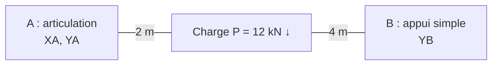
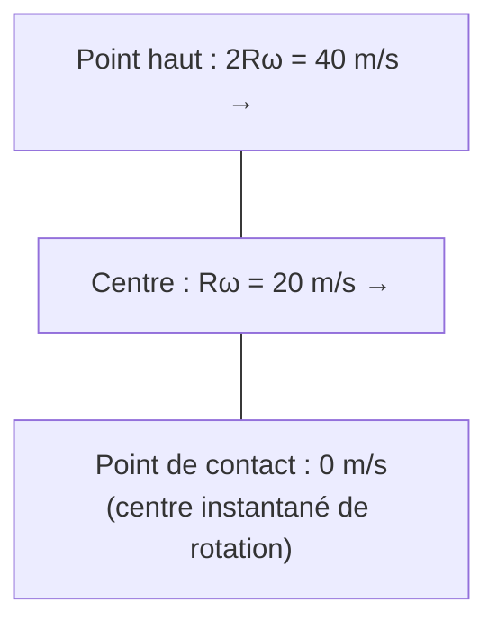

# Exercices corrigés de mécanique des solides

[← Retour au sommaire](README.md)

Exercices types sur les 5 chapitres. Calculs vérifiés numériquement. On prend g = 9,81 m/s².

---

## Exercice 1. Réactions d'une poutre (statique plane)

Une poutre AB de 6 m, de poids négligeable, repose sur une articulation en A et un appui simple en B. Elle porte une charge verticale P = 12 kN à 2 m de A. Calculer les réactions.

### Correction

On isole la poutre. Inconnues : XA, YA, YB (3 inconnues, 3 équations : isostatique).

- $\sum X = 0$ : XA = 0.
- $\sum M_A = 0$ : YB × 6 − 12 × 2 = 0, donc **YB = 4 kN**.
- $\sum Y = 0$ : YA + YB − 12 = 0, donc **YA = 8 kN**.

Vérification avec $\sum M_B = 0$ : −YA × 6 + 12 × 4 = −48 + 48 = 0. L'appui le plus proche de la charge reprend le plus d'effort.

---

## Exercice 2. Échelle contre un mur (frottement de Coulomb)

Une échelle AB de longueur L et de poids P (en son milieu G) s'appuie en A sur le sol (frottement, f = 0,4) et en B contre un mur lisse (sans frottement). Elle fait un angle α avec le sol. Quel angle minimal α évite le glissement ?

### Correction

On isole l'échelle. Actions : poids P en G ; en A, NA (vertical) et TA (horizontal, vers le mur) ; en B, NB (horizontal, perpendiculaire au mur lisse).

- $\sum X = 0$ : TA = NB.
- $\sum Y = 0$ : NA = P.
- $\sum M_A = 0$ : NB × L sin α = P × (L/2) cos α, donc $N_B = \dfrac{P}{2\tan\alpha}$.

Condition d'adhérence en A : TA ≤ f NA, soit :

$$\frac{P}{2\tan\alpha} \le f\,P \quad\Longrightarrow\quad \tan\alpha \ge \frac{1}{2f} = 1{,}25 \quad\Longrightarrow\quad \alpha \ge 51{,}3°$$

Le résultat ne dépend ni de P ni de L. Plus le sol est glissant (f petit), plus il faut redresser l'échelle.

---

## Exercice 3. Torseur et transport

Une force $\vec{F} = (0 ; -500 ; 0)$ N est appliquée au point A (2 ; 0 ; 0) m. Écrire le torseur en A puis en O (0 ; 0 ; 0).

### Correction

En A : $\{\mathcal{T}\}_A = \begin{Bmatrix} \vec{F} \\ \vec{0} \end{Bmatrix}$ (glisseur).

En O : $\vec{M}_O = \vec{M}_A + \vec{OA}\wedge\vec{F} = (2;0;0)\wedge(0;-500;0)$.

$$\vec{OA}\wedge\vec{F} = \begin{pmatrix} 0\cdot0 - 0\cdot(-500) \\ 0\cdot0 - 2\cdot0 \\ 2\cdot(-500) - 0\cdot0 \end{pmatrix} = \begin{pmatrix} 0 \\ 0 \\ -1000 \end{pmatrix}\ \text{N·m}$$

Vérification en plan : F = 500 N, bras de levier 2 m, rotation dans le sens horaire (négatif autour de z) : M = −1000 N·m.

---

## Exercice 4. Bielle-manivelle (loi entrée-sortie)

Manivelle OA = r = 0,10 m, bielle AB = L = 0,40 m. Position du piston x = OB pour θ = 60° ?

### Correction

$$x = r\cos\theta + \sqrt{L^2 - r^2\sin^2\theta} = 0{,}05 + \sqrt{0{,}16 - 0{,}0075} = 0{,}05 + 0{,}3905 = 0{,}4405\ \text{m}$$

Positions extrêmes : θ = 0 donne x = r + L = 0,50 m ; θ = 180° donne x = L − r = 0,30 m. La **course** du piston vaut 2r = 0,20 m.

---

## Exercice 5. Roue qui roule sans glisser

Une roue de rayon R = 0,30 m roule sans glisser sur une route, son centre avance à 20 m/s (72 km/h). Calculer ω, puis la vitesse du point haut et du point de contact.

### Correction

Roulement sans glissement : $\vec{V}(I) = \vec{0}$, donc V_centre = Rω.

- ω = 20 / 0,30 = **66,7 rad/s** (≈ 637 tr/min).
- Point de contact I : **0 m/s**.
- Point haut H : $\vec{V}(H) = \vec{V}(I) + \vec{HI}\wedge\vec{\Omega}$ ; HI = 2R, donc V(H) = 2Rω = **40 m/s**.

---

## Exercice 6. Centre de gravité d'une plaque en L

Plaque homogène en L formée de deux rectangles : (1) 4 m × 1 m, de x = 0 à 4 et y = 0 à 1 ; (2) 1 m × 3 m, de x = 0 à 1 et y = 1 à 4. Coordonnées de G ?

### Correction

| Partie | Surface (m²) | xG (m) | yG (m) |
| --- | --- | --- | --- |
| 1 | 4 | 2 | 0,5 |
| 2 | 3 | 0,5 | 2,5 |

$$x_G = \frac{4\times2 + 3\times0{,}5}{7} = \frac{9{,}5}{7} = 1{,}36\ \text{m} \qquad y_G = \frac{4\times0{,}5 + 3\times2{,}5}{7} = \frac{9{,}5}{7} = 1{,}36\ \text{m}$$

xG = yG : normal, la plaque est symétrique par rapport à la droite y = x. G est hors de la matière (dans le coin intérieur du L), ce qui est fréquent pour les formes creuses.

---

## Exercice 7. Plan incliné avec frottement (dynamique)

Un bloc glisse sur un plan incliné de α = 30°, coefficient de frottement f = 0,2. Accélération ? Vitesse après 3 m de glissement depuis le repos ?

### Correction

Théorème de la résultante dynamique, projeté :

- perpendiculairement au plan : N = mg cos α ;
- le long du plan : m a = mg sin α − f N.

$$a = g(\sin\alpha - f\cos\alpha) = 9{,}81\,(0{,}5 - 0{,}2\times0{,}866) = 3{,}21\ \text{m/s}^2$$

Mouvement uniformément accéléré : $v = \sqrt{2ad} = \sqrt{2\times3{,}21\times3} = 4{,}39$ m/s.

Le bloc glisse seulement si tan α > f : tan 30° = 0,577 > 0,2, c'est bien le cas.

---

## Exercice 8. Volant d'inertie (rotation autour d'un axe fixe)

Un disque plein de masse 20 kg et de rayon 0,5 m, initialement immobile, reçoit un couple moteur constant de 10 N·m. Calculer J, l'accélération angulaire, ω après 5 s et l'énergie cinétique.

### Correction

- $J = \tfrac12 mR^2 = \tfrac12\times20\times0{,}25 = 2{,}5$ kg·m².
- $J\ddot\theta = C$ : $\ddot\theta = 10/2{,}5 = 4$ rad/s².
- ω = 4 × 5 = **20 rad/s**.
- $T = \tfrac12 J\omega^2 = \tfrac12\times2{,}5\times400 = 500$ J.

Vérification par le théorème de l'énergie : travail du couple = C × θ, avec θ = ½ × 4 × 5² = 50 rad, donc 10 × 50 = 500 J. ✔

---

## Exercice 9. Pendule simple

Longueur L = 1 m. Période des petites oscillations ? Quelle longueur pour une période de 1 s ?

### Correction

$$T_0 = 2\pi\sqrt{\frac{L}{g}} = 2\pi\sqrt{\frac{1}{9{,}81}} = 2{,}01\ \text{s}$$

Pour T0 = 1 s : $L = g\left(\dfrac{T_0}{2\pi}\right)^2 = 9{,}81\times0{,}0253 = 0{,}248$ m, soit environ 25 cm.
