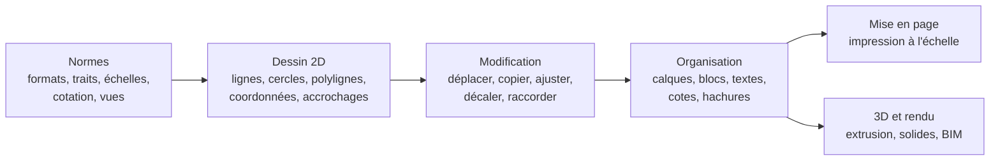

# DAO (Dessin assisté par ordinateur)

Cours construit à partir de la consigne du dossier de recherche « Le Dessin Assisté par Ordinateur (DAO) » (8 parties, 12 à 20 pages, en binôme). Le dossier lui-même n'est pas un cours : tout le contenu ci-dessous est **[Complément]**, organisé selon le plan imposé.

## Fichiers

| Fichier | Contenu |
| --- | --- |
| [cours.md](cours.md) | Les 8 parties du dossier : définition, historique, normes, outils 2D, modification, organisation, 3D, conclusion |
| [commandes-autocad.md](commandes-autocad.md) | Aide-mémoire des commandes AutoCAD (raccourcis, coordonnées, touches F) |
| [exercices-corriges.md](exercices-corriges.md) | Exercices de normes, d'échelles et de tracé, avec correction |

## Vue d'ensemble

## Pour le dossier à rendre

La consigne demande un travail **personnel et reformulé**, avec des illustrations titrées et légendées et des sources citées. Ce cours sert de base pour comprendre et structurer : il faut le réécrire avec vos mots et y ajouter vos propres captures d'écran (AutoCAD ou un logiciel gratuit comme LibreCAD ou FreeCAD).
