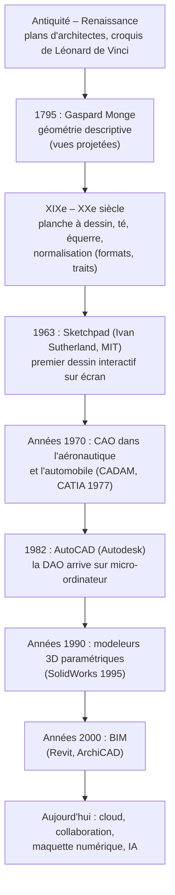
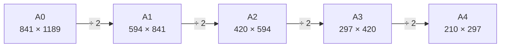
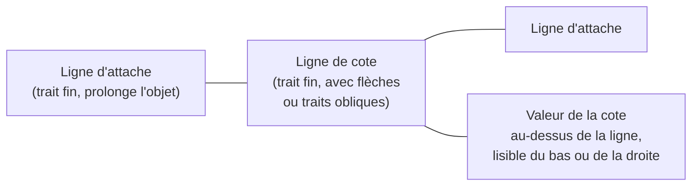
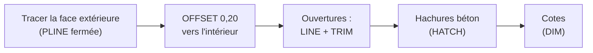
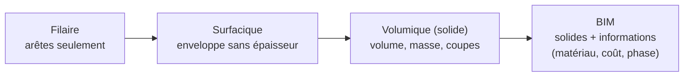

# Cours de DAO

[← Retour au sommaire](README.md)

Plan identique à celui du dossier demandé. Les commandes sont données pour AutoCAD (le logiciel le plus utilisé en génie civil), en anglais avec le raccourci clavier ; la version française d'AutoCAD accepte les commandes anglaises précédées de « _ » (ex. `_LINE`).

## Sommaire

1. [Définition de la DAO](#1-définition-de-la-dao)
2. [Évolution historique](#2-évolution-historique)
3. [Normes du dessin technique](#3-normes-du-dessin-technique)
4. [Outils de dessin 2D](#4-outils-de-dessin-2d)
5. [Outils de modification 2D](#5-outils-de-modification-et-dédition-2d)
6. [Structuration et organisation du dessin](#6-structuration-et-organisation-du-dessin)
7. [Introduction à la 3D et aux rendus](#7-introduction-à-la-3d-et-aux-rendus)
8. [Conclusion](#8-conclusion-et-perspectives)

---

## 1. Définition de la DAO

La **DAO** (Dessin Assisté par Ordinateur, en anglais *CAD, Computer-Aided Design/Drafting*) est l'utilisation d'un logiciel pour produire des dessins techniques précis : plans, coupes, détails, modèles 3D.

On distingue :

- la **DAO** au sens strict : produire le dessin (2D surtout) ;
- la **CAO** (Conception Assistée par Ordinateur) : concevoir et calculer l'objet (modèle 3D paramétrique, simulations) ;
- le **BIM** (Building Information Modeling) : maquette numérique du bâtiment où chaque objet (mur, poutre, fenêtre) porte ses informations (matériau, coût, phase).

### Principes fondamentaux

| Principe | Explication |
| --- | --- |
| On dessine en **vraie grandeur** | Un mur de 5 m mesure 5 unités dans le fichier. L'échelle n'intervient qu'à l'impression. |
| **Précision** absolue | Coordonnées et accrochages : pas d'à-peu-près comme au crayon. |
| Dessin **vectoriel** | Chaque objet est défini mathématiquement (ligne = 2 points, cercle = centre + rayon). |
| **Calques** | Les objets sont rangés par catégorie (murs, cotes, axes…), qu'on affiche ou masque. |
| **Réutilisation** | Blocs, copies, gabarits : on ne redessine jamais deux fois la même chose. |
| **Modification facile** | Changer un dessin ne demande pas de le refaire. |

### Domaines d'application

| Domaine | Exemples | Logiciels courants |
| --- | --- | --- |
| Bâtiment, architecture | Plans, coupes, façades, ferraillage | AutoCAD, Revit, ArchiCAD |
| Travaux publics, routes | Tracé en plan, profils en long et en travers, cubatures | Covadis, AutoCAD Civil 3D, Mensura |
| Topographie | Plans de levés, implantation | AutoCAD, Covadis |
| Structures | Plans de coffrage et de ferraillage | Robot, Tekla, AutoCAD |
| Mécanique industrielle | Pièces, assemblages | SolidWorks, CATIA, Inventor |
| Réseaux | AEP, assainissement, électricité | AutoCAD, Covadis |

Dans les métiers techniques, la DAO est devenue la norme : les plans sont échangés en fichiers (DWG, DXF, PDF), les entreprises exigent sa maîtrise, et elle réduit les erreurs et les délais.

---

## 2. Évolution historique

### Du manuel au numérique

| Dessin manuel | Dessin numérique |
| --- | --- |
| Planche, té, équerres, compas, rapporteur, calque | Ordinateur, souris, logiciel |
| Échelle choisie avant de dessiner | Dessin en vraie grandeur, échelle à l'impression |
| Correction = gommer ou recommencer | Correction en quelques clics |
| Copie = recopier ou tirage | Copie illimitée et identique |
| Archivage papier (encombrant, fragile) | Fichiers, sauvegardes, échange par e-mail |
| Précision limitée par la mine (≈ 0,2 mm) | Précision mathématique |

Le dessin manuel reste utile pour les **croquis** de terrain et de réflexion.

---

## 3. Normes du dessin technique

Les normes garantissent que tout le monde lit un plan de la même façon. Principales références : **ISO** (internationales), **NF** (France), **NT** (Tunisie, souvent reprises des ISO). Exemples : ISO 128 (traits et représentation), ISO 5455 (échelles), ISO 129 (cotation), ISO 5457 (formats), ISO 7200 (cartouche).

### 3.1 Formats de papier (série A, ISO 216)

Chaque format est la moitié du précédent. Le rapport longueur / largeur vaut toujours √2, et l'A0 a une surface de 1 m².

| Format | Dimensions (mm) |
| --- | --- |
| A0 | 841 × 1189 |
| A1 | 594 × 841 |
| A2 | 420 × 594 |
| A3 | 297 × 420 |
| A4 | 210 × 297 |

Chaque feuille a un **cadre** (marge d'environ 10 mm, 20 mm côté reliure) et un **cartouche** en bas à droite : titre, nom de l'auteur, date, échelle, numéro de plan, indice de révision.

### 3.2 Types et épaisseurs de traits

| Trait | Aspect | Usage |
| --- | --- | --- |
| Continu **fort** | ━━━━━ | Arêtes et contours **vus**, éléments coupés |
| Continu **fin** | ───── | Lignes de cote et d'attache, hachures, lignes de rappel |
| Interrompu fin | ─ ─ ─ ─ | Arêtes et contours **cachés** |
| Mixte fin (trait-point) | ─ · ─ · ─ | **Axes**, plans de symétrie, trajectoires |
| Mixte fort aux extrémités | ━ · ─ · ━ | Trace d'un **plan de coupe** |
| Continu fin à main levée ou zigzag | ∿∿∿ | Limite de vue partielle ou de coupe partielle |

Épaisseurs normalisées (mm) : 0,13 – 0,18 – 0,25 – 0,35 – 0,5 – 0,7 – 1 – 1,4 – 2. Le trait fort est environ **2 fois** le trait fin (par exemple 0,5 et 0,25 mm).

### 3.3 Échelles

$$\text{Échelle} = \frac{\text{dimension sur le dessin}}{\text{dimension réelle}}$$

| Type | Exemples | Usage |
| --- | --- | --- |
| Réduction | 1:2, 1:5, 1:10, 1:20, 1:50, 1:100, 1:200, 1:500, 1:1000 | Bâtiment, génie civil |
| Vraie grandeur | 1:1 | Petites pièces |
| Agrandissement | 2:1, 5:1, 10:1 | Très petites pièces |

En génie civil : plans de masse 1/500 à 1/200, plans d'étage 1/100 ou 1/50, détails 1/20 à 1/5, plans routiers 1/1000 à 1/500.

### 3.4 Cotation

Règles principales :

- la cote indique la **dimension réelle**, quelle que soit l'échelle ;
- unité : **mm** en mécanique (sans l'écrire), **cm ou m** en bâtiment (préciser dans le cartouche) ;
- chaque dimension est cotée **une seule fois** ;
- on évite de coter sur des traits cachés ;
- symboles : Ø diamètre, R rayon, □ carré ;
- en bâtiment : cotes en **chaîne** (successives) et cotes **cumulées** (totales), niveaux en m (ex. +3,00).

### 3.5 Vues et coupes

**Vues** : on projette l'objet sur des plans perpendiculaires (géométrie de Monge). En **projection européenne** (méthode E, utilisée en Tunisie et en Europe) :

| | |
| --- | --- |
| **Vue de face** (vue principale) | **Vue de gauche**, placée à DROITE |
| **Vue de dessus**, placée EN DESSOUS | |

- La vue de **dessus** se place **sous** la vue de face ; la vue de **gauche** se place **à droite**. (La méthode américaine fait l'inverse.)
- Les vues sont **alignées** : mêmes hauteurs sur une ligne, mêmes largeurs dans une colonne.
- On ne dessine que les vues nécessaires (souvent 2 ou 3).

**Coupes** : pour voir l'intérieur, on coupe l'objet par un plan fictif, on enlève la partie avant et on dessine le reste.

- Le plan de coupe est indiqué par un trait mixte fort aux extrémités avec des flèches et des lettres (coupe A-A).
- Les surfaces coupées sont **hachurées** (traits fins à 45°), avec un motif différent par matériau (béton, maçonnerie, terre…).
- **Section** : on ne dessine que la surface coupée, sans ce qui est derrière.

En bâtiment, un **plan d'étage** est une coupe horizontale à environ 1 m du sol ; une **coupe** verticale montre les hauteurs, planchers et fondations.

---

## 4. Outils de dessin 2D

### 4.1 Systèmes de coordonnées

AutoCAD travaille dans un repère (X, Y). Les angles sont comptés à partir de l'Est (axe X), dans le sens **inverse des aiguilles d'une montre**.

| Type | Syntaxe | Signification |
| --- | --- | --- |
| Absolues cartésiennes | `x,y` | Point par rapport à l'origine (0,0) |
| Relatives cartésiennes | `@dx,dy` | Décalage par rapport au dernier point |
| Relatives polaires | `@d<angle` | Distance d dans la direction angle |
| Saisie directe | direction de la souris + longueur | Rapide avec ORTHO ou POLAIRE |

Exemple : un rectangle de 5 × 3 commençant en (2,1) : `LINE` → `2,1` → `@5,0` → `@0,3` → `@-5,0` → `C` (clore).

### 4.2 Aides au dessin

| Aide | Touche | Rôle |
| --- | --- | --- |
| **Accrochage aux objets (OSNAP)** | F3 | S'accrocher exactement à l'extrémité, au milieu, au centre, à l'intersection, à la perpendiculaire, à la tangente |
| Grille | F7 | Afficher une grille de repère |
| **Mode ORTHO** | F8 | Forcer les lignes horizontales et verticales |
| Résolution (snap) | F9 | Le curseur saute de pas en pas |
| Repérage polaire | F10 | Guides tous les 15°, 30°, 45°… |
| Repérage d'accrochage | F11 | Alignements avec des points existants |

Ne jamais « viser à l'œil » : toujours un accrochage ou une coordonnée.

### 4.3 Commandes de création

| Objet | Commande | Raccourci | Données à saisir |
| --- | --- | --- | --- |
| Ligne | `LINE` | L | Point de départ, points suivants |
| Cercle | `CIRCLE` | C | Centre + rayon (ou diamètre, 2 ou 3 points, tangent-tangent-rayon) |
| Arc | `ARC` | A | 3 points, ou début-centre-fin… |
| Rectangle | `RECTANG` | REC | 2 coins opposés (ex. `0,0` puis `@5,3`) |
| Polyligne | `PLINE` | PL | Suite de segments et d'arcs formant **un seul objet** |
| Polygone | `POLYGON` | POL | Nombre de côtés, centre, inscrit ou circonscrit |
| Ellipse | `ELLIPSE` | EL | Axes |
| Point | `POINT` | PO | Coordonnées |

La **polyligne** est très utile : un contour de bâtiment en polyligne fermée donne directement son aire et son périmètre (commande `AREA` ou palette Propriétés).

---

## 5. Outils de modification et d'édition 2D

| Action | Commande | Raccourci | Utilisation |
| --- | --- | --- | --- |
| Effacer | `ERASE` | E | Supprimer des objets |
| Déplacer | `MOVE` | M | Point de base, puis point de destination |
| Copier | `COPY` | CO | Comme déplacer, l'original reste |
| Rotation | `ROTATE` | RO | Point de base + angle |
| Symétrie (miroir) | `MIRROR` | MI | Axe de symétrie par 2 points ; garder ou non l'original |
| Échelle | `SCALE` | SC | Point de base + facteur |
| Décaler | `OFFSET` | O | Parallèle à une distance donnée (épaisseur d'un mur) |
| Ajuster | `TRIM` | TR | Couper ce qui dépasse d'une limite |
| Prolonger | `EXTEND` | EX | Allonger jusqu'à une limite |
| Raccord | `FILLET` | F | Arrondir un angle avec un rayon (rayon 0 = coin net) |
| Chanfrein | `CHAMFER` | CHA | Couper un angle en biais |
| Étirer | `STRETCH` | S | Allonger une partie (sélection par fenêtre capturante) |
| Réseau | `ARRAY` | AR | Copies en grille, en cercle ou le long d'un chemin |
| Décomposer | `EXPLODE` | X | Casser une polyligne ou un bloc en objets simples |
| Joindre | `JOIN` | J | Réunir des segments en une polyligne |

**Sélection** : fenêtre de gauche à droite (bleue) = objets **entièrement** dedans ; de droite à gauche (verte, capturante) = objets **touchés**.

**Exemple pratique : dessiner un mur de 20 cm** : tracer l'axe ou une face en polyligne, `OFFSET` de 0,20, puis `TRIM` ou `FILLET` (rayon 0) pour nettoyer les angles.

---

## 6. Structuration et organisation du dessin

### 6.1 Calques (layers)

Un **calque** est comme une feuille transparente : chaque catégorie d'objets a le sien. Chaque calque a une couleur, un type de ligne, une épaisseur ; on peut l'afficher, le geler, le verrouiller ou l'empêcher d'être imprimé. Commande `LAYER` (LA).

Exemple de calques pour un plan de bâtiment :

| Calque | Couleur | Type de ligne | Épaisseur |
| --- | --- | --- | --- |
| AXES | Rouge | Mixte (CENTER) | 0,18 |
| MURS | Blanc/noir | Continu | 0,50 |
| CLOISONS | Gris | Continu | 0,35 |
| MENUISERIES | Cyan | Continu | 0,25 |
| COTES | Vert | Continu | 0,18 |
| HACHURES | Gris clair | Continu | 0,13 |
| TEXTES | Jaune | Continu | 0,25 |
| CARTOUCHE | Blanc/noir | Continu | 0,35 |

Bonne pratique : propriétés des objets **« DuCalque » (ByLayer)** : l'objet prend la couleur et le type de ligne de son calque, ce qui rend tout le plan modifiable en une fois.

### 6.2 Blocs

Un **bloc** est un groupe d'objets enregistré sous un nom et inséré autant de fois qu'on veut (porte, fenêtre, sanitaire, symbole, cartouche).

- Créer : `BLOCK` (B), avec un point de base.
- Insérer : `INSERT` (I), avec position, échelle, rotation.
- Modifier la définition met à jour **toutes** les occurrences.
- `WBLOCK` enregistre un bloc dans un fichier séparé (bibliothèque).
- Les **attributs** ajoutent des textes variables à un bloc (numéro de pièce, surface).

### 6.3 Textes, cotes et hachures

| Élément | Commande | Remarques |
| --- | --- | --- |
| Texte sur une ligne | `TEXT` (DT) | Titres, étiquettes |
| Texte multiligne | `MTEXT` (T) | Paragraphes, notes |
| Cotes | `DIMLINEAR`, `DIMALIGNED`, `DIMRADIUS`, `DIMDIAMETER`, `DIMANGULAR`, `DIMCONTINUE` | Régler le **style de cote** (`DIMSTYLE`) : taille du texte, flèches, unités |
| Hachures | `HATCH` (H) | Choisir le motif (ANSI31 = 45°, AR-CONC = béton…) et l'échelle du motif |

### 6.4 Organisation et sauvegarde

- **Espace objet** (*Model*) : on dessine en vraie grandeur.
- **Espace papier** (*Layout*) : on met en page sur un format A, avec cartouche et une ou plusieurs **fenêtres** à l'échelle voulue.
- Formats de fichiers : **.dwg** (natif AutoCAD), **.dxf** (échange entre logiciels), **.dwt** (gabarit avec calques, styles et cartouche préréglés), **.pdf** (diffusion).
- Sauvegarder souvent (`QSAVE`, Ctrl+S), nommer clairement (`Projet_Plan-RDC_indA.dwg`), garder les versions.
- `PURGE` supprime les calques et blocs inutilisés ; `AUDIT` répare un fichier.

---

## 7. Introduction à la 3D et aux rendus

### 7.1 Principes

On ajoute l'axe **Z**. Le repère utilisateur (**SCU**, *UCS*) peut être déplacé et tourné pour dessiner sur n'importe quel plan.

### 7.2 2D et 3D

| Dessin 2D | Modélisation 3D |
| --- | --- |
| Plusieurs vues séparées (plan, coupe, façade) à mettre en cohérence soi-même | Un seul modèle, les vues en sont extraites |
| Rapide pour les plans d'exécution | Visualisation, détection des conflits, métrés |
| Abstrait pour un non-spécialiste | Compréhensible par tous (client, chantier) |

### 7.3 Types de modèles 3D

### 7.4 Outils de modélisation 3D

| Outil | Commande AutoCAD | Exemple |
| --- | --- | --- |
| Extrusion | `EXTRUDE` (EXT) | Un contour de dalle extrudé de 0,20 m |
| Révolution | `REVOLVE` (REV) | Un poteau circulaire, une cuve |
| Balayage | `SWEEP` | Une conduite le long d'un tracé |
| Lissage | `LOFT` | Une transition entre deux sections |
| Appuyer-tirer | `PRESSPULL` | Ouvrir une baie dans un mur |
| Opérations booléennes | `UNION`, `SUBTRACT`, `INTERSECT` | Mur moins fenêtre (SUBTRACT) |
| Solides de base | `BOX`, `CYLINDER`, `SPHERE`, `CONE` | |

### 7.5 Rendus

Le **rendu** produit une image réaliste : on applique des **matériaux** (béton, bois, verre), des **lumières** (soleil selon le lieu et l'heure), une **caméra**, puis on calcule l'image. Styles visuels rapides : filaire, masqué, réaliste, conceptuel.

---

## 8. Conclusion et perspectives

**Synthèse** : la DAO a remplacé la planche à dessin. Elle repose sur la précision (coordonnées, accrochages), l'organisation (calques, blocs) et le respect des normes du dessin technique, qui restent les mêmes qu'au crayon.

**Importance** : en génie civil, tout projet (bâtiment, route, ouvrage hydraulique, réseau) passe par des plans numériques échangés entre bureau d'études, architecte, entreprise et administration.

**Perspectives** :

- généralisation du **BIM**, déjà obligatoire pour les marchés publics dans plusieurs pays ;
- travail **collaboratif** dans le cloud sur une maquette unique ;
- **conception générative** et IA qui proposent des solutions optimisées ;
- lien avec le terrain : **nuages de points** (scanner laser, drones), réalité augmentée sur chantier, impression 3D de béton ;
- **jumeau numérique** : maquette qui vit avec l'ouvrage pendant son exploitation.
