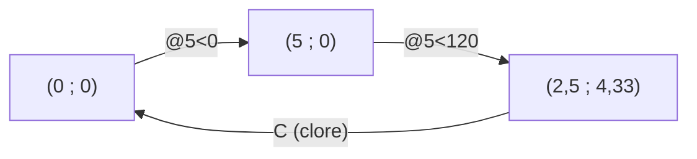
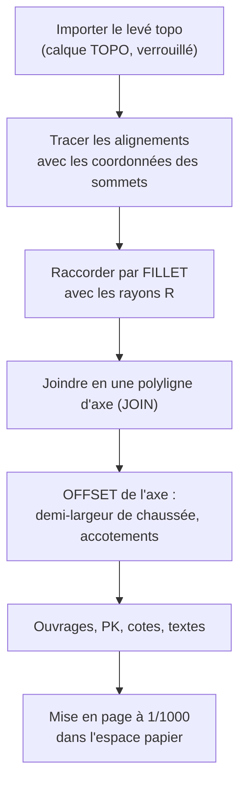

# Exercices corrigés de DAO

[← Retour au sommaire](README.md)

---

## Exercice 1. Formats et échelles

Un bâtiment mesure 15 m × 10 m en plan.

1. À quelle taille est-il dessiné à 1/100, à 1/50, à 1/20 ?
2. Quel est le plus petit format A sur lequel il tient à 1/50, avec un cadre de 10 mm (20 mm à gauche) et un cartouche de 60 mm de haut en bas ?

### Correction

1. Taille sur le papier = taille réelle × échelle :

| Échelle | 15 m | 10 m |
| --- | --- | --- |
| 1/100 | 15 cm | 10 cm |
| 1/50 | 30 cm | 20 cm |
| 1/20 | 75 cm | 50 cm |

2. Il faut une zone utile d'au moins 300 × 200 mm (plus de la place pour les cotes, environ 20 mm de chaque côté, soit 340 × 240 mm).
   - A4 paysage (297 × 210) : trop petit.
   - A3 paysage (420 × 297) : largeur utile 420 − 20 − 10 = 390 mm (suffit) ; hauteur utile 297 − 20 − 60 = 217 mm (insuffisant pour 240 mm).
   - A2 paysage (594 × 420) : 564 × 340 mm, ça tient largement.

   Réponse : **A2**. L'A3 ne passerait qu'en réduisant le cartouche ou en le plaçant à côté du dessin.

---

## Exercice 2. Lire une échelle

Sur un plan au 1/200, une route mesure 7,5 cm de large. Sur un autre plan, 4 m réels mesurent 8 cm. Calculer la largeur réelle de la route et l'échelle du second plan.

### Correction

- 7,5 cm × 200 = 1 500 cm = **15 m**.
- Échelle = 8 cm / 400 cm = 1/50.

---

## Exercice 3. Coordonnées

Tracer avec `LINE`, en partant du point (0,0) :

1. un rectangle de 6 × 4 en coordonnées relatives ;
2. un triangle équilatéral de côté 5 en coordonnées polaires ;
3. donner les coordonnées absolues du sommet du triangle.

### Correction

1. `L` → `0,0` → `@6,0` → `@0,4` → `@-6,0` → `C`. (Ou plus simple : `REC` → `0,0` → `@6,4`.)
2. `L` → `0,0` → `@5<0` → `@5<120` → `C`. Les angles extérieurs d'un triangle équilatéral valent 120° : on tourne de 120° à chaque côté.
3. Le sommet est à (5 + 5 cos 120° ; 5 sin 120°) = (5 − 2,5 ; 4,33) = **(2,5 ; 4,33)**.

---

## Exercice 4. Choisir la bonne commande

Quelle commande pour chaque besoin ?

| Besoin | Commande |
| --- | --- |
| Dessiner la deuxième face d'un mur de 20 cm | ? |
| Couper les morceaux de lignes qui dépassent à un croisement de murs | ? |
| Placer 12 poteaux identiques tous les 5 m | ? |
| Dessiner la moitié d'un bâtiment symétrique puis compléter | ? |
| Arrondir l'angle d'une bordure de trottoir avec R = 6 m | ? |
| Allonger un bâtiment de 2 m sans redessiner | ? |
| Placer 30 fois la même fenêtre | ? |

### Correction

| Besoin | Commande |
| --- | --- |
| Deuxième face d'un mur | `OFFSET` (O) de 0,20 |
| Couper ce qui dépasse | `TRIM` (TR) |
| 12 poteaux tous les 5 m | `ARRAY` (AR) rectangulaire, ou `COPY` avec option Réseau |
| Bâtiment symétrique | `MIRROR` (MI) |
| Arrondi de bordure R = 6 m | `FILLET` (F), rayon 6 |
| Allonger de 2 m | `STRETCH` (S) avec fenêtre capturante |
| 30 fenêtres | Créer un `BLOCK` puis `INSERT`, ou copier le bloc |

---

## Exercice 5. Organiser un plan de route

On dessine le plan d'un tronçon de route (voir le cours de [Routes](../01-routes/cours.md)). Proposer les calques, puis l'ordre de travail.

### Correction

| Calque | Contenu | Type de ligne |
| --- | --- | --- |
| AXE | Axe de la route, sommets, points de tangence | Mixte |
| CHAUSSEE | Bords de chaussée | Continu fort |
| ACCOTEMENTS | Accotements, fossés | Continu fin |
| OUVRAGES | Dalots, buses | Continu |
| TOPO | Levé du terrain, courbes de niveau | Continu fin, gris |
| PK | Points kilométriques, textes | Continu fin |
| COTES | Rayons, longueurs | Continu fin |

Remarque : `FILLET` avec un rayon donne exactement le raccordement circulaire du cours de Routes ; AutoCAD calcule les points de tangence. Les logiciels routiers (Covadis, Civil 3D) automatisent ensuite profils et cubatures.

---

## Exercice 6. Types de traits

Pour chacun des éléments d'un plan de bâtiment, donner le type de trait.

1. Murs coupés dans un plan d'étage.
2. Axes des poteaux.
3. Semelle de fondation (sous le plancher, donc cachée).
4. Lignes de cote.
5. Trace du plan de coupe A-A.

### Correction

1. Continu **fort**.
2. **Mixte fin** (trait-point).
3. **Interrompu fin**.
4. Continu **fin**.
5. **Mixte fin, fort aux extrémités**, avec flèches et lettres A.
