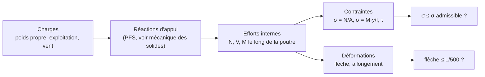

# RDM et théorie des structures

Matière du programme de 1re année de l'ENIT, absente des cours du dossier. Tout le contenu est **[Complément]**, construit sur le programme usuel (résistance des matériaux, poutres isostatiques). À compléter avec le polycopié de l'enseignant dès qu'il est disponible.

## Fichiers

| Fichier | Contenu |
| --- | --- |
| [cours.md](cours.md) | Hypothèses, efforts internes, diagrammes, traction, flexion, cisaillement, flèches, flambement, treillis |
| [exercices-corriges.md](exercices-corriges.md) | Exercices types avec correction |

## Vue d'ensemble

La RDM répond à deux questions : la structure **résiste-t-elle** (contraintes) et **se déforme-t-elle trop** (flèches) ?

Prérequis : la statique de [04-mecanique-des-solides](../04-mecanique-des-solides/cours.md).
