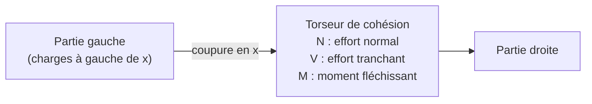
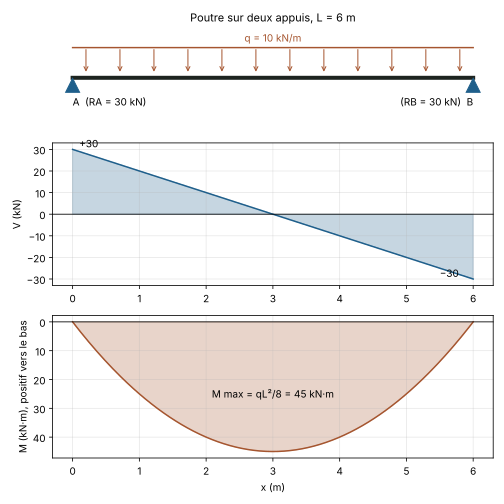
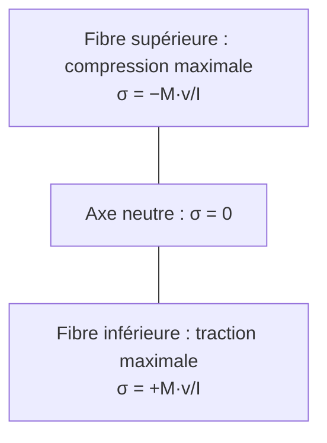
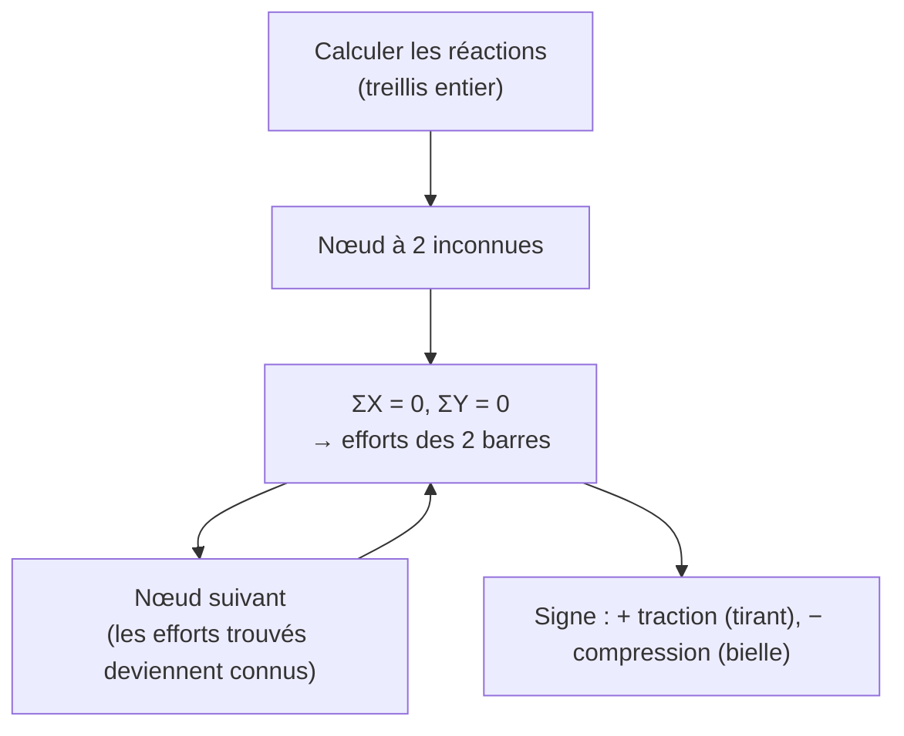

# Cours de RDM

[← Retour au sommaire](README.md)

**[Complément]** : tout ce cours est construit sur le programme usuel de 1re année (ENIT). Unités : forces en kN, longueurs en m, contraintes en MPa (1 MPa = 1 N/mm²).

## Sommaire

1. [Hypothèses et modélisation](#1-hypothèses-et-modélisation)
2. [Efforts internes](#2-efforts-internes-n-v-m)
3. [Diagrammes des efforts](#3-diagrammes-des-efforts)
4. [Caractéristiques des sections](#4-caractéristiques-géométriques-des-sections)
5. [Traction et compression](#5-traction-et-compression)
6. [Flexion](#6-flexion-simple)
7. [Cisaillement](#7-cisaillement)
8. [Déformée et flèche](#8-déformée-et-flèche)
9. [Flambement](#9-flambement)
10. [Treillis](#10-treillis)

---

## 1. Hypothèses et modélisation

| Hypothèse | Signification |
| --- | --- |
| Matériau **homogène et isotrope** | Mêmes propriétés partout et dans toutes les directions |
| **Élasticité linéaire** (loi de Hooke) | σ = E ε : la déformation est proportionnelle à la contrainte et disparaît au déchargement |
| **Petites déformations** | On écrit l'équilibre sur la géométrie non déformée |
| **Navier-Bernoulli** | Une section plane et perpendiculaire à la fibre moyenne le reste après déformation |
| **Saint-Venant** | Loin des points d'application, l'effet d'une charge ne dépend que de son torseur |

**Modèle poutre** : une pièce longue par rapport à sa section est représentée par sa **fibre moyenne** (ligne des centres de gravité des sections).

**Charges** : concentrée P (kN), répartie q (kN/m), couple C (kN·m).

**Appuis** (plan) :

| Appui | Réactions | Symbole usuel |
| --- | --- | --- |
| Appui simple | 1 (perpendiculaire) | Triangle sur rouleaux |
| Articulation | 2 (H, V) | Triangle |
| Encastrement | 3 (H, V, M) | Hachures |

**Degré d'hyperstaticité** : h = nombre de réactions − 3 (pour une poutre seule). h = 0 : isostatique ; h > 0 : hyperstatique ; h < 0 : mécanisme (instable).

---

## 2. Efforts internes N, V, M

On coupe la poutre en une section d'abscisse x. Pour que la partie gauche reste en équilibre, la partie droite exerce sur elle un torseur : le **torseur de cohésion**.

| Effort | Direction | Sollicitation |
| --- | --- | --- |
| **N** (effort normal) | Le long de la fibre | Traction (N > 0) ou compression (N < 0) |
| **V** (ou T, effort tranchant) | Perpendiculaire à la fibre | Cisaillement |
| **M** (moment fléchissant) | Rotation dans le plan | Flexion |

Méthode : N, V et M en x = somme des actions **à gauche** de la coupure (avec la convention de signe choisie, et en restant cohérent).

**Relations différentielles** (charge répartie q vers le bas) :

$$\frac{dV}{dx} = -q \qquad \frac{dM}{dx} = V$$

Conséquences pratiques :

- M est **maximal là où V s'annule** ;
- sous charge répartie, V est linéaire et M parabolique ;
- sans charge répartie, V est constant et M linéaire ;
- une charge concentrée fait un **saut** dans V et un **angle** dans M.

---

## 3. Diagrammes des efforts

### 3.1 Poutre sur deux appuis, charge uniforme q

Réactions : $R_A = R_B = \dfrac{qL}{2}$.

$$V(x) = \frac{qL}{2} - qx \qquad M(x) = \frac{qL}{2}x - \frac{qx^2}{2}$$

$$M_{max} = \frac{qL^2}{8}\ \text{(à mi-portée)} \qquad V_{max} = \frac{qL}{2}\ \text{(aux appuis)}$$

### 3.2 Cas usuels à connaître

| Poutre et charge | Réactions | M max | Flèche max |
| --- | --- | --- | --- |
| Deux appuis, q uniforme | qL/2 | $qL^2/8$ (milieu) | $\dfrac{5qL^4}{384EI}$ |
| Deux appuis, P au milieu | P/2 | $PL/4$ | $\dfrac{PL^3}{48EI}$ |
| Deux appuis, P à a de A (b = L − a) | Pb/L et Pa/L | $Pab/L$ | — |
| Console, P à l'extrémité | P, M = PL | $PL$ (encastrement) | $\dfrac{PL^3}{3EI}$ |
| Console, q uniforme | qL, M = qL²/2 | $qL^2/2$ (encastrement) | $\dfrac{qL^4}{8EI}$ |

---

## 4. Caractéristiques géométriques des sections

| Grandeur | Définition | Unité |
| --- | --- | --- |
| Aire | $A = \int dA$ | m², mm² |
| Moment statique | $S = \int y\,dA$ | m³ |
| **Moment quadratique** | $I = \int y^2\,dA$ | m⁴, cm⁴ |
| Module de flexion | $W = I / v$, v = distance de la fibre la plus éloignée | m³ |

| Section | Aire | I (axe horizontal passant par G) |
| --- | --- | --- |
| Rectangle b × h | bh | $\dfrac{bh^3}{12}$ |
| Cercle plein de diamètre D | πD²/4 | $\dfrac{\pi D^4}{64}$ |
| Tube D extérieur, d intérieur | π(D² − d²)/4 | $\dfrac{\pi(D^4 - d^4)}{64}$ |

**Huygens** : $I_\Delta = I_G + A\,d^2$. Sert pour les sections composées (T, I) : on découpe en rectangles et on additionne.

Pourquoi les poutres sont « debout » : un rectangle 20 × 40 cm a I = 0,2 × 0,4³ / 12 = 1,07 × 10⁻³ m⁴ quand h = 40 cm est vertical, mais seulement 0,27 × 10⁻³ m⁴ couché. Quatre fois moins rigide.

---

## 5. Traction et compression

$$\sigma = \frac{N}{A} \qquad \varepsilon = \frac{\Delta L}{L} \qquad \sigma = E\,\varepsilon \qquad \Delta L = \frac{N L}{E A}$$

| Matériau | E (GPa) | Résistance indicative |
| --- | --- | --- |
| Acier | 210 | fe = 235 à 500 MPa (limite élastique) |
| Béton | 30 environ | fc28 = 25 à 30 MPa en compression, faible en traction |
| Bois | 10 à 12 | 20 à 40 MPa |
| Aluminium | 70 | 100 à 300 MPa |

Condition de résistance : $\sigma \le \sigma_{adm} = \dfrac{f}{s}$ (s = coefficient de sécurité).

---

## 6. Flexion simple

Sous un moment M, la poutre se courbe : les fibres d'un côté s'allongent (traction), de l'autre se raccourcissent (compression). L'**axe neutre** (passant par G) ne change pas de longueur.

$$\sigma(y) = \frac{M\,y}{I} \qquad \sigma_{max} = \frac{M\,v}{I} = \frac{M}{W}$$

C'est pour cela que le béton armé met les **aciers en bas** (zone tendue) dans une poutre sur deux appuis, et **en haut** au droit des appuis d'une poutre continue ou dans une console.

---

## 7. Cisaillement

L'effort tranchant V crée des contraintes de cisaillement τ.

- Valeur moyenne : $\tau_{moy} = V / A$.
- Section rectangulaire : répartition parabolique, maximale sur l'axe neutre : $\tau_{max} = \dfrac{3}{2}\dfrac{V}{A}$.
- Formule générale (Jourawski) : $\tau = \dfrac{V\,S}{I\,b}$.

En béton armé, le cisaillement est repris par les **étriers** (cadres), plus serrés près des appuis où V est maximal.

---

## 8. Déformée et flèche

Équation de la déformée (y = déplacement vertical) :

$$E I\,y''(x) = M(x)$$

On intègre deux fois et on fixe les constantes avec les conditions aux appuis (y = 0 sur un appui ; y = 0 et y′ = 0 à un encastrement).

Limites usuelles de flèche : **L/500** pour les planchers portant des cloisons fragiles, L/300 à L/250 dans les autres cas.

---

## 9. Flambement

Une pièce comprimée et élancée peut se dérober latéralement bien avant d'atteindre sa résistance en compression. **Charge critique d'Euler** :

$$N_{cr} = \frac{\pi^2 E I}{L_f^2}$$

| Conditions aux extrémités | Longueur de flambement L_f |
| --- | --- |
| Articulé – articulé | L |
| Encastré – libre (mât) | 2L |
| Encastré – articulé | 0,7 L |
| Encastré – encastré | 0,5 L |

**Élancement** : $\lambda = L_f / i$ avec $i = \sqrt{I/A}$ (rayon de giration). Plus λ est grand, plus le risque de flambement est grand. On prend le I le plus **faible** de la section.

---

## 10. Treillis

Un **treillis** est un assemblage de barres articulées à leurs extrémités (nœuds), chargé seulement aux nœuds. Chaque barre ne porte qu'un **effort normal** (traction ou compression) : c'est un solide soumis à 2 forces.

**Isostaticité** d'un treillis plan : b + r = 2n (b barres, r réactions, n nœuds).

**Méthode des nœuds** : on isole chaque nœud et on écrit $\sum X = 0$, $\sum Y = 0$. On commence par un nœud qui n'a que 2 inconnues.

**Méthode des sections (Ritter)** : on coupe le treillis par au plus 3 barres inconnues et on écrit l'équilibre d'une moitié ; un moment pris à l'intersection de deux barres donne directement la troisième.

