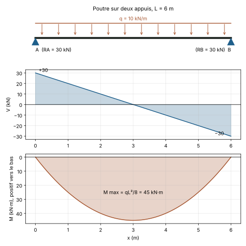
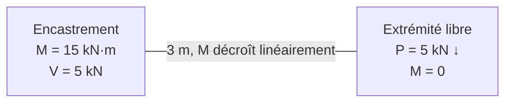

# Exercices corrigés de RDM

[← Retour au sommaire](README.md)

Exercices types de 1re année. Calculs vérifiés numériquement.

---

## Exercice 1. Barre en traction

Une barre d'acier de diamètre 20 mm et de longueur 2 m supporte un effort de traction de 50 kN. E = 210 GPa, fe = 235 MPa.

1. Contrainte et allongement.
2. La barre résiste-t-elle avec un coefficient de sécurité de 1,5 ?

### Correction

1. $A = \pi \times 10^2 = 314{,}2\ \text{mm}^2$.

$$\sigma = \frac{50\,000}{314{,}2} = 159{,}2\ \text{MPa} \qquad \Delta L = \frac{\sigma L}{E} = \frac{159{,}2\times2000}{210\,000} = 1{,}52\ \text{mm}$$

2. σadm = 235 / 1,5 = 156,7 MPa < 159,2 MPa : **non**, de justesse. Il faut un diamètre un peu plus grand : A ≥ 50 000 / 156,7 = 319 mm², soit D ≥ 20,2 mm. On prend **D = 22 mm**.

---

## Exercice 2. Poutre en béton sur deux appuis

Poutre de portée 6 m, section 20 × 40 cm (h = 40 cm vertical), charge uniforme q = 10 kN/m. E = 30 GPa.

1. Réactions, V max, M max ; tracer les diagrammes.
2. Contrainte normale maximale.
3. Contrainte de cisaillement maximale.
4. Flèche à mi-portée ; comparer à L/500.

### Correction

1. RA = RB = qL/2 = **30 kN** = V max ; M max = qL²/8 = 10 × 36 / 8 = **45 kN·m** à mi-portée.

2. $I = \dfrac{bh^3}{12} = \dfrac{0{,}2\times0{,}4^3}{12} = 1{,}067\times10^{-3}\ \text{m}^4$, v = 0,20 m.

$$\sigma_{max} = \frac{M\,v}{I} = \frac{45\times10^3\times0{,}2}{1{,}067\times10^{-3}} = 8{,}44\ \text{MPa}$$

   Compression en haut, traction en bas. 8,44 MPa en traction est bien au-delà de ce que le béton supporte (≈ 2 à 3 MPa) : d'où les **armatures** en bas.

3. $\tau_{max} = \dfrac{3}{2}\dfrac{V}{A} = 1{,}5\times\dfrac{30\times10^3}{0{,}08} = 0{,}56\ \text{MPa}$.

4. $f = \dfrac{5qL^4}{384EI} = \dfrac{5\times10\,000\times6^4}{384\times30\times10^9\times1{,}067\times10^{-3}} = 5{,}27\ \text{mm}$.

   L/500 = 12 mm > 5,27 mm : **vérifié**.

---

## Exercice 3. Console

Une console (balcon) de 3 m, encastrée à gauche, porte une charge P = 5 kN à son extrémité. Même section que l'exercice 2.

### Correction

- Réactions à l'encastrement : V = 5 kN, M = P × L = **15 kN·m**.
- V est constant (5 kN) ; M varie linéairement de 15 kN·m à l'encastrement à 0 à l'extrémité.
- Flèche : $f = \dfrac{PL^3}{3EI} = \dfrac{5000\times27}{3\times30\times10^9\times1{,}067\times10^{-3}} = 1{,}41\ \text{mm}$.

Dans une console, la fibre **tendue est en haut** : les aciers principaux d'un balcon sont en partie supérieure. Erreur classique sur chantier.

---

## Exercice 4. Charge concentrée excentrée

Poutre sur deux appuis, L = 5 m, P = 20 kN à a = 2 m de A. Réactions et M max.

### Correction

- $\sum M_A = 0$ : RB × 5 = 20 × 2, **RB = 8 kN**.
- RA = 20 − 8 = **12 kN**.
- M max sous la charge : $M = \dfrac{Pab}{L} = \dfrac{20\times2\times3}{5} = 24\ \text{kN·m}$ (vérification : RA × a = 12 × 2 = 24 ✔).
- V vaut +12 kN de A à la charge, puis −8 kN jusqu'à B : il change de signe sous la charge, là où M est maximal.

---

## Exercice 5. Treillis simple

Deux barres identiques articulées en C supportent une charge verticale P = 20 kN. Chaque barre fait un angle α = 30° avec l'horizontale (appuis A et B au même niveau, symétriques). Effort dans chaque barre ?

### Correction

On isole le nœud C. Par symétrie, les deux barres portent le même effort N.

$\sum Y = 0$ : 2 N sin α = P, donc :

$$N = \frac{P}{2\sin\alpha} = \frac{20}{2\times0{,}5} = 20\ \text{kN}$$

Les barres sont **comprimées** (elles poussent le nœud vers le haut). Plus α est faible (barres presque horizontales), plus l'effort explose : à α = 10°, N = 57,6 kN.

---

## Exercice 6. Flambement d'un poteau

Poteau en béton 25 × 25 cm, hauteur 3 m, articulé aux deux extrémités, E = 30 GPa. Charge critique d'Euler ?

### Correction

$I = \dfrac{0{,}25^4}{12} = 3{,}26\times10^{-4}$ m⁴ ; L_f = L = 3 m.

$$N_{cr} = \frac{\pi^2 E I}{L_f^2} = \frac{9{,}87\times30\times10^9\times3{,}26\times10^{-4}}{9} = 10{,}7\ \text{MN}$$

Charge d'écrasement : 0,0625 m² × 25 MPa = 1,56 MN, bien plus faible : ce poteau court casse par compression avant de flamber. Si on l'encastrait en pied et le laissait libre en tête (L_f = 6 m), N_cr serait divisé par 4 (2,7 MN), toujours au-dessus. Le flambement devient critique pour les poteaux élancés et les profilés métalliques.
