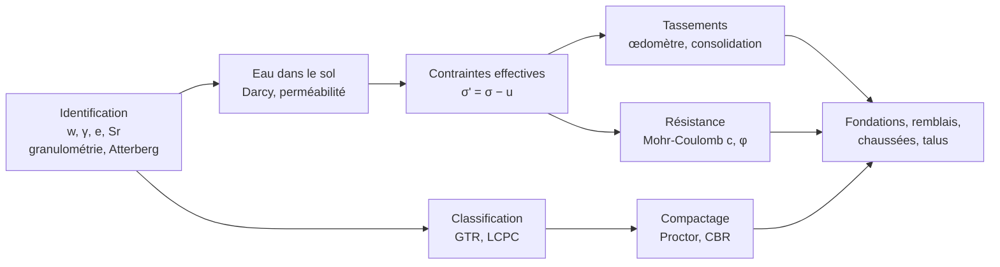

# Mécanique des sols

Matière du programme de 1re année de l'ENIT, absente des cours du dossier. Tout le contenu est **[Complément]**. À compléter avec le polycopié de l'enseignant.

## Fichiers

| Fichier | Contenu |
| --- | --- |
| [cours.md](cours.md) | Identification, classification, compactage, eau dans le sol, contraintes effectives, tassements, cisaillement |
| [exercices-corriges.md](exercices-corriges.md) | Exercices types avec correction |

## Vue d'ensemble

Le sol est un matériau à **trois phases** (grains, eau, air). Presque tout son comportement vient de l'eau.

Liens : la classe de sol S0 à S4 et l'indice CBR du cours de [Routes](../01-routes/cours.md) ; la nature des terrains en [Géologie](../12-geologie/README.md).
