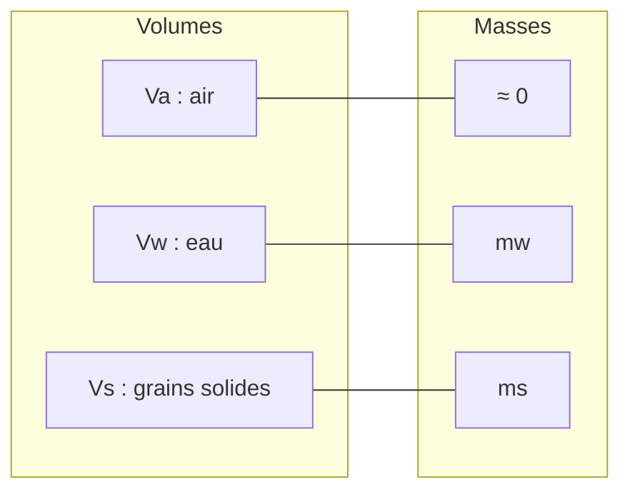
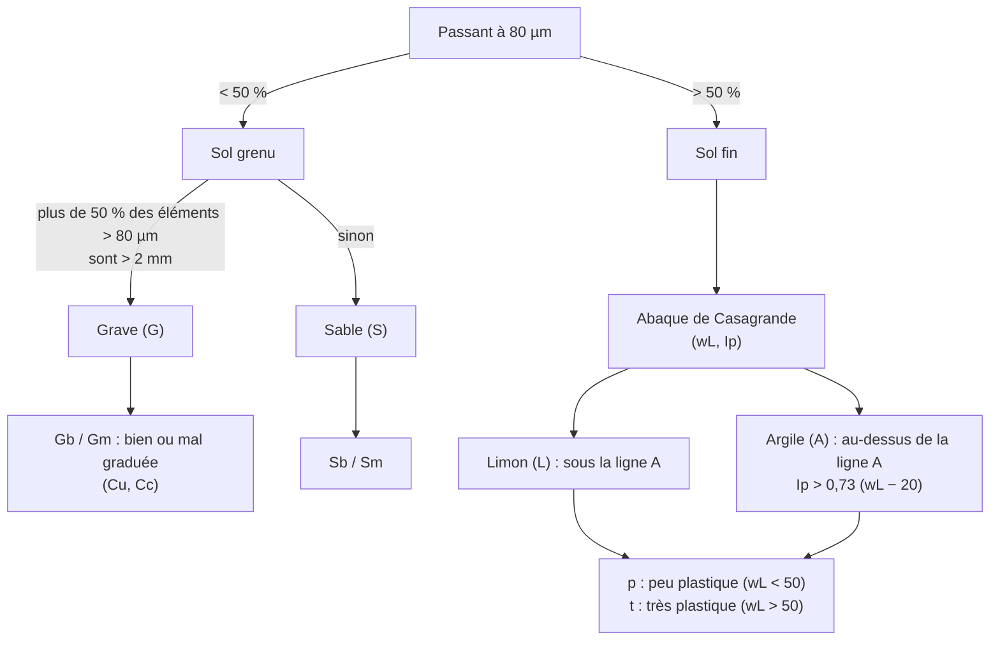
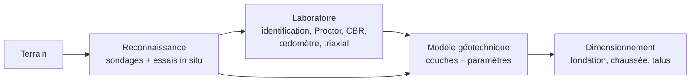

# Cours de mécanique des sols

[← Retour au sommaire](README.md)

**[Complément]** : cours construit sur le programme usuel. Unités : poids volumiques en kN/m³, contraintes en kPa (1 kPa = 1 kN/m²), γw = 10 kN/m³ (9,81 en toute rigueur).

## Sommaire

1. [Le sol, matériau à trois phases](#1-le-sol-matériau-à-trois-phases)
2. [Granulométrie](#2-granulométrie)
3. [Limites d'Atterberg](#3-limites-datterberg-et-plasticité)
4. [Classification](#4-classification)
5. [Compactage](#5-compactage-proctor-et-cbr)
6. [L'eau dans le sol](#6-leau-dans-le-sol-perméabilité)
7. [Contraintes effectives](#7-contraintes-dans-le-sol-et-contrainte-effective)
8. [Tassement et consolidation](#8-tassement-et-consolidation)
9. [Résistance au cisaillement](#9-résistance-au-cisaillement)
10. [Essais in situ](#10-reconnaissance-et-essais-in-situ)

---

## 1. Le sol, matériau à trois phases

Vides : Vv = Va + Vw. Volume total : V = Vs + Vv.

| Paramètre | Formule | Valeurs courantes |
| --- | --- | --- |
| Teneur en eau | $w = \dfrac{m_w}{m_s}$ | 5 à 40 % (jusqu'à > 100 % pour une vase) |
| Indice des vides | $e = \dfrac{V_v}{V_s}$ | 0,3 (dense) à 1,5 (argile molle) |
| Porosité | $n = \dfrac{V_v}{V}$ ; $n = \dfrac{e}{1+e}$ | 0,25 à 0,6 |
| Degré de saturation | $S_r = \dfrac{V_w}{V_v}$ | 0 (sec) à 1 (saturé) |
| Poids volumique humide | $\gamma = \dfrac{W}{V}$ | 17 à 21 kN/m³ |
| Poids volumique sec | $\gamma_d = \dfrac{W_s}{V} = \dfrac{\gamma}{1+w}$ | 14 à 19 kN/m³ |
| Poids volumique des grains | $\gamma_s = G_s\,\gamma_w$ | Gs ≈ 2,65 à 2,75 |
| Poids volumique déjaugé | $\gamma' = \gamma_{sat} - \gamma_w$ | ≈ 10 kN/m³ |

**Relations à connaître** :

$$\gamma_d = \frac{\gamma_s}{1+e} \qquad S_r\,e = w\,G_s \qquad \gamma_{sat} = \frac{\gamma_s + e\,\gamma_w}{1+e}$$

La relation $S_r e = w G_s$ est la plus utile : elle relie les quatre grandeurs.

---

## 2. Granulométrie

On mesure la répartition des tailles de grains :

- par **tamisage** pour les grains > 80 µm (0,08 mm) ;
- par **sédimentométrie** pour les fines < 80 µm.

| Famille | Taille |
| --- | --- |
| Blocs, cailloux | > 20 mm |
| Graviers | 2 à 20 mm |
| Sables | 0,08 à 2 mm |
| Limons | 2 µm à 80 µm |
| Argiles | < 2 µm |

On trace la **courbe granulométrique** (pourcentage de passant en fonction du diamètre, échelle logarithmique) et on lit D10, D30, D60 (diamètres pour lesquels 10, 30, 60 % du poids passe).

$$C_u = \frac{D_{60}}{D_{10}} \quad\text{(uniformité)} \qquad C_c = \frac{D_{30}^2}{D_{10}\,D_{60}} \quad\text{(courbure)}$$

Un sol est **bien gradué** (bon pour le compactage) si Cc est entre 1 et 3 et Cu > 4 (graves) ou Cu > 6 (sables). Sinon il est mal gradué (granulométrie serrée ou discontinue).

---

## 3. Limites d'Atterberg et plasticité

Pour les sols fins, le comportement change avec la teneur en eau :

- **wL** : mesurée à la coupelle de Casagrande (rainure qui se referme en 25 coups) ou au cône.
- **wP** : teneur en eau où un rouleau de 3 mm se fissure.
- **Indice de plasticité** : $I_p = w_L - w_P$.
- **Indice de consistance** : $I_c = \dfrac{w_L - w}{I_p}$ (Ic > 1 : solide ; 0 < Ic < 1 : plastique ; Ic < 0 : liquide).

| Ip | Sol |
| --- | --- |
| < 12 | Peu plastique (limon) |
| 12 à 25 | Moyennement plastique |
| 25 à 40 | Plastique (argile) |
| > 40 | Très plastique (argile gonflante possible) |

Les argiles très plastiques **gonflent** quand elles s'humidifient et se **rétractent** en séchant : fissures des maisons et des chaussées dans le sud tunisien.

**VBS** (valeur au bleu de méthylène) : mesure l'activité de la fraction argileuse, utilisée par la classification GTR.

---

## 4. Classification

**Classification LCPC / USCS** (sols) : on sépare d'abord sols grenus et sols fins à 50 % de passant à 80 µm.

**Classification GTR** (Guide des Terrassements Routiers, utilisée en Tunisie pour les routes) : classes A (sols fins), B (sables et graves avec fines), C (sols avec gros éléments), D (sols insensibles à l'eau), R (roches), F (sols organiques, sous-produits), avec un état hydrique (th, h, m, s, ts). Elle dit si un sol peut être réutilisé en remblai ou en couche de forme.

---

## 5. Compactage (Proctor et CBR)

Compacter = réduire les vides en chassant l'air, pour augmenter la portance et réduire les tassements.

**Essai Proctor** : on compacte le sol dans un moule à plusieurs teneurs en eau et on trace γd en fonction de w. La courbe a un maximum :

- **wOPN** : teneur en eau optimale ;
- **γd max** : poids volumique sec maximal.

Trop sec, les grains frottent ; trop humide, l'eau occupe les vides et ne peut pas être chassée. Proctor **normal** (petite énergie) ou **modifié** (grande énergie, chaussées).

Sur chantier, on exige un taux de compactage : γd mesuré ≥ 95 % (remblai) à 98 % (couche de forme) de γd max OPM.

**Essai CBR** (California Bearing Ratio) : on enfonce un poinçon dans le sol compacté (souvent après 4 jours d'imbibition) et on compare à un matériau de référence. CBR = indice de portance en %. C'est l'indice I de la formule de dimensionnement des chaussées du cours de [Routes](../01-routes/cours.md).

---

## 6. L'eau dans le sol, perméabilité

**Charge hydraulique** : $h = z + \dfrac{u}{\gamma_w}$ (la vitesse est négligeable dans le sol).

**Loi de Darcy** :

$$v = k\,i \qquad Q = k\,i\,A \qquad i = \frac{\Delta h}{L}$$

k = **coefficient de perméabilité** (m/s), i = gradient hydraulique.

| Sol | k (m/s) |
| --- | --- |
| Gravier | 10⁻¹ à 10⁻³ |
| Sable | 10⁻³ à 10⁻⁵ |
| Limon | 10⁻⁵ à 10⁻⁸ |
| Argile | < 10⁻⁹ (quasi imperméable) |

Mesure : perméamètre à charge constante (sols perméables) ou variable (sols peu perméables), essais Lefranc ou Lugeon en place.

**Gradient critique** : quand l'eau remonte, le sol peut perdre toute résistance (**boulance**, sables mouvants) si $i \ge i_c = \gamma'/\gamma_w \approx 1$.

---

## 7. Contraintes dans le sol et contrainte effective

**Contrainte totale verticale** à la profondeur z :

$$\sigma_v = \sum \gamma_i\,h_i$$

(γ au-dessus de la nappe, γsat en dessous).

**Pression interstitielle** (eau immobile) : $u = \gamma_w\,z_w$, z_w = profondeur sous la nappe.

**Principe de Terzaghi** :

$$\sigma' = \sigma - u$$

C'est la **contrainte effective** σ′, portée par le squelette de grains, qui gouverne les tassements et la résistance. L'eau, elle, ne résiste pas au cisaillement.

Conséquence : une montée de la nappe diminue σ′ et donc la résistance du sol (glissements de talus après la pluie).

**Contraintes dues à une charge en surface** (Boussinesq) : elles diminuent avec la profondeur. Approximation **2 pour 1** : une semelle B × L chargée de q donne à la profondeur z :

$$\Delta\sigma = \frac{q\,B\,L}{(B+z)(L+z)}$$

---

## 8. Tassement et consolidation

Sous une charge, un sol saturé tasse parce que l'eau est expulsée des vides. Dans une argile peu perméable, cela prend des mois ou des années : c'est la **consolidation**.

**Essai œdométrique** : échantillon confiné latéralement, chargé par paliers ; on trace e en fonction de log σ′.

- **Cc** : indice de compression (pente de la partie vierge) ;
- **Cs** : indice de gonflement (déchargement) ;
- **σ′p** : contrainte de préconsolidation (la plus forte jamais subie).

Sol **normalement consolidé** (σ′0 = σ′p) :

$$s = \frac{H\,C_c}{1+e_0}\log\frac{\sigma'_0 + \Delta\sigma}{\sigma'_0}$$

Sol **surconsolidé** chargé sous σ′p : on remplace Cc par Cs (tassements beaucoup plus faibles).

**Vitesse de consolidation** (Terzaghi) : $t = \dfrac{T_v\,H_d^2}{c_v}$, H_d = longueur de drainage (moitié de la couche si drainée des deux côtés). Le temps est proportionnel au **carré** de l'épaisseur : une couche deux fois plus épaisse met quatre fois plus de temps.

---

## 9. Résistance au cisaillement

**Critère de Mohr-Coulomb** :

$$\tau_f = c' + \sigma'\tan\varphi'$$

- c′ : cohésion (kPa), nulle pour un sable propre ;
- φ′ : angle de frottement interne (25° à 40° pour les sables, 15° à 30° pour les argiles).

**Essais** :

| Essai | Principe |
| --- | --- |
| Cisaillement direct (boîte de Casagrande) | On cisaille l'échantillon le long d'un plan imposé, sous plusieurs σ |
| Triaxial | Échantillon cylindrique sous pression de confinement σ3, on augmente σ1 jusqu'à la rupture ; on trace les cercles de Mohr |
| Scissomètre | Moulinet tourné dans une argile molle (en place) |

Conditions **drainées** (long terme, c′ et φ′) ou **non drainées** (court terme dans une argile saturée, cu et φu = 0).

**Applications** : capacité portante des fondations, stabilité des talus, poussée des terres sur les murs de soutènement (coefficients $K_a = \tan^2(45° - \varphi/2)$ et $K_p = \tan^2(45° + \varphi/2)$).

---

## 10. Reconnaissance et essais in situ

| Essai | Ce qu'il donne |
| --- | --- |
| Sondages, puits, tranchées | Coupe des couches, échantillons pour le labo |
| Pénétromètre dynamique | Résistance de pointe qd, compacité |
| Pénétromètre statique (CPT) | Résistance de pointe qc et frottement latéral |
| SPT | Nombre de coups N pour 30 cm |
| Pressiomètre Ménard | Module EM et pression limite pl (dimensionnement des fondations en France et en Tunisie) |
| Essai à la plaque | Module EV2 de la plateforme (routes) |

