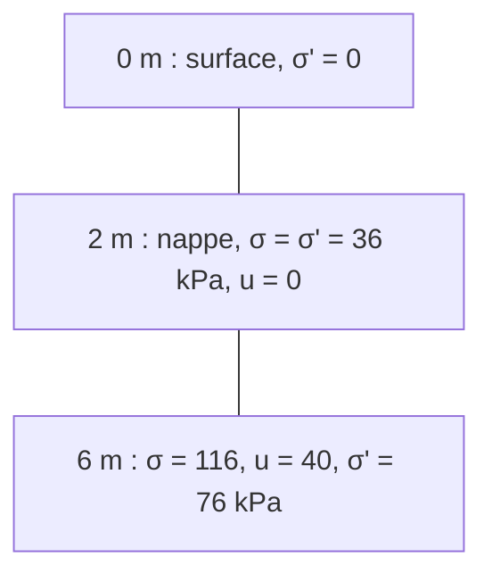

# Exercices corrigés de mécanique des sols

[← Retour au sommaire](README.md)

Exercices types. Calculs vérifiés numériquement. γw = 10 kN/m³.

---

## Exercice 1. Paramètres d'état

Un échantillon de volume 110 cm³ pèse 200 g humide et 170 g après étuvage. Gs = 2,70. Calculer w, γ, γd, e, n, Sr.

### Correction

- $w = \dfrac{200 - 170}{170} = 17{,}6\ \%$
- $\rho = 200/110 = 1{,}82$ g/cm³, soit **γ = 18,2 kN/m³** ; $\rho_d = 170/110 = 1{,}545$ g/cm³, soit **γd = 15,5 kN/m³**
- $V_s = 170 / 2{,}70 = 62{,}96$ cm³ ; $V_v = 110 - 62{,}96 = 47{,}04$ cm³
- $e = 47{,}04 / 62{,}96 = 0{,}747$ ; $n = 47{,}04/110 = 0{,}428$
- $V_w = 30$ cm³ ; $S_r = 30 / 47{,}04 = 0{,}638$ = **64 %**

Vérification avec $S_r e = w G_s$ : 0,638 × 0,747 = 0,477 et 0,176 × 2,70 = 0,476. ✔

---

## Exercice 2. Granulométrie

Sur la courbe d'un sable : D10 = 0,1 mm, D30 = 0,4 mm, D60 = 1,2 mm. Le sable est-il bien gradué ?

### Correction

$$C_u = \frac{1{,}2}{0{,}1} = 12 \qquad C_c = \frac{0{,}4^2}{0{,}1\times1{,}2} = 1{,}33$$

Cu > 6 et 1 < Cc < 3 : **sable bien gradué** (Sb). Il se compacte bien.

---

## Exercice 3. Limites d'Atterberg

Un sol fin a wL = 45 %, wP = 22 %, et une teneur en eau naturelle w = 30 %. Ip, Ic, classification ?

### Correction

- Ip = 45 − 22 = **23** : moyennement plastique.
- Ic = (45 − 30) / 23 = **0,65** : état plastique (ferme à mou).
- Ligne A : 0,73 (45 − 20) = 18,25 < 23 : au-dessus de la ligne A, donc **argile** ; wL < 50 : **peu plastique**. Classe **Ap**.

---

## Exercice 4. Contraintes effectives

Un sol a γ = 18 kN/m³ au-dessus de la nappe, située à 2 m de profondeur, et γsat = 20 kN/m³ en dessous. Calculer σv, u et σ′v à 6 m.

### Correction

- σv = 2 × 18 + 4 × 20 = **116 kPa**
- u = 4 × 10 = **40 kPa**
- σ′v = 116 − 40 = **76 kPa**

Autre méthode : σ′v = 2 × 18 + 4 × (20 − 10) = 36 + 40 = 76 kPa (poids déjaugé sous la nappe). ✔

Si la nappe remontait jusqu'à la surface : σ′v = 6 × 10 = 60 kPa, soit 21 % de moins.

---

## Exercice 5. Tassement œdométrique

Sous le point de l'exercice 4 (σ′0 = 76 kPa au milieu), une couche d'argile normalement consolidée de 4 m d'épaisseur a e0 = 0,9 et Cc = 0,3. Un remblai ajoute Δσ = 50 kPa. Tassement ?

### Correction

$$s = \frac{H\,C_c}{1+e_0}\log\frac{\sigma'_0 + \Delta\sigma}{\sigma'_0} = \frac{4\times0{,}3}{1{,}9}\log\frac{126}{76} = 0{,}632\times0{,}220 = 0{,}139\ \text{m}$$

Environ **14 cm**. Pour un remblai routier, on surveille ce tassement avant de construire la chaussée (sinon elle se déforme), ou on l'accélère par des drains verticaux.

---

## Exercice 6. Perméabilité

Un sable (k = 10⁻⁵ m/s) est traversé par un écoulement sous un gradient i = 0,2, sur une section de 10 m². Débit ?

### Correction

$$Q = k\,i\,A = 10^{-5}\times0{,}2\times10 = 2\times10^{-5}\ \text{m}^3/\text{s} = 1{,}73\ \text{m}^3/\text{jour}$$

---

## Exercice 7. Résistance au cisaillement

Un sol a c′ = 10 kPa et φ′ = 30°. Résistance au cisaillement sous σ′ = 100 kPa ? Coefficients de poussée et de butée ?

### Correction

$$\tau_f = 10 + 100\tan30° = 10 + 57{,}7 = 67{,}7\ \text{kPa}$$

$K_a = \tan^2(45° - 15°) = \tan^2 30° = 0{,}333$ ; $K_p = \tan^2 60° = 3{,}0$.

Un mur de soutènement subit une poussée trois fois plus faible que la contrainte verticale, alors que la butée devant un mur est trois fois plus forte.
