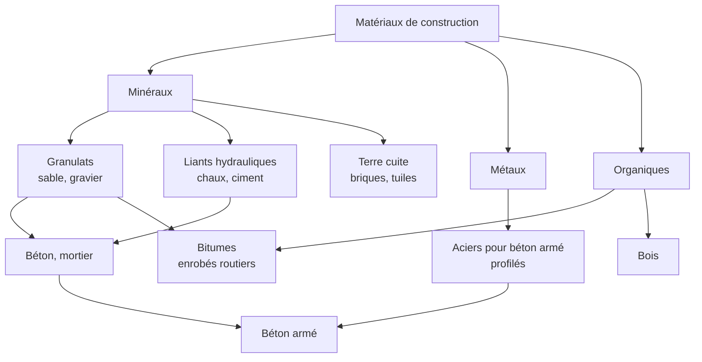

# Matériaux de construction

Matière du programme de 1re année de l'ENIT, absente des cours du dossier. Tout le contenu est **[Complément]**. À compléter avec le polycopié et les TP de l'enseignant.

## Fichiers

| Fichier | Contenu |
| --- | --- |
| [cours.md](cours.md) | Propriétés, granulats, liants, béton, mortiers, aciers, liants hydrocarbonés, autres matériaux |
| [exercices-corriges.md](exercices-corriges.md) | Exercices types avec correction |

## Vue d'ensemble

