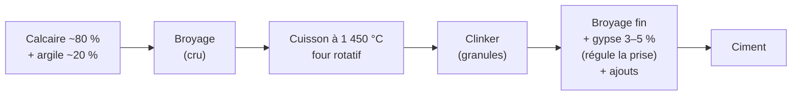
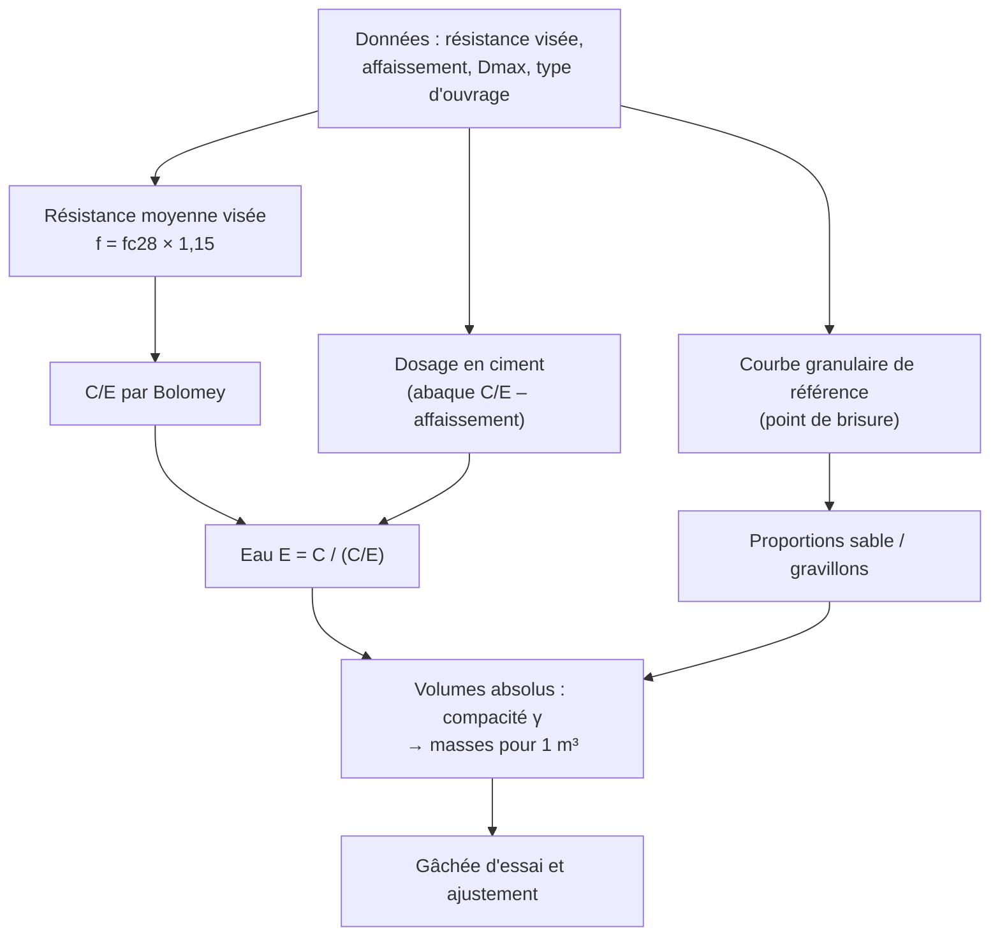
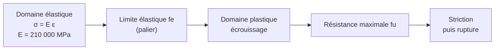

# Cours de matériaux de construction

[← Retour au sommaire](README.md)

**[Complément]** : cours construit sur le programme usuel de 1re année.

## Sommaire

1. [Propriétés générales](#1-propriétés-générales-des-matériaux)
2. [Granulats](#2-granulats)
3. [Liants hydrauliques](#3-liants-hydrauliques-chaux-et-ciment)
4. [Béton](#4-le-béton)
5. [Mortiers](#5-mortiers)
6. [Aciers](#6-aciers)
7. [Liants hydrocarbonés](#7-liants-hydrocarbonés-et-enrobés)
8. [Autres matériaux](#8-autres-matériaux)

---

## 1. Propriétés générales des matériaux

### 1.1 Propriétés physiques

| Propriété | Définition |
| --- | --- |
| Masse volumique **absolue** ρs | Masse / volume de la matière seule (sans vides) |
| Masse volumique **apparente** ρ | Masse / volume total (avec les vides) |
| Porosité | Volume des vides / volume total : $p = 1 - \rho/\rho_s$ |
| Compacité | $c = 1 - p = \rho/\rho_s$ |
| Absorption d'eau | Masse d'eau absorbée / masse sèche |
| Teneur en eau | Masse d'eau / masse sèche |

| Matériau | ρ (kg/m³) |
| --- | --- |
| Béton | 2 300 – 2 400 (béton armé : 2 500) |
| Acier | 7 850 |
| Granulats (absolue) | 2 600 – 2 700 |
| Sable (apparente, en vrac) | 1 400 – 1 700 |
| Ciment (absolue / en vrac) | 3 100 / 1 100 – 1 200 |
| Brique creuse | 700 – 900 |
| Bois | 450 – 900 |
| Eau | 1 000 |

### 1.2 Propriétés mécaniques

- **Résistance** en compression, traction, flexion (MPa).
- **Module d'élasticité E** (pente de la courbe contrainte-déformation).
- **Ductilité** (l'acier s'allonge beaucoup avant de rompre) ou **fragilité** (le béton, la brique et le verre cassent sans prévenir).

Le béton résiste environ **10 fois moins en traction** qu'en compression : c'est toute la raison d'être du béton armé.

### 1.3 Autres propriétés

Thermiques (conductivité λ, dilatation α ≈ 10⁻⁵ /°C pour le béton et l'acier : c'est pour cela qu'ils travaillent bien ensemble), acoustiques, durabilité (gel, sels, sulfates, corrosion), réaction au feu.

---

## 2. Granulats

Grains minéraux (sable, gravillons, graviers) qui forment le squelette du béton, des mortiers, des enrobés et des couches de chaussée.

**Origine** : roulés (alluvionnaires, oueds) ou concassés (carrières de calcaire en Tunisie).

**Désignation** : d/D, où d et D sont les tailles minimale et maximale en mm.

| Classe | Dimensions |
| --- | --- |
| Fillers | 0/D avec D < 2 mm et beaucoup de fines |
| Sables | 0/D, D ≤ 4 mm |
| Graves | 0/D, D > 4 mm |
| Gravillons | d ≥ 2 mm, D ≤ 63 mm |

**Essais principaux** :

| Essai | Mesure | Exigence courante |
| --- | --- | --- |
| Analyse granulométrique | Courbe granulométrique | Fuseau du projet |
| **Module de finesse** MF (sables) | Somme des refus cumulés (en %) sur les tamis 0,16 – 0,315 – 0,63 – 1,25 – 2,5 – 5 mm, divisée par 100 | 2,2 à 2,8 pour un bon sable à béton |
| **Équivalent de sable** ES | Propreté (proportion d'argile) | ES > 75 à 80 pour un béton |
| **Los Angeles** LA | Résistance à la fragmentation (chocs) | LA < 30 à 40 selon l'usage |
| **Micro-Deval** MDE | Résistance à l'usure | Couches de roulement |
| Coefficient d'aplatissement | Forme des grains | Éviter les grains plats |

Los Angeles : $LA = 100\,\dfrac{m}{M}$, avec M = masse initiale (5 000 g) et m = masse passant au tamis de 1,6 mm après rotation avec des boulets.

---

## 3. Liants hydrauliques (chaux et ciment)

Un **liant hydraulique** fait prise et durcit avec l'eau, même sous l'eau.

### 3.1 Chaux

- **Chaux aérienne** : calcaire cuit à 900 °C (CaCO₃ → CaO + CO₂), puis éteint (CaO + H₂O → Ca(OH)₂). Durcit à l'air en reprenant le CO₂.
- **Chaux hydraulique** : calcaire argileux, durcit aussi sous l'eau.
- En routes : la chaux sert à **traiter les sols argileux** humides (elle sèche le sol et diminue sa plasticité).

### 3.2 Ciment Portland

**Constituants du clinker** : C₃S (silicate tricalcique, résistance rapide), C₂S (résistance à long terme), C₃A (prise rapide, sensible aux sulfates), C₄AF.

**Hydratation** : ciment + eau → silicates de calcium hydratés (**C-S-H**, la « colle ») + portlandite Ca(OH)₂ + chaleur. La **prise** commence après 1 h 30 à 3 h ; le **durcissement** continue pendant des mois (on prend la référence à 28 jours).

**Types de ciments (NT 47.01 / EN 197-1)** :

| Type | Nom | Composition |
| --- | --- | --- |
| CEM I | Portland | ≥ 95 % clinker |
| CEM II | Portland composé | Clinker + calcaire, laitier, pouzzolane, cendres |
| CEM III | Haut fourneau | Beaucoup de laitier |
| CEM IV | Pouzzolanique | |
| CEM V | Composé | |

**Classes de résistance** : 32,5 – 42,5 – 52,5 MPa (résistance minimale à 28 jours sur mortier normalisé), suffixe N (normal) ou R (rapide). Exemple : **CEM II/A-L 32,5 N**. Il existe des ciments **HRS** (haute résistance aux sulfates) pour les sols et eaux agressifs (sebkhas, bord de mer).

---

## 4. Le béton

### 4.1 Composition

Béton = ciment + eau + granulats (sable + gravillons) + éventuellement adjuvants. Pour 1 m³ de béton courant :

| Constituant | Ordre de grandeur |
| --- | --- |
| Ciment | 300 à 400 kg |
| Eau | 160 à 200 L |
| Sable 0/4 | 600 à 800 kg |
| Gravillons 4/16 ou 4/25 | 1 000 à 1 200 kg |

### 4.2 Le rapport E/C

C'est le paramètre le plus important :

- **E/C faible** (0,4 – 0,5) : béton résistant et durable, mais peu maniable ;
- **E/C élevé** (> 0,6) : béton maniable, mais poreux, moins résistant, sensible au retrait. Ajouter de l'eau sur chantier pour « faciliter le coulage » est l'erreur classique.

**Formule de Bolomey** (résistance à 28 jours) :

$$f_{c28} = G\,\sigma'_c\left(\frac{C}{E} - 0{,}5\right)$$

G = coefficient granulaire (0,35 à 0,65 selon la qualité des granulats), σ′c = classe vraie du ciment.

### 4.3 Formulation (méthode de Dreux-Gorisse)

### 4.4 Béton frais

- **Ouvrabilité** : mesurée par l'**affaissement au cône d'Abrams** (*slump test*).

| Classe | Affaissement | Consistance |
| --- | --- | --- |
| S1 | 10 – 40 mm | Ferme |
| S2 | 50 – 90 mm | Plastique |
| S3 | 100 – 150 mm | Très plastique (courant) |
| S4 | 160 – 210 mm | Fluide |

- **Mise en place** : vibration (chasser l'air), éviter la ségrégation (hauteur de chute < 1,5 m).
- **Cure** : garder le béton humide au moins 7 jours (arrosage, bâche, produit de cure). Indispensable sous le climat chaud et sec de la Tunisie, sinon fissures de retrait.

### 4.5 Béton durci

- **Résistance caractéristique** fc28 (ou fck) sur éprouvettes cylindriques 16 × 32 cm à 28 jours. Classes : C20/25, C25/30, C30/37… (cylindre / cube).
- Évolution : environ 65 % de fc28 à 7 jours.
- Traction : $f_{t28} = 0{,}6 + 0{,}06\,f_{c28}$ (BAEL), environ 2,1 MPa pour 25 MPa.
- Module : E ≈ 30 000 MPa.
- **Retrait** (le béton se raccourcit en séchant) et **fluage** (il se déforme sous charge constante).

**Adjuvants** : plastifiants et superplastifiants (moins d'eau à maniabilité égale), accélérateurs, retardateurs (bétonnage par temps chaud), entraîneurs d'air, hydrofuges.

---

## 5. Mortiers

Mortier = ciment (ou chaux) + sable + eau, sans gravillons.

| Usage | Dosage en ciment (kg/m³ de sable) |
| --- | --- |
| Maçonnerie (hourdage) | 250 – 350 |
| Enduit | 300 – 450 selon la couche |
| Chape | 350 – 400 |

---

## 6. Aciers

### 6.1 Essai de traction

On mesure **fe** (limite élastique), **fu** (résistance à la rupture) et l'**allongement à la rupture** A % (ductilité).

### 6.2 Aciers pour béton armé

| Type | Désignation | fe |
| --- | --- | --- |
| Ronds lisses | FeE235 (RL) | 235 MPa |
| Haute adhérence | **FeE400**, **FeE500** (HA) | 400 / 500 MPa |
| Treillis soudés | TS | 500 MPa |

Diamètres courants HA : 6, 8, 10, 12, 14, 16, 20, 25, 32 mm. Section d'une barre : πΦ²/4 (HA12 : 1,13 cm²).

**Corrosion** : le béton protège l'acier (milieu basique, pH ≈ 13) tant que l'**enrobage** est suffisant (2,5 à 5 cm selon l'exposition). En bord de mer, les chlorures percent cette protection.

### 6.3 Aciers de construction métallique

Profilés IPE, HEA, HEB, cornières, tubes ; nuances S235, S275, S355 (le nombre est fe en MPa).

---

## 7. Liants hydrocarbonés et enrobés

- **Bitume** : résidu de la distillation du pétrole. Classé par sa **pénétrabilité** (enfoncement d'une aiguille en 1/10 mm à 25 °C) : 40/50 (dur, climat chaud, utilisé en Tunisie), 60/70, 80/100. Autre essai : **point de ramollissement bille-anneau** (TBA).
- **Émulsions** : bitume dispersé dans l'eau (enduits superficiels, couches d'accrochage et d'imprégnation).
- **Cut-backs** : bitume fluidifié par un solvant (imprégnation).
- **Enrobés** : granulats + 5 à 6 % de bitume, fabriqués à chaud (≈ 160 °C) en centrale. **BB** (béton bitumineux, couche de roulement), **GB** (grave-bitume, couche de base). Essais : Marshall, Duriez.

Lien avec la structure de chaussée du cours de [Routes](../01-routes/cours.md).

---

## 8. Autres matériaux

| Matériau | Points clés |
| --- | --- |
| **Briques** (terre cuite) | Argile cuite vers 900 – 1 000 °C ; briques creuses 8, 12 trous pour les cloisons et le remplissage des murs en Tunisie |
| **Blocs de béton** (parpaings) | Moulés et vibrés |
| **Plâtre** | Gypse cuit (CaSO₄·2H₂O → CaSO₄·½H₂O), prise rapide, intérieur seulement |
| **Bois** | Léger, bonne résistance à la traction le long des fibres, sensible à l'humidité, aux insectes et au feu |
| **Verre** | Fragile, transparent ; verre trempé ou feuilleté pour la sécurité |
| **Pierre** | Calcaires, grès, marbres ; murs, dallages, granulats |
| **Matériaux composites** | Fibres de carbone pour renforcer les structures existantes |
