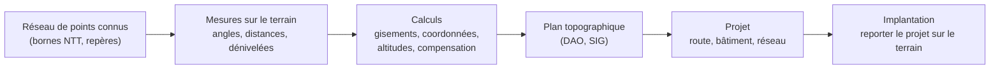

# Topographie

Matière du programme de 1re année de l'ENIT, absente des cours du dossier (le cours SIG et cartographie en donne les bases géodésiques). Tout le contenu est **[Complément]**. À compléter avec le polycopié et les TP de terrain.

## Fichiers

| Fichier | Contenu |
| --- | --- |
| [cours.md](cours.md) | Angles, distances, gisements, rayonnement, polygonation, nivellement, surfaces, implantation, GPS |
| [exercices-corriges.md](exercices-corriges.md) | Exercices types avec correction |

## Vue d'ensemble

Liens : systèmes de coordonnées en [SIG et cartographie](../03-sig-cartographie/cours.md) ; gisements et tracé en [Routes](../01-routes/exercices-corriges.md).
