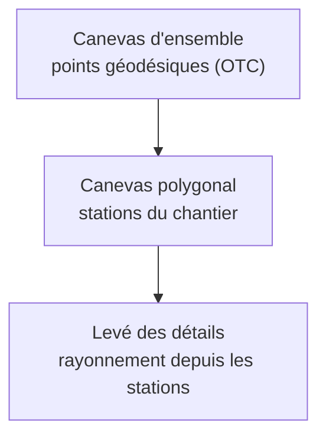
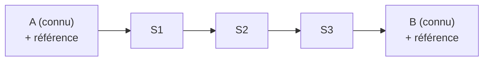
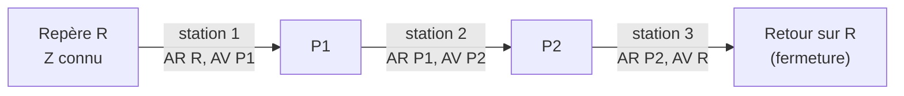
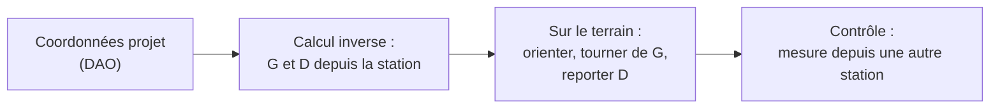

# Cours de topographie

[← Retour au sommaire](README.md)

**[Complément]** : cours construit sur le programme usuel. Angles en **grades** (400 gr = 360°), distances en mètres.

## Sommaire

1. [Généralités](#1-généralités)
2. [Mesure des angles](#2-mesure-des-angles)
3. [Mesure des distances](#3-mesure-des-distances)
4. [Gisements et coordonnées](#4-gisements-et-coordonnées)
5. [Polygonation](#5-polygonation-cheminement)
6. [Nivellement](#6-nivellement)
7. [Calcul de surfaces](#7-calcul-de-surfaces)
8. [Levé et implantation](#8-levé-de-détails-et-implantation)
9. [GPS en topographie](#9-gnss-gps-en-topographie)

---

## 1. Généralités

- **Planimétrie** : position en plan (X, Y) ; **altimétrie** : altitude Z.
- **Principe** : on va de l'ensemble au détail. On s'appuie sur un **canevas** de points connus, puis on lève les détails depuis ces points.
- **Erreurs** : fautes (grossières, à éliminer par contrôle), erreurs systématiques (étalonnage, à corriger), erreurs accidentelles (aléatoires, à répartir par **compensation**). On contrôle toujours par une **fermeture**.

---

## 2. Mesure des angles

**Instruments** : théodolite, et aujourd'hui **station totale** (théodolite + distancemètre électronique + carnet électronique).

| Angle | Mesure | Plage |
| --- | --- | --- |
| **Horizontal Hz** | Lecture sur le cercle horizontal ; un angle = différence de deux lectures | 0 à 400 gr |
| **Vertical (zénithal) V** | Depuis le zénith (V = 100 gr à l'horizontale) | 0 à 400 gr |

**Mise en station** : centrage (à la verticale du point, plomb optique ou laser) puis calage (nivelles).

**Double retournement** (cercle gauche CG et cercle droit CD) : on vise deux fois en retournant la lunette ; la moyenne élimine les erreurs de collimation. Contrôle : $V_{CG} + V_{CD} = 400$ gr.

**Tour d'horizon** : depuis une station, on vise successivement plusieurs points et on revient sur le premier (fermeture).

---

## 3. Mesure des distances

| Méthode | Précision | Usage |
| --- | --- | --- |
| Pas, odomètre | 1/100 | Reconnaissance |
| Ruban (décamètre) | 1/1 000 à 1/10 000 | Petites distances, bâtiment |
| Stadimétrie | 1/500 | Ancien |
| **Distancemètre électronique** (IMEL, station totale) | ± (2 mm + 2 ppm) | Courant |
| GPS | cm | Grandes distances |

**Distance inclinée et horizontale** : la station mesure la distance suivant la pente Di. Avec l'angle zénithal V :

$$D_h = D_i\sin V \qquad \Delta H = D_i\cos V$$

Toujours travailler avec des distances **horizontales** pour les calculs en plan.

---

## 4. Gisements et coordonnées

### 4.1 Gisement

Le **gisement** $G_{AB}$ est l'angle horizontal entre le **Nord du quadrillage** (axe Y) et la direction AB, mesuré dans le **sens des aiguilles d'une montre**, de 0 à 400 gr.

- $G_{BA} = G_{AB} \pm 200$ gr.
- Un **angle** au sommet se déduit des gisements : angle ABC = G_BC − G_BA (à 400 près).

### 4.2 Calcul inverse : gisement et distance entre deux points connus

$$D_{AB} = \sqrt{\Delta X^2 + \Delta Y^2} \qquad \tan G = \frac{\Delta X}{\Delta Y}$$

Attention au **quadrant** (la calculatrice ne le connaît pas). Avec g = arctan(|ΔX| / |ΔY|) :

| ΔX | ΔY | Quadrant | Gisement |
| --- | --- | --- | --- |
| + | + | Nord-Est | G = g |
| + | − | Sud-Est | G = 200 − g |
| − | − | Sud-Ouest | G = 200 + g |
| − | + | Nord-Ouest | G = 400 − g |

### 4.3 Calcul direct : rayonnement

Depuis un point connu S, on mesure le gisement G et la distance horizontale D vers un point P :

$$X_P = X_S + D\sin G \qquad Y_P = Y_S + D\cos G$$

En pratique, la station totale ne mesure pas directement G : on vise d'abord une **référence** connue (gisement calculé), ce qui oriente le cercle horizontal (**G0 de station**), puis G = G0 + lecture.

---

## 5. Polygonation (cheminement)

Une **polygonale** est une suite de stations reliées par des angles et des distances mesurés. Elle sert de canevas pour le chantier.

- **Fermée** : elle revient au point de départ (contrôle entre elle-même).
- **Encadrée** : entre deux points connus avec deux références (meilleur contrôle).
- **Ouverte** : sans contrôle, à éviter.

### 5.1 Fermeture angulaire

Polygone fermé à n sommets : somme théorique des angles **intérieurs** = (n − 2) × 200 gr.

$$f_\alpha = \sum\alpha_{mesurés} - (n-2)\times200$$

Si $f_\alpha$ est inférieure à la tolérance, on la répartit également : correction = $-f_\alpha / n$ par angle.

### 5.2 Transmission des gisements

$$G_{i,i+1} = G_{i-1,i} + \alpha_i \pm 200$$

(α angle mesuré à gauche dans le sens de parcours ; on retire ou ajoute 400 pour rester entre 0 et 400.)

### 5.3 Fermeture planimétrique

On calcule ΔX = D sin G et ΔY = D cos G pour chaque côté. Pour une polygonale fermée, ΣΔX et ΣΔY devraient être nuls :

$$f_X = \sum\Delta X \qquad f_Y = \sum\Delta Y \qquad f = \sqrt{f_X^2 + f_Y^2}$$

Compensation **proportionnelle aux longueurs** : correction sur ΔX d'un côté = $-f_X \times D_i / \sum D$ (idem pour Y).

---

## 6. Nivellement

### 6.1 Nivellement direct (géométrique)

Un **niveau** donne une visée horizontale. On lit une **mire** posée en arrière (AR, point connu) puis en avant (AV, point à déterminer) :

$$\Delta H = L_{AR} - L_{AV} \qquad Z_{AV} = Z_{AR} + \Delta H$$

Moyen mnémotechnique : si la lecture avant est plus petite, le point avant est plus haut.

**Cheminement** : on enchaîne les stations ; chaque point de changement est lu en AV puis en AR depuis la station suivante.

$$\Delta H_{total} = \sum L_{AR} - \sum L_{AV}$$

**Fermeture** : sur un cheminement fermé, la somme des dénivelées devrait être nulle. L'écart $f_h$ est réparti également entre les stations (ou proportionnellement aux distances) s'il est inférieur à la tolérance (de l'ordre de quelques mm × √(nombre de stations) ou de 1 à 2 cm × √(L en km)).

Bonne pratique : **portées égales** AR et AV (le niveau à mi-distance), ce qui annule l'erreur de collimation et l'effet de la courbure.

### 6.2 Nivellement indirect (trigonométrique)

Avec une station totale (hauteur d'instrument hi) visant un prisme (hauteur hv), angle zénithal V et distance horizontale Dh :

$$\Delta H = \frac{D_h}{\tan V} + h_i - h_v$$

Plus rapide sur un terrain accidenté, moins précis que le nivellement direct.

### 6.3 Profils et courbes de niveau

- **Profil en long** : altitudes le long de l'axe (routes, canalisations).
- **Profils en travers** : perpendiculaires à l'axe, pour les cubatures.
- **Courbes de niveau** : lignes d'égale altitude, obtenues par interpolation entre points levés (ou automatiquement par un MNT). Équidistance : 0,5 à 1 m pour un plan de projet, 10 m sur une carte au 1/50 000.

---

## 7. Calcul de surfaces

**Formule de Gauss** (méthode des coordonnées), pour un polygone de sommets numérotés dans l'ordre :

$$S = \frac{1}{2}\left|\sum_{i=1}^{n}\left(X_i\,Y_{i+1} - X_{i+1}\,Y_i\right)\right|$$

(avec le point n + 1 = point 1). C'est ce que calcule un logiciel de DAO ou un SIG.

Autres méthodes : décomposition en triangles (formule de Héron), planimètre sur un plan papier.

---

## 8. Levé de détails et implantation

**Levé** : depuis chaque station, on lève par rayonnement tous les détails (bâtiments, bords de route, réseaux, points du terrain naturel) avec un code. Le croquis de terrain est indispensable.

**Implantation** : l'inverse du levé. On calcule, à partir des coordonnées du projet, le gisement et la distance depuis une station connue, puis on matérialise le point sur le terrain (piquet, clou).

Pour les routes : implantation de l'axe (sommets, points de tangence, points de l'arc), puis des profils en travers (piquets de bord de terrassement).

---

## 9. GNSS (GPS) en topographie

- **Positionnement absolu** (un récepteur) : précision de quelques mètres.
- **Différentiel / RTK** (*Real Time Kinematic*) : une base sur un point connu envoie des corrections à un mobile : précision **centimétrique** en temps réel.
- Le GPS donne des coordonnées **WGS84** et une hauteur ellipsoïdale : il faut les transformer vers le système national (NTT, UTM 32N) et convertir la hauteur en altitude (voir le [cours SIG](../03-sig-cartographie/cours.md)).
- Limites : besoin de ciel dégagé (pas sous les arbres, ni entre les immeubles).
