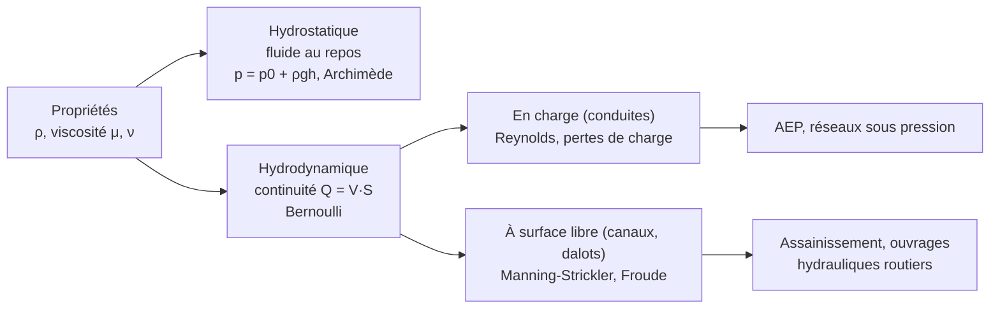

# Mécanique des fluides et hydraulique

Matière du programme de 1re année de l'ENIT, absente des cours du dossier. Tout le contenu est **[Complément]**. À compléter avec le polycopié de l'enseignant.

## Fichiers

| Fichier | Contenu |
| --- | --- |
| [cours.md](cours.md) | Propriétés des fluides, hydrostatique, continuité, Bernoulli, pertes de charge, écoulements à surface libre |
| [exercices-corriges.md](exercices-corriges.md) | Exercices types avec correction |

## Vue d'ensemble

Le débit de projet calculé en [Hydrologie](../02-hydrologie/cours.md) sert ici à dimensionner l'ouvrage (exercice 7).
