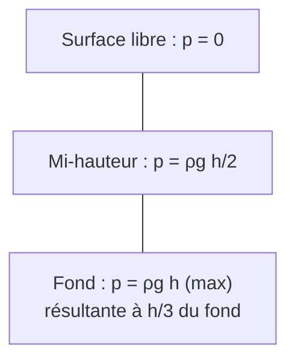

# Cours de mécanique des fluides

[← Retour au sommaire](README.md)

**[Complément]** : cours construit sur le programme usuel. g = 9,81 m/s², eau : ρ = 1 000 kg/m³, ν = 10⁻⁶ m²/s à 20 °C.

## Sommaire

1. [Propriétés des fluides](#1-propriétés-des-fluides)
2. [Hydrostatique](#2-hydrostatique)
3. [Cinématique : débit et continuité](#3-cinématique-débit-et-continuité)
4. [Théorème de Bernoulli](#4-théorème-de-bernoulli)
5. [Écoulements réels en charge](#5-écoulements-réels-en-charge)
6. [Écoulements à surface libre](#6-écoulements-à-surface-libre)
7. [Théorème d'Euler (quantité de mouvement)](#7-théorème-des-quantités-de-mouvement)

---

## 1. Propriétés des fluides

| Propriété | Symbole | Eau à 20 °C |
| --- | --- | --- |
| Masse volumique | ρ (kg/m³) | 1 000 |
| Poids volumique | ϖ = ρg (N/m³) | 9 810 |
| Viscosité dynamique | μ (Pa·s) | 10⁻³ |
| Viscosité cinématique | ν = μ/ρ (m²/s) | 10⁻⁶ |
| Pression de vapeur saturante | | 2,3 kPa |

- **Liquide** : pratiquement incompressible. **Gaz** : compressible.
- **Fluide parfait** : sans viscosité (modèle simplifié). **Fluide réel** : avec viscosité, donc frottements et pertes d'énergie.
- **Fluide newtonien** (eau, air) : contrainte de cisaillement proportionnelle au gradient de vitesse, $\tau = \mu\,\dfrac{dv}{dy}$.

---

## 2. Hydrostatique

### 2.1 Loi fondamentale

Dans un fluide au repos, la pression ne dépend que de la profondeur :

$$p = p_0 + \rho g h$$

- Pression relative (par rapport à l'atmosphère) : $p = \rho g h$. Dans l'eau, **+ 1 bar tous les 10 m** environ.
- Les surfaces d'égale pression sont horizontales (**principe des vases communicants**).
- **Pascal** : une variation de pression se transmet intégralement (presse hydraulique : $F_2 = F_1\,S_2/S_1$).
- Pression atmosphérique : 101 325 Pa ≈ 1 bar ≈ 10,33 m d'eau.

**Charge piézométrique** : $z + \dfrac{p}{\rho g}$ = constante dans un fluide au repos.

### 2.2 Force sur une paroi plane

Sur une paroi plane immergée d'aire S, dont le centre de gravité G est à la profondeur h_G :

$$F = \rho g\,h_G\,S$$

La force s'applique au **centre de poussée** C, plus bas que G :

$$h_C = h_G + \frac{I_G}{h_G\,S}$$

**Cas classique : paroi verticale rectangulaire** de largeur b, eau sur une hauteur h depuis la surface : la pression est triangulaire.

$$F = \frac{\rho g\,b\,h^2}{2} \quad\text{appliquée à } \frac{h}{3}\text{ au-dessus du fond}$$

C'est le calcul de base des murs de réservoirs, barrages, batardeaux, vannes.

### 2.3 Poussée d'Archimède

Tout corps immergé subit une poussée verticale vers le haut égale au poids du volume de fluide déplacé :

$$\Pi = \rho_{fluide}\,g\,V_{immergé}$$

Un corps flotte si sa masse volumique moyenne est inférieure à celle du fluide. Application en génie civil : **sous-pression** sous les radiers et les ouvrages enterrés dans une nappe (risque de soulèvement des bassins vides).

---

## 3. Cinématique : débit et continuité

- **Débit volumique** : $Q = V\,S$ (m³/s), V = vitesse moyenne, S = section mouillée.
- **Écoulement permanent** : rien ne change dans le temps en un point.
- **Équation de continuité** (fluide incompressible, conservation de la masse) :

$$Q = V_1 S_1 = V_2 S_2$$

Quand la section diminue, la vitesse augmente. Diviser le diamètre par 2 multiplie la vitesse par 4.

---

## 4. Théorème de Bernoulli

Pour un fluide **parfait**, incompressible, en écoulement permanent, le long d'une ligne de courant, la **charge** H est constante :

$$H = z + \frac{p}{\rho g} + \frac{V^2}{2g} = \text{constante}$$

| Terme | Nom | Énergie |
| --- | --- | --- |
| z | Cote (charge de position) | Potentielle de pesanteur |
| p/ρg | Hauteur de pression | De pression |
| V²/2g | Hauteur cinétique | Cinétique |

(Tous en mètres de colonne de fluide.)

**Applications** :

- **Torricelli** (vidange d'un réservoir par un orifice à une profondeur h) : $V = \sqrt{2gh}$ ; débit réel $Q = C_d\,S\sqrt{2gh}$ avec $C_d \approx 0{,}62$ (contraction de la veine).
- **Venturi** : rétrécissement d'une conduite ; la mesure de la chute de pression donne le débit.
- **Tube de Pitot** : mesure de la vitesse par la pression d'arrêt.

**Avec une pompe ou une turbine et des pertes** (fluide réel) :

$$H_1 + H_{pompe} = H_2 + \Delta H_{1\to2}$$

Puissance hydraulique d'une pompe : $P = \rho g\,Q\,H_{mt}$, puissance absorbée $P/\eta$.

---

## 5. Écoulements réels en charge

### 5.1 Nombre de Reynolds

$$Re = \frac{V\,D}{\nu}$$

| Re | Régime |
| --- | --- |
| < 2 000 | **Laminaire** (filets parallèles) |
| 2 000 à 4 000 | Transitoire |
| > 4 000 | **Turbulent** (cas de presque tous les réseaux d'eau) |

### 5.2 Pertes de charge linéaires (Darcy-Weisbach)

$$\Delta H = \lambda\,\frac{L}{D}\,\frac{V^2}{2g}$$

- Laminaire : $\lambda = 64/Re$.
- Turbulent : λ dépend de Re et de la rugosité relative ε/D (**diagramme de Moody**, formule de **Colebrook**). Ordre de grandeur : λ ≈ 0,015 à 0,03.
- Formules pratiques des réseaux : Hazen-Williams, Manning-Strickler en charge.

### 5.3 Pertes de charge singulières

$$\Delta H_s = K\,\frac{V^2}{2g}$$

K dépend de l'accident : coude, vanne, entrée (0,5), sortie dans un réservoir (1), élargissement, rétrécissement.

La **ligne de charge** descend le long de la conduite ; la **ligne piézométrique** est en dessous d'elle de V²/2g.

---

## 6. Écoulements à surface libre

Canaux, fossés, oueds, dalots et collecteurs d'assainissement non remplis : la surface de l'eau est à la pression atmosphérique.

### 6.1 Grandeurs géométriques

| Grandeur | Définition | Rectangle b × y |
| --- | --- | --- |
| Section mouillée S | Aire occupée par l'eau | b y |
| Périmètre mouillé P | Longueur de paroi au contact de l'eau | b + 2y |
| Rayon hydraulique Rh | S / P | by / (b + 2y) |

### 6.2 Écoulement uniforme : Manning-Strickler

$$Q = K\,S\,R_h^{2/3}\,\sqrt{I}$$

I = pente du fond (m/m), K = coefficient de Strickler (m^(1/3)/s) :

| Paroi | K |
| --- | --- |
| Béton lisse | 70 – 80 |
| Béton brut, maçonnerie | 60 – 70 |
| Terre propre | 40 – 50 |
| Lit naturel d'oued avec végétation | 20 – 35 |

(Formule de Manning : n = 1/K.)

### 6.3 Nombre de Froude

$$Fr = \frac{V}{\sqrt{g\,y}}$$

| Fr | Régime |
| --- | --- |
| < 1 | **Fluvial** (lent, profond, influencé par l'aval) |
| = 1 | Critique (hauteur critique yc) |
| > 1 | **Torrentiel** (rapide, peu profond) |

Le passage brutal du torrentiel au fluvial est le **ressaut hydraulique**, très dissipatif : on le provoque volontairement en sortie d'ouvrage dans un bassin de dissipation pour protéger le lit contre l'érosion.

---

## 7. Théorème des quantités de mouvement

Pour un volume de contrôle en écoulement permanent :

$$\sum\vec{F}_{ext} = \rho\,Q\,(\vec{V}_{sortie} - \vec{V}_{entrée})$$

Applications : force d'un jet sur une plaque, efforts sur un coude de conduite (dimensionnement des **butées** en béton des conduites d'eau), ressaut hydraulique.
