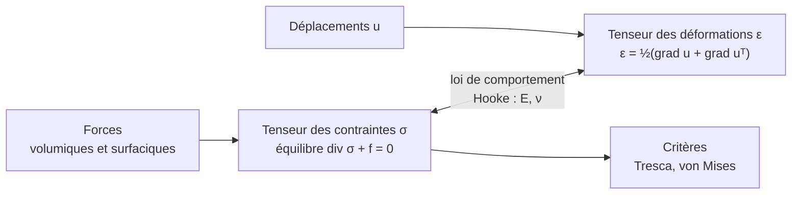

# Mécanique des milieux continus

Matière du programme de 1re année de l'ENIT, absente des cours du dossier. Tout le contenu est **[Complément]**. À compléter avec le polycopié de l'enseignant.

## Fichiers

| Fichier | Contenu |
| --- | --- |
| [cours.md](cours.md) | Outils tensoriels, contraintes, cercle de Mohr, déformations, élasticité, critères de résistance |
| [exercices-corriges.md](exercices-corriges.md) | Exercices types avec correction |

## Vue d'ensemble

La MMC généralise la RDM : au lieu d'une poutre, on étudie un solide quelconque, point par point.

Prérequis : torseurs de [mécanique des solides](../04-mecanique-des-solides/cours.md), calcul matriciel de [mathématiques](../13-mathematiques/cours.md). Suite : [RDM](../06-rdm/cours.md) et [mécanique des sols](../07-mecanique-des-sols/cours.md) (cercle de Mohr, Mohr-Coulomb).
