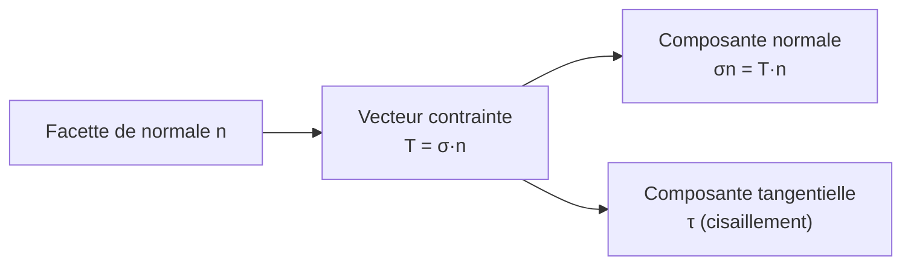
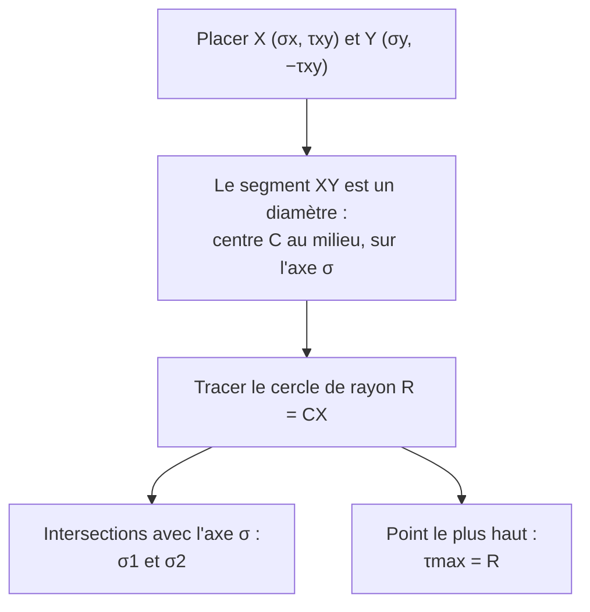
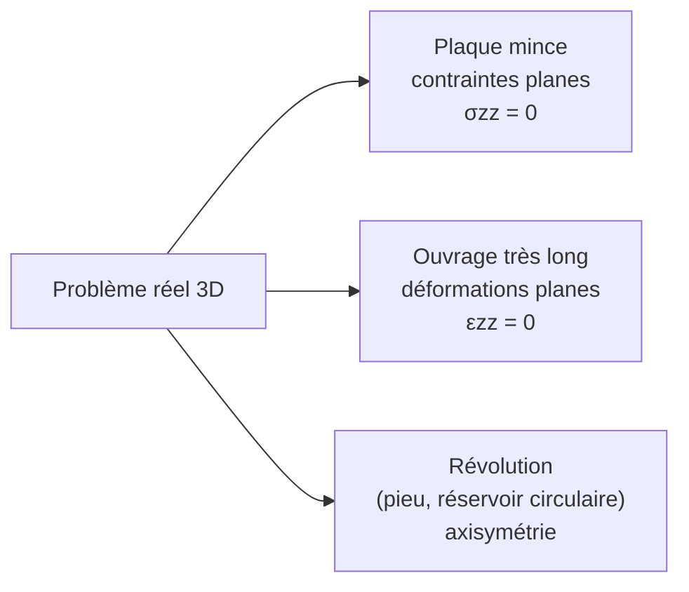

# Cours de mécanique des milieux continus

[← Retour au sommaire](README.md)

**[Complément]** : cours construit sur le programme usuel. Hypothèse des **petites perturbations** (HPP) : petits déplacements et petites déformations.

## Sommaire

1. [Outils mathématiques](#1-outils-mathématiques)
2. [Contraintes](#2-le-tenseur-des-contraintes)
3. [Contraintes principales et cercle de Mohr](#3-contraintes-principales-et-cercle-de-mohr)
4. [Équations d'équilibre](#4-équations-déquilibre)
5. [Déformations](#5-le-tenseur-des-déformations)
6. [Élasticité linéaire](#6-loi-de-comportement-élasticité-linéaire-isotrope)
7. [Critères de résistance](#7-critères-de-résistance)
8. [Problèmes plans](#8-problèmes-plans)

---

## 1. Outils mathématiques

- **Notation indicielle** et convention d'Einstein : un indice répété est sommé. $a_i b_i = a_1b_1 + a_2b_2 + a_3b_3$.
- **Symbole de Kronecker** : $\delta_{ij} = 1$ si i = j, 0 sinon.
- **Tenseur d'ordre 2** : application linéaire représentée par une matrice 3 × 3 dans une base. Il est **symétrique** si $T_{ij} = T_{ji}$.
- **Trace** : $\text{tr}\,T = T_{ii} = T_{11} + T_{22} + T_{33}$ (invariante par changement de base).
- **Gradient** d'un champ de vecteurs u : matrice $\partial u_i/\partial x_j$. **Divergence** d'un tenseur σ : vecteur $\partial\sigma_{ij}/\partial x_j$.
- **Valeurs et vecteurs propres** : directions où le tenseur agit comme un simple coefficient. Un tenseur symétrique réel a 3 valeurs propres réelles et 3 directions propres orthogonales.

---

## 2. Le tenseur des contraintes

On coupe le solide par une petite facette de normale $\vec{n}$ autour d'un point M. La matière d'un côté exerce sur l'autre une force par unité de surface : le **vecteur contrainte** $\vec{T}(M,\vec{n})$ (en Pa).

**Théorème de Cauchy** : il existe un tenseur σ tel que

$$\vec{T}(M,\vec{n}) = \sigma(M)\,\vec{n}$$

$$\sigma = \begin{bmatrix} \sigma_{xx} & \sigma_{xy} & \sigma_{xz} \\ \sigma_{xy} & \sigma_{yy} & \sigma_{yz} \\ \sigma_{xz} & \sigma_{yz} & \sigma_{zz} \end{bmatrix}$$

- termes diagonaux : **contraintes normales** (traction > 0, compression < 0) ;
- termes hors diagonale : **contraintes tangentielles** (cisaillement) ;
- σ est **symétrique** (réciprocité des cisaillements, conséquence de l'équilibre des moments).

Décomposition du vecteur contrainte sur une facette :

$$\sigma_n = \vec{T}\cdot\vec{n} \qquad \tau = \sqrt{\|\vec{T}\|^2 - \sigma_n^2}$$

**Partie sphérique et déviateur** : $\sigma = p\,I + s$ avec $p = \tfrac13\text{tr}\,\sigma$ (pression moyenne) et s le déviateur (trace nulle, responsable des changements de forme).

---

## 3. Contraintes principales et cercle de Mohr

Les **directions principales** sont les facettes où il n'y a **pas de cisaillement**. Les **contraintes principales** σ1 ≥ σ2 ≥ σ3 sont les valeurs propres de σ :

$$\det(\sigma - \lambda I) = 0$$

**En 2D** (σx, σy, τxy) :

$$\sigma_{1,2} = \frac{\sigma_x + \sigma_y}{2} \pm \sqrt{\left(\frac{\sigma_x - \sigma_y}{2}\right)^2 + \tau_{xy}^2} \qquad \tan2\theta_p = \frac{2\tau_{xy}}{\sigma_x - \sigma_y}$$

**Cercle de Mohr** : dans le plan (σn, τ), quand la facette tourne, le point représentatif décrit un cercle :

- centre $C = \dfrac{\sigma_x + \sigma_y}{2}$ sur l'axe σ ;
- rayon $R = \sqrt{\left(\dfrac{\sigma_x - \sigma_y}{2}\right)^2 + \tau_{xy}^2}$ ;
- σ1 = C + R, σ2 = C − R ; cisaillement maximal τmax = R ;
- une rotation de θ de la facette correspond à une rotation de **2θ** sur le cercle.

C'est le même cercle qu'en mécanique des sols (critère de Mohr-Coulomb : le cercle touche la droite intrinsèque τ = c + σ tan φ à la rupture).

---

## 4. Équations d'équilibre

En tout point, avec $\vec{f}$ les forces volumiques (poids : ρg) :

$$\text{div}\,\sigma + \vec{f} = \vec{0} \quad\Longleftrightarrow\quad \frac{\partial\sigma_{ij}}{\partial x_j} + f_i = 0$$

En dynamique : $\text{div}\,\sigma + \vec{f} = \rho\,\vec{\gamma}$.

**Conditions aux limites** : sur la surface, $\sigma\,\vec{n} = \vec{T}_{imposé}$ (efforts donnés) ou $\vec{u} = \vec{u}_{imposé}$ (déplacements donnés, appuis).

---

## 5. Le tenseur des déformations

Le solide se déforme : chaque point M se déplace de $\vec{u}(M)$. En HPP :

$$\varepsilon = \frac{1}{2}\left(\text{grad}\,\vec{u} + \text{grad}\,\vec{u}^T\right) \qquad \varepsilon_{ij} = \frac12\left(\frac{\partial u_i}{\partial x_j} + \frac{\partial u_j}{\partial x_i}\right)$$

- $\varepsilon_{xx}$ : **allongement relatif** dans la direction x ;
- $2\varepsilon_{xy} = \gamma_{xy}$ : **distorsion** (variation de l'angle droit entre x et y) ;
- $\text{tr}\,\varepsilon = \Delta V / V$ : **variation relative de volume** (dilatation).

**Équations de compatibilité** : un champ ε quelconque ne vient pas forcément d'un déplacement ; il doit vérifier des conditions (en 2D : $\dfrac{\partial^2\varepsilon_{xx}}{\partial y^2} + \dfrac{\partial^2\varepsilon_{yy}}{\partial x^2} = 2\dfrac{\partial^2\varepsilon_{xy}}{\partial x\,\partial y}$).

**Mesure** : jauges de déformation (extensomètres) collées sur la pièce, en rosette (3 directions) pour obtenir εxx, εyy, γxy.

---

## 6. Loi de comportement : élasticité linéaire isotrope

**Loi de Hooke généralisée** :

$$\varepsilon = \frac{1+\nu}{E}\,\sigma - \frac{\nu}{E}\,(\text{tr}\,\sigma)\,I \qquad \sigma = \lambda\,(\text{tr}\,\varepsilon)\,I + 2\mu\,\varepsilon$$

En composantes :

$$\varepsilon_{xx} = \frac{1}{E}\left[\sigma_{xx} - \nu(\sigma_{yy} + \sigma_{zz})\right] \qquad \gamma_{xy} = \frac{\tau_{xy}}{G}$$

| Constante | Nom | Acier | Béton |
| --- | --- | --- | --- |
| E | Module d'Young | 210 GPa | 30 GPa |
| ν | Coefficient de Poisson (0 à 0,5) | 0,3 | 0,2 |
| G = μ | Module de cisaillement, $G = \dfrac{E}{2(1+\nu)}$ | 81 GPa | 12,5 GPa |
| λ | Coefficient de Lamé, $\lambda = \dfrac{E\nu}{(1+\nu)(1-2\nu)}$ | 121 GPa | 8,3 GPa |
| K | Module de compressibilité, $K = \dfrac{E}{3(1-2\nu)}$ | 175 GPa | 16,7 GPa |

ν = 0,5 correspond à un matériau **incompressible** (caoutchouc, argile saturée non drainée).

**Effet Poisson** : une barre tirée s'allonge et s'amincit : $\varepsilon_{trans} = -\nu\,\varepsilon_{long}$.

---

## 7. Critères de résistance

On compare un état de contraintes 3D à la limite d'un essai de traction simple (σe).

| Critère | Contrainte équivalente | Usage |
| --- | --- | --- |
| **Tresca** (cisaillement maximal) | $\sigma_{eq} = \sigma_1 - \sigma_3$ | Métaux ductiles, prudent |
| **Von Mises** (énergie de distorsion) | $\sigma_{eq} = \sqrt{\tfrac12\left[(\sigma_1-\sigma_2)^2 + (\sigma_2-\sigma_3)^2 + (\sigma_3-\sigma_1)^2\right]}$ | Métaux ductiles, le plus utilisé |
| **Rankine** (contrainte normale maximale) | $\sigma_{eq} = \sigma_1$ | Matériaux fragiles (béton en traction, fonte) |
| **Mohr-Coulomb** | $\tau = c + \sigma\tan\varphi$ | Sols, roches, béton |

Condition : $\sigma_{eq} \le \sigma_e / s$ (s = coefficient de sécurité).

---

## 8. Problèmes plans

- **Contraintes planes** (plaque mince chargée dans son plan) : σzz = σxz = σyz = 0, mais εzz ≠ 0.
- **Déformations planes** (ouvrage long : mur de soutènement, barrage, tunnel, remblai) : εzz = 0, mais σzz = ν (σxx + σyy) ≠ 0.

