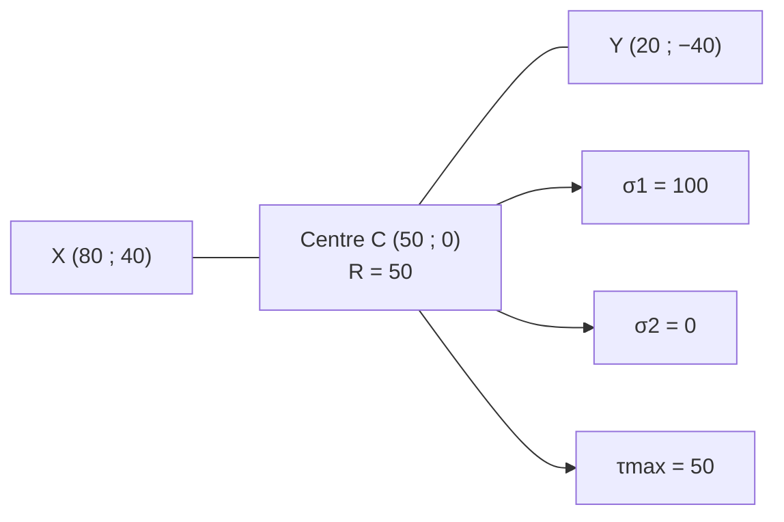

# Exercices corrigés de mécanique des milieux continus

[← Retour au sommaire](README.md)

Exercices types. Calculs vérifiés numériquement.

On étudie en un point d'une pièce en acier (E = 210 GPa, ν = 0,3, σe = 235 MPa) l'état de **contraintes planes** :

$$\sigma = \begin{bmatrix} 80 & 40 \\ 40 & 20 \end{bmatrix}\ \text{MPa}$$

---

## Exercice 1. Vecteur contrainte sur une facette

Calculer le vecteur contrainte, la contrainte normale et le cisaillement sur la facette de normale $\vec{n} = \tfrac{1}{\sqrt2}(1 ; 1)$.

### Correction

$$\vec{T} = \sigma\,\vec{n} = \frac{1}{\sqrt2}\begin{pmatrix} 80 + 40 \\ 40 + 20 \end{pmatrix} = \begin{pmatrix} 84{,}85 \\ 42{,}43 \end{pmatrix}\ \text{MPa}$$

$$\sigma_n = \vec{T}\cdot\vec{n} = \frac{120 + 60}{2} = 90\ \text{MPa} \qquad \tau = \sqrt{84{,}85^2 + 42{,}43^2 - 90^2} = \sqrt{9000 - 8100} = 30\ \text{MPa}$$

---

## Exercice 2. Contraintes principales et cercle de Mohr

### Correction

- Centre : C = (80 + 20) / 2 = **50 MPa**.
- Rayon : $R = \sqrt{30^2 + 40^2} = $ **50 MPa**.
- σ1 = 50 + 50 = **100 MPa** ; σ2 = 50 − 50 = **0 MPa**.
- τmax = R = **50 MPa**.
- Direction principale : $\tan2\theta_p = \dfrac{2\times40}{80 - 20} = 1{,}333$, donc 2θp = 53,13° et **θp = 26,57°** par rapport à x.

Vérifications : σ1 + σ2 = 100 = σx + σy (trace invariante) ; σ1 σ2 = 0 = 80 × 20 − 40² (déterminant invariant). ✔

La facette de l'exercice 1 (à 45°) correspond sur le cercle à un angle de 90° depuis X. Son point (90 ; 30) est bien sur le cercle : (90 − 50)² + 30² = 1600 + 900 = 2500 = 50². ✔

---

## Exercice 3. Déformations (loi de Hooke)

Calculer εxx, εyy, γxy et εzz.

### Correction

$G = \dfrac{210\,000}{2\times1{,}3} = 80\,769$ MPa.

$$\varepsilon_{xx} = \frac{80 - 0{,}3\times20}{210\,000} = 3{,}52\times10^{-4} \qquad \varepsilon_{yy} = \frac{20 - 0{,}3\times80}{210\,000} = -1{,}90\times10^{-5}$$

$$\gamma_{xy} = \frac{40}{80\,769} = 4{,}95\times10^{-4} \qquad \varepsilon_{zz} = -\frac{\nu}{E}(\sigma_x + \sigma_y) = -1{,}43\times10^{-4}$$

εyy est négatif alors que σyy est une traction : c'est l'effet Poisson de la forte traction σxx. En contraintes planes, εzz n'est pas nul (la plaque s'amincit).

---

## Exercice 4. Critères de résistance

Vérifier la pièce avec Tresca et von Mises (coefficient de sécurité 1,5).

### Correction

Contraintes planes : σ1 = 100, σ2 = 0, σ3 = 0 (la troisième contrainte principale, hors plan, est nulle).

- Tresca : σeq = σ1 − σ3 = 100 − 0 = **100 MPa**.
- Von Mises : $\sigma_{eq} = \sqrt{\tfrac12\left[(100-0)^2 + 0 + (0-100)^2\right]} = $ **100 MPa**.

Admissible : 235 / 1,5 = 157 MPa > 100 MPa : **la pièce résiste**.

Attention : si σ2 avait été négatif (par exemple −30 MPa), Tresca aurait donné σ1 − σ3 = 130 MPa. Il faut toujours classer les trois contraintes principales, y compris celle hors du plan.

---

## Exercice 5. Constantes élastiques

Pour le béton (E = 30 GPa, ν = 0,2), calculer G, λ et K.

### Correction

$$G = \frac{30}{2\times1{,}2} = 12{,}5\ \text{GPa} \qquad \lambda = \frac{30\times0{,}2}{1{,}2\times0{,}6} = 8{,}33\ \text{GPa} \qquad K = \frac{30}{3\times0{,}6} = 16{,}7\ \text{GPa}$$
