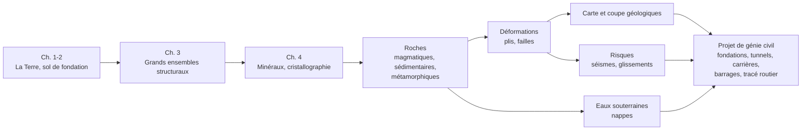

# Géologie de l'ingénieur

Matière de 1re année (ESSAT Gabès, cours du samedi). Les chapitres 1 à 4 suivent **mes notes de cours manuscrites** ; la suite est un **[Complément]** construit sur le programme usuel, à remplacer au fur et à mesure du cours.

## Fichiers

| Fichier | Contenu |
| --- | --- |
| [cours.md](cours.md) | Ch. 1-2 : la Terre, rôle du sol de fondation. Ch. 3 : grands ensembles structuraux (continents, océans, marges, ceintures orogéniques, mers). Ch. 4 : minéraux et cristallographie. Suite [Complément] : roches, temps géologiques, déformations, cartes, eaux souterraines, risques, Tunisie |
| [exercices-corriges.md](exercices-corriges.md) | Questions et exercices types avec correction (exercices 7 à 9 sur mes chapitres) |
| [images/marges-continentales.svg](images/marges-continentales.svg) | Coupe marge passive / marge active |

## Vue d'ensemble

Suite logique : [mécanique des sols](../07-mecanique-des-sols/cours.md).
