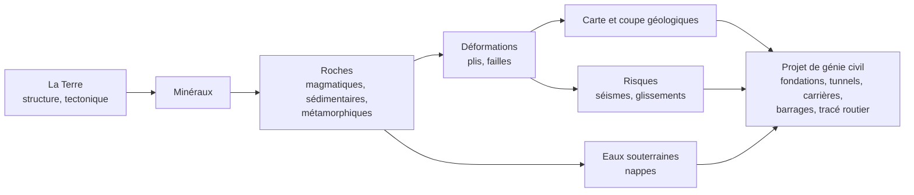

# Géologie de l'ingénieur

Matière du programme de 1re année de l'ENIT, absente des cours du dossier. Tout le contenu est **[Complément]**. À compléter avec le polycopié de l'enseignant.

## Fichiers

| Fichier | Contenu |
| --- | --- |
| [cours.md](cours.md) | Structure de la Terre, minéraux, roches, temps géologiques, déformations, cartes géologiques, eaux souterraines, risques, géologie de la Tunisie |
| [exercices-corriges.md](exercices-corriges.md) | Questions et exercices types avec correction |

## Vue d'ensemble

Suite logique : [mécanique des sols](../07-mecanique-des-sols/cours.md).
