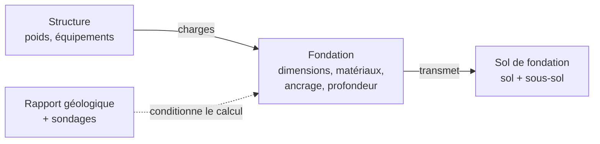
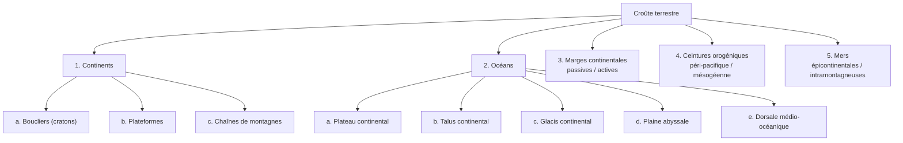
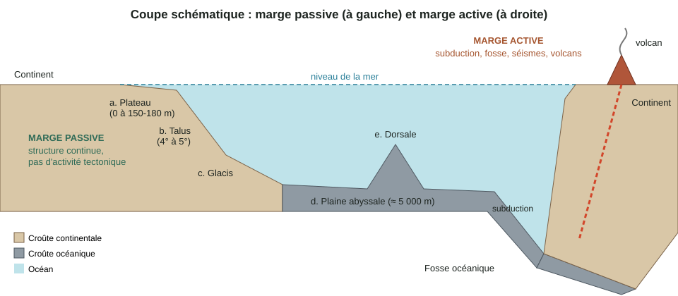
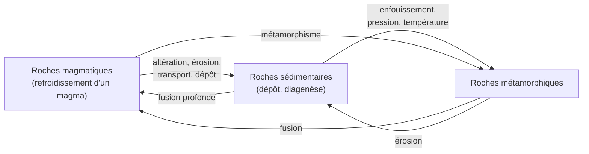
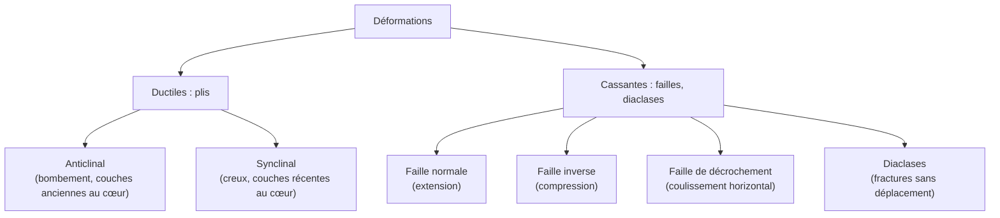
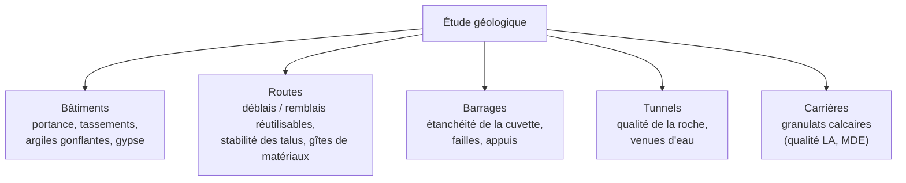

# Cours de géologie de l'ingénieur

[← Retour au sommaire](README.md)

> **Sources.** Les chapitres 3 et 4 et la partie « rôle du sol de fondation » viennent de **mes notes de cours** (ESSAT Gabès, 2026-2027). Les passages marqués **[Complément]** ont été ajoutés pour compléter, ils sont à vérifier avec l'enseignant. Les titres exacts des chapitres 1 et 2 ne figurent pas dans mes notes.

## Sommaire

1. [Chapitres 1 et 2 : la Terre et le sol de fondation](#chapitres-1-et-2--la-terre-et-le-sol-de-fondation)
2. [Chapitre 3 : Les grands ensembles structuraux de la croûte terrestre](#chapitre-3--les-grands-ensembles-structuraux-de-la-croûte-terrestre)
3. [Chapitre 4 : Les minéraux](#chapitre-4--les-minéraux)
4. [Suite du programme [Complément]](#suite-du-programme-complément) : roches, temps géologiques, déformations, cartes, eaux souterraines, altération, risques, ouvrages, Tunisie

---

## Chapitres 1 et 2 : la Terre et le sol de fondation

### Structure de la Terre [Complément]

| Enveloppe | Profondeur | Nature |
| --- | --- | --- |
| Croûte continentale | 0 – 30/70 km | Granites, roches sédimentaires |
| Croûte océanique | 0 – 7 km | Basaltes |
| Manteau | jusqu'à 2 900 km | Péridotites, solide mais déformable |
| Noyau externe | 2 900 – 5 100 km | Fer liquide |
| Noyau interne | 5 100 – 6 370 km | Fer solide |

La **lithosphère** (croûte + manteau supérieur rigide, ≈ 100 km) est découpée en **plaques** qui se déplacent de quelques cm par an sur l'asthénosphère.

| Frontière | Mouvement | Phénomènes |
| --- | --- | --- |
| Divergente | Écartement | Dorsales océaniques, rifts |
| Convergente | Rapprochement | Subduction, chaînes de montagnes, séismes, volcans |
| Transformante | Coulissement | Grandes failles, séismes |

La Tunisie est au bord de la plaque africaine, qui converge vers la plaque eurasienne : c'est l'origine de l'Atlas et de la sismicité du nord du pays.

### Quel est le rôle du sol de fondation dans une construction ?

**1. Fondation.** La fondation est la partie inférieure d'un bâtiment ou d'un ouvrage qui **assure sa stabilité** et **transmet les charges au sol**.

**2. Les rôles du sol de fondation**

- Il **porte le poids** de toute la structure et des équipements.
- Il **travaille sous toutes les sollicitations** subies par l'édifice tout au long de sa vie.
- Il est **en contact permanent** avec la construction.
- Une fondation bien étudiée et bien exécutée est la **garantie d'un ouvrage stable**. Une fondation mal réalisée ou mal exécutée peut mettre toute la construction en péril.

**3. Le calcul des fondations.** Il permet de déterminer :

- leurs dimensions ;
- les matériaux à utiliser ;
- leurs ancrages ;
- leur profondeur, qui dépend de la nature du sol.

Le sol est constitué d'une partie de sol et du sous-sol qui l'accueille. On ne peut pas concevoir des fondations sans connaître le terrain où elles seront réalisées.

> **À retenir.** L'une des premières tâches de l'ingénieur en génie civil est de demander un **rapport géologique détaillé** des lieux de l'ouvrage, et parfois de réaliser des **sondages**.

---

## Chapitre 3 : Les grands ensembles structuraux de la croûte terrestre

### 1. Les continents

La croûte terrestre est composée d'une partie **continentale** au-dessus des océans et d'une partie **sous-océanique**. Les structures continentales sont composées des **boucliers**, des **plateformes** et des **chaînes de montagnes**.

**a. Boucliers.** Ils sont formés de terrains **très anciens**, généralement **intensément plissés, métamorphisés et granitisés**. On les appelle **cratons** : partie très ancienne, stable et rigide de la croûte continentale.

**b. Plateformes.** Ce sont des boucliers **recouverts par des terrains sédimentaires marins de 10 à 15 km**, pas ou peu plissés, avec des **sillons** (zones longues et basses entre les reliefs).

**c. Chaînes de montagnes.** Elles sont composées de terrains **marins, plissés, granitisés et métamorphisés**.

> **NB : différence entre bouclier et plateforme**
>
> | Bouclier | Plateforme |
> | --- | --- |
> | Partie très ancienne et stable d'un continent, composée de roches dures | Fait partie de la partie stable d'un continent |
> | Constitue le cœur ou la base de la croûte continentale | Formée de couches sédimentaires **reposant sur un bouclier** |
> | Roches plissées, métamorphisées, granitisées | Zone plate et peu déformée |

**[Complément]** Exemples : bouclier canadien, bouclier africain (craton ouest-africain) ; plateforme saharienne (le sud tunisien en fait partie) ; chaînes : Alpes, Himalaya, Atlas.

### 2. Les océans

Les structures océaniques sont composées du plateau continental, du talus continental, du glacis, de la plaine abyssale et de la crête médio-océanique.

| Structure | Description | Profondeur, pente |
| --- | --- | --- |
| **a. Plateau continental** | Bordure du continent dont les structures sont immergées ; descend en pente douce | jusqu'à **150 à 180 m** |
| **b. Talus continental** | Domaine de transition entre les continents et les océans | descend vers **3 000 à 4 000 m**, inclinaison moyenne **4° à 5°** |
| **c. Glacis continental** | Au pied du talus, où s'accumulent les matériaux venant du continent ; inclinaison faible, comparable à celle du plateau | jusqu'à **5 000 m** |
| **d. Plaine abyssale** (bassin océanique) | Étendue pratiquement plane, nappée de sédiments fins ; fond des océans sur la croûte océanique | ≈ **5 000 m** |
| **e. Crête (dorsale) médio-océanique** | Relief considérable, généralement au centre des océans | |

### 3. Les marges continentales

**a. Marges passives (stables).** La structure est **continue**. Les plateaux continentaux sont généralement **étendus** et la profondeur des océans est **faible**. Il n'y a **pas de mouvements tectoniques actifs** et les continents ont un relief peu accentué.

**b. Marges actives.** La structure de la croûte terrestre **n'est pas continue**. La croûte océanique s'enfonce sous la croûte continentale, dans le manteau : c'est une **zone de subduction** (endroit où une plaque tectonique océanique plonge sous une autre plaque). On y trouve des **fosses océaniques**, des **volcans actifs** et des **séismes**.

> **NB : différence entre marge passive et marge active**
>
> | Marge passive | Marge active |
> | --- | --- |
> | Zone de transition continent / océan | Zone de transition continent / océan |
> | **Non affectée** par les mouvements tectoniques actifs | **Forte activité tectonique** : volcans et séismes |
> | Plateau large, structure continue | Fosse océanique, subduction |
> | [Complément] Ex. : côtes atlantiques de l'Afrique et de l'Europe | [Complément] Ex. : côte ouest de l'Amérique du Sud (Andes) |

### 4. Les ceintures orogéniques

Il existe deux grandes ceintures orogéniques mondiales actuelles :

- la ceinture **péri-pacifique**, sur le pourtour des continents américain et asiatique ;
- la ceinture **mésogéenne**, orientée **Est-Ouest**, perpendiculaire à la précédente, comprise entre deux blocs :
  - au nord : l'Amérique du Nord, l'Europe et l'Asie ;
  - au sud : l'Amérique du Sud, l'Afrique et l'Inde.

Ces ceintures sont le **siège des séismes et des volcans** à l'échelle mondiale. Elles sont caractérisées par :

- une chaîne de montagnes ;
- des archipels de jeunes montagnes (**arcs insulaires**) ;
- des mers intérieures.

**[Complément]** L'Atlas tunisien et la Méditerranée appartiennent à la ceinture mésogéenne : c'est pourquoi le nord de la Tunisie est sismique et doit appliquer des règles parasismiques.

### 5. Les mers

**a. Mers épicontinentales.** Elles appartiennent au plateau continental des océans voisins. Ce sont des mers **peu profondes** (profondeur **inférieure à 200 m**). [Complément] Ex. : Manche, mer du Nord.

**b. Mers intramontagneuses.** La **Méditerranée** en est le type : elle est entièrement comprise dans les chaînes de montagnes qui la bordent de toutes parts. Les profondeurs sont importantes et atteignent plusieurs milliers de mètres. La profondeur maximale est de **5 121 m**, au sud-ouest du Péloponnèse.

---

## Chapitre 4 : Les minéraux

### I. Notion de minéralogie

#### 1. Définition

Un **minéral** est une substance **formée naturellement ou synthétisée artificiellement**, définie par sa **composition chimique** et sa **structure atomique**.

Les minéraux sont subdivisés en deux groupes :

| Groupe | Part de la croûte terrestre | Exemples [Complément] |
| --- | --- | --- |
| Minéraux **silicatés** | environ **95 %** | Quartz, feldspaths, micas, argiles |
| Minéraux **non silicatés** | environ **5 %** | Calcite, dolomite, gypse, halite |

Les minéraux sont généralement **solides** dans les conditions normales de température et de pression. Ils s'associent pour former les **roches** de la croûte terrestre et, plus généralement, de la lithosphère. Il existe cependant des minéraux **liquides** : eau, pétrole…

L'étude d'un minéral se fait par trois approches :

| Approche | Ce qu'on étudie |
| --- | --- |
| Cristallographique | Géométrie, forme |
| Physique | Couleur, fracture, clivage, dureté… |
| Chimique | Composition chimique |

#### 2. Notion de cristallographie

**a. Définition.** La **cristallographie** est la science qui étudie les **substances cristallines à l'échelle atomique**. Elle étudie les propriétés physico-chimiques d'un cristal. Les cristaux sont étroitement liés à l'**arrangement spatial des atomes** dans la matière. L'**état cristallin** est défini par un caractère **périodique et ordonné** à l'échelle atomique ou moléculaire.

- **Maille élémentaire** : la plus petite unité de structure cristalline qui, par répétition dans l'espace, permet de reconstituer tout le cristal.
- Le **cristal** est obtenu par **translation** de la maille élémentaire dans toutes les directions.
- On appelle **cristal** un solide minéral naturel, homogène, de forme régulière, limité par des surfaces habituellement planes faisant entre elles des angles bien définis.

**b. Les systèmes de cristallisation.** Une maille est décrite par trois longueurs a, b, c et trois angles α, β, γ.

| Système | Description (mes notes) | Paramètres de la maille | Exemple |
| --- | --- | --- | --- |
| i. **Cubique** | Prisme droit à six faces égales | a = b = c ; α = β = γ = 90° | Halite, pyrite |
| ii. **Quadratique** | Prisme droit à base carrée et à quatre faces rectangulaires | a = b ≠ c ; α = β = γ = 90° | Zircon |
| iii. **Hexagonal** | Prisme droit à six faces rectangulaires à base hexagonale | a = b ≠ c ; α = β = 90°, γ = 120° | Béryl, quartz [Complément] |
| iv. **Rhomboédrique** | Prisme oblique où toutes les faces sont des losanges | a = b = c ; α = β = γ ≠ 90° | Calcite, dolomite |
| v. **Orthorhombique** [Complément] | Prisme droit à base rectangle | a ≠ b ≠ c ; α = β = γ = 90° | Aragonite, olivine |
| vi. **Monoclinique** [Complément] | Prisme oblique à base rectangle | a ≠ b ≠ c ; α = γ = 90°, β ≠ 90° | Gypse, micas, orthose |
| vii. **Triclinique** [Complément] | Prisme oblique, aucun angle droit | a ≠ b ≠ c ; α ≠ β ≠ γ ≠ 90° | Plagioclases, kaolinite |

Les paramètres de maille et les systèmes v à vii ne sont pas encore dans mes notes : à vérifier quand le cours continue.

### II. Propriétés physiques et minéraux courants [Complément]

- **Clivage** : le minéral se casse suivant des plans réguliers (micas, calcite). **Fracture** : cassure irrégulière (quartz).
- **Dureté de Mohs** : de 1 (talc) à 10 (diamant). Repères : ongle ≈ 2,5, verre ≈ 5,5, quartz = 7.

| Minéral | Composition | Reconnaissance | Intérêt pour l'ingénieur |
| --- | --- | --- | --- |
| Quartz | SiO₂ | Dur (raye le verre), pas de clivage | Sables, granulats durs |
| Feldspaths | Silicates d'Al, K, Na, Ca | Clivages, s'altèrent en argiles | |
| Micas | Silicates en feuillets | Se débitent en paillettes | Plans de faiblesse |
| **Calcite** | CaCO₃ | Fait effervescence à l'acide chlorhydrique dilué | Calcaires, chaux, ciment |
| Dolomite | CaMg(CO₃)₂ | Effervescence faible | Granulats |
| **Gypse** | CaSO₄·2H₂O | Rayé à l'ongle | Plâtre ; **soluble** et agressif pour le béton |
| Halite | NaCl | Goût salé | Sebkhas, très soluble |
| **Argiles** | Silicates en feuillets fins | Plastiques mouillées | Gonflement (montmorillonite), glissements |

---

## Suite du programme [Complément]

Les chapitres suivants ne sont pas encore dans mes notes. Ils suivent le programme usuel et seront remplacés au fur et à mesure du cours.

## 5. Les roches

### 5.1 Roches magmatiques

| Type | Formation | Texture | Exemples |
| --- | --- | --- | --- |
| Plutoniques | Refroidissement lent en profondeur | Grenue (cristaux visibles) | Granite, diorite, gabbro |
| Volcaniques | Refroidissement rapide en surface | Microlitique, vitreuse | Basalte, andésite, rhyolite |

Très résistantes, excellents granulats (basalte), peu présentes en Tunisie (quelques affleurements dans le nord, région de Nefza).

### 5.2 Roches sédimentaires (les plus fréquentes en Tunisie)

| Origine | Exemples | Comportement |
| --- | --- | --- |
| **Détritiques** (débris) | Conglomérats, grès, sables, **argiles**, marnes, limons | Grès : bon ; argiles et marnes : gonflantes, glissantes |
| **Carbonatées** | **Calcaires**, dolomies, craie | Calcaire compact : très bon (granulats, pierre) ; attention aux **cavités karstiques** |
| **Évaporitiques** | **Gypse**, sel | Solubles : dissolution, effondrements, attaque du béton |
| Organiques | Charbon, pétrole, **phosphates** | Phosphates de Gafsa |

**Marne** = mélange de calcaire et d'argile (35 à 65 % de chacun) : très courante, sensible à l'eau.

### 5.3 Roches métamorphiques

Transformation à l'état solide sous pression et température : argile → schiste → micaschiste → gneiss ; calcaire → **marbre** ; grès → quartzite. Souvent **foliées** (plans de faiblesse orientés).

---

## 6. Le temps géologique

**Principes de datation relative** :

1. **Superposition** : une couche est plus récente que celle qu'elle recouvre (si elle n'a pas été renversée).
2. **Recoupement** : une faille ou un filon est plus récent que les couches qu'il recoupe.
3. **Inclusion** : un fragment inclus est plus ancien que la roche qui le contient.
4. **Continuité** : une même couche a le même âge partout.
5. **Identité paléontologique** : mêmes fossiles stratigraphiques, même âge.

**Datation absolue** : radioactivité (isotopes).

| Ère | Périodes | Âge (millions d'années) |
| --- | --- | --- |
| Quaternaire | Pléistocène, Holocène | 2,6 – aujourd'hui |
| **Cénozoïque** (Tertiaire) | Paléogène (Éocène…), Néogène (Miocène, Pliocène) | 66 – 2,6 |
| **Mésozoïque** (Secondaire) | Trias, Jurassique, **Crétacé** | 252 – 66 |
| Paléozoïque (Primaire) | Cambrien … Permien | 541 – 252 |
| Précambrien | | 4 600 – 541 |

---

## 7. Les déformations : plis et failles

**Orientation d'une couche** :

- **direction** : angle entre le Nord et l'horizontale de la couche (ex. N30°E) ;
- **pendage** : angle de la couche avec l'horizontale, et sens de la plongée (ex. 40° SE).

Notation : N30°E, 40° SE.

Pour l'ingénieur, failles et diaclases sont des **zones de faiblesse** et des chemins pour l'eau : on les évite sous les fondations de barrages et on les traite dans les tunnels.

---

## 8. Cartes et coupes géologiques

Une **carte géologique** (en Tunisie : cartes de l'ONM, Office National des Mines, au 1/50 000 et 1/100 000) montre les formations qui affleurent, avec :

- des **couleurs** par âge (codes : Q pour Quaternaire, C pour Crétacé…) ;
- les **pendages** (symbole en T avec une valeur) ;
- les **failles** (traits épais) ;
- une **légende stratigraphique** (de la plus ancienne en bas à la plus récente en haut) ;
- une ou plusieurs **coupes**.

**Règle du V** : quand une couche traverse une vallée, son contour dessine un V. Pour une couche horizontale, le contour suit les courbes de niveau.

**Coupe géologique** : on trace le profil topographique, puis on reporte les contacts et les pendages, et on prolonge les couches en profondeur.

**Épaisseur réelle** d'une couche sur un terrain horizontal : $e = l\sin p$, avec l la largeur d'affleurement mesurée perpendiculairement à la direction, et p le pendage.

---

## 9. Les eaux souterraines

| Terme | Définition |
| --- | --- |
| Aquifère | Roche poreuse et perméable contenant de l'eau exploitable (sables, grès, calcaires fissurés) |
| Aquiclude | Roche imperméable (argiles, marnes) |
| **Nappe libre** | Surface de l'eau à la pression atmosphérique (niveau piézométrique = toit de la nappe) |
| **Nappe captive** | Entre deux couches imperméables, sous pression : l'eau remonte dans le forage (artésien si elle jaillit) |

Les grandes nappes profondes du sud tunisien (Continental Intercalaire, Complexe Terminal) sont partagées avec l'Algérie et la Libye et se renouvellent très peu.

Problèmes en génie civil : venues d'eau dans les fouilles (rabattement de nappe), sous-pressions, dissolution du gypse, rétention d'eau des argiles.

---

## 10. Altération, érosion et sols

- **Altération physique** (gel, variations de température, cristallisation de sel) et **chimique** (dissolution des calcaires et du gypse, transformation des feldspaths en argiles).
- **Érosion** par l'eau (ravinement, oueds), le vent (sud tunisien) et la mer.
- Le **sol** au sens de l'ingénieur est l'ensemble des matériaux meubles au-dessus du substratum rocheux.
- Formations typiques du sud : **croûtes calcaires et gypseuses** (encroûtements), utilisées parfois en couches de chaussée ; **sebkhas** (dépressions salées, très mauvais terrain de fondation).

---

## 11. Risques géologiques

| Risque | Causes | Prévention |
| --- | --- | --- |
| **Séismes** | Failles actives | Règles parasismiques, choix du site |
| **Glissements de terrain** | Pente + argiles ou marnes + eau | Drainage, murs, reprofilage des talus |
| **Chutes de blocs** | Falaises fracturées | Filets, purge, ancrages |
| **Effondrements** | Cavités karstiques, dissolution du gypse | Reconnaissance (géophysique, sondages), injections |
| Retrait-gonflement | Argiles gonflantes | Fondations profondes, drainage autour du bâtiment |
| Inondations, érosion | Crues d'oueds | Ouvrages hydrauliques bien dimensionnés |

Le nord de la Tunisie a une sismicité modérée ; elle est prise en compte dans les règles de construction.

---

## 12. Géologie et ouvrages de génie civil

Démarche : étude documentaire (cartes, archives) → visite de terrain → reconnaissance (sondages, géophysique) → modèle géologique → choix du projet.

---

## 13. Aperçu de la géologie de la Tunisie

| Région | Caractères principaux |
| --- | --- |
| **Tell** (nord) | Reliefs plissés, argiles et marnes : nombreux glissements ; pluviométrie la plus forte |
| **Dorsale tunisienne** (Atlas) | Chaîne SW-NE de calcaires du Jurassique et du Crétacé (Zaghouan, Chaambi) : carrières de granulats |
| **Sahel et plaines** | Formations tertiaires et quaternaires, sebkhas côtières |
| **Région des Chotts** | Grandes dépressions salées (Chott el Jerid) |
| **Sud** (plateforme saharienne) | Couches peu déformées, gypse, croûtes, dunes ; grands aquifères profonds |
| **Bassin minier de Gafsa** | Phosphates de l'Éocène |

Gabès se trouve entre la région des Chotts et le golfe : formations gypseuses et sebkhas, sols salés et agressifs pour le béton.
