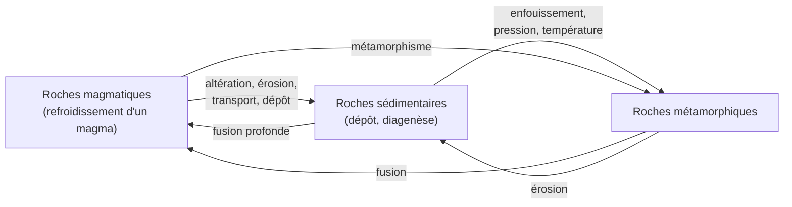
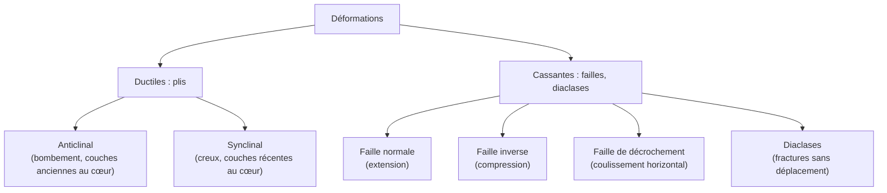
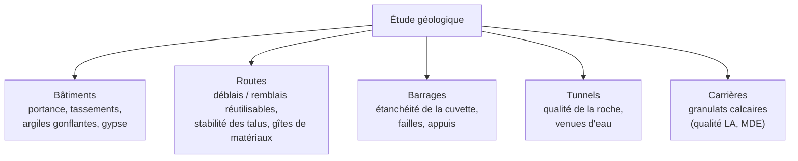

# Cours de géologie de l'ingénieur

[← Retour au sommaire](README.md)

**[Complément]** : cours construit sur le programme usuel.

## Sommaire

1. [La Terre](#1-structure-de-la-terre-et-tectonique-des-plaques)
2. [Minéraux](#2-les-minéraux)
3. [Roches](#3-les-roches)
4. [Temps géologiques](#4-le-temps-géologique)
5. [Déformations](#5-les-déformations-plis-et-failles)
6. [Cartes et coupes](#6-cartes-et-coupes-géologiques)
7. [Eaux souterraines](#7-les-eaux-souterraines)
8. [Altération et érosion](#8-altération-érosion-et-sols)
9. [Risques géologiques](#9-risques-géologiques)
10. [Géologie et ouvrages](#10-géologie-et-ouvrages-de-génie-civil)
11. [Aperçu de la Tunisie](#11-aperçu-de-la-géologie-de-la-tunisie)

---

## 1. Structure de la Terre et tectonique des plaques

| Enveloppe | Profondeur | Nature |
| --- | --- | --- |
| Croûte continentale | 0 – 30/70 km | Granites, roches sédimentaires |
| Croûte océanique | 0 – 7 km | Basaltes |
| Manteau | jusqu'à 2 900 km | Péridotites, solide mais déformable |
| Noyau externe | 2 900 – 5 100 km | Fer liquide |
| Noyau interne | 5 100 – 6 370 km | Fer solide |

La **lithosphère** (croûte + manteau supérieur rigide, ≈ 100 km) est découpée en **plaques** qui se déplacent de quelques cm par an sur l'asthénosphère.

| Frontière | Mouvement | Phénomènes |
| --- | --- | --- |
| Divergente | Écartement | Dorsales océaniques, rifts |
| Convergente | Rapprochement | Subduction, chaînes de montagnes, séismes, volcans |
| Transformante | Coulissement | Grandes failles, séismes |

La Tunisie est au bord de la plaque africaine, qui converge vers la plaque eurasienne : c'est l'origine de l'Atlas et de la sismicité du nord du pays.

---

## 2. Les minéraux

Un **minéral** est un solide naturel de composition chimique et de structure cristalline définies.

| Minéral | Composition | Reconnaissance | Intérêt pour l'ingénieur |
| --- | --- | --- | --- |
| Quartz | SiO₂ | Dur (raye le verre), pas de clivage | Sables, granulats durs |
| Feldspaths | Silicates d'Al, K, Na, Ca | Clivages, s'altèrent en argiles | |
| Micas | Silicates en feuillets | Se débitent en paillettes | Plans de faiblesse |
| **Calcite** | CaCO₃ | Fait effervescence à l'acide chlorhydrique dilué | Calcaires, chaux, ciment |
| Dolomite | CaMg(CO₃)₂ | Effervescence faible | Granulats |
| **Gypse** | CaSO₄·2H₂O | Rayé à l'ongle | Plâtre ; **soluble** et agressif pour le béton |
| Halite | NaCl | Goût salé | Sebkhas, très soluble |
| **Argiles** | Silicates en feuillets fins | Plastiques mouillées | Gonflement (montmorillonite), glissements |

**Dureté de Mohs** : de 1 (talc) à 10 (diamant) ; ongle ≈ 2,5, verre ≈ 5,5, quartz = 7.

---

## 3. Les roches

### 3.1 Roches magmatiques

| Type | Formation | Texture | Exemples |
| --- | --- | --- | --- |
| Plutoniques | Refroidissement lent en profondeur | Grenue (cristaux visibles) | Granite, diorite, gabbro |
| Volcaniques | Refroidissement rapide en surface | Microlitique, vitreuse | Basalte, andésite, rhyolite |

Très résistantes, excellents granulats (basalte), peu présentes en Tunisie (quelques affleurements dans le nord, région de Nefza).

### 3.2 Roches sédimentaires (les plus fréquentes en Tunisie)

| Origine | Exemples | Comportement |
| --- | --- | --- |
| **Détritiques** (débris) | Conglomérats, grès, sables, **argiles**, marnes, limons | Grès : bon ; argiles et marnes : gonflantes, glissantes |
| **Carbonatées** | **Calcaires**, dolomies, craie | Calcaire compact : très bon (granulats, pierre) ; attention aux **cavités karstiques** |
| **Évaporitiques** | **Gypse**, sel | Solubles : dissolution, effondrements, attaque du béton |
| Organiques | Charbon, pétrole, **phosphates** | Phosphates de Gafsa |

**Marne** = mélange de calcaire et d'argile (35 à 65 % de chacun) : très courante, sensible à l'eau.

### 3.3 Roches métamorphiques

Transformation à l'état solide sous pression et température : argile → schiste → micaschiste → gneiss ; calcaire → **marbre** ; grès → quartzite. Souvent **foliées** (plans de faiblesse orientés).

---

## 4. Le temps géologique

**Principes de datation relative** :

1. **Superposition** : une couche est plus récente que celle qu'elle recouvre (si elle n'a pas été renversée).
2. **Recoupement** : une faille ou un filon est plus récent que les couches qu'il recoupe.
3. **Inclusion** : un fragment inclus est plus ancien que la roche qui le contient.
4. **Continuité** : une même couche a le même âge partout.
5. **Identité paléontologique** : mêmes fossiles stratigraphiques, même âge.

**Datation absolue** : radioactivité (isotopes).

| Ère | Périodes | Âge (millions d'années) |
| --- | --- | --- |
| Quaternaire | Pléistocène, Holocène | 2,6 – aujourd'hui |
| **Cénozoïque** (Tertiaire) | Paléogène (Éocène…), Néogène (Miocène, Pliocène) | 66 – 2,6 |
| **Mésozoïque** (Secondaire) | Trias, Jurassique, **Crétacé** | 252 – 66 |
| Paléozoïque (Primaire) | Cambrien … Permien | 541 – 252 |
| Précambrien | | 4 600 – 541 |

---

## 5. Les déformations : plis et failles

**Orientation d'une couche** :

- **direction** : angle entre le Nord et l'horizontale de la couche (ex. N30°E) ;
- **pendage** : angle de la couche avec l'horizontale, et sens de la plongée (ex. 40° SE).

Notation : N30°E, 40° SE.

Pour l'ingénieur, failles et diaclases sont des **zones de faiblesse** et des chemins pour l'eau : on les évite sous les fondations de barrages et on les traite dans les tunnels.

---

## 6. Cartes et coupes géologiques

Une **carte géologique** (en Tunisie : cartes de l'ONM, Office National des Mines, au 1/50 000 et 1/100 000) montre les formations qui affleurent, avec :

- des **couleurs** par âge (codes : Q pour Quaternaire, C pour Crétacé…) ;
- les **pendages** (symbole en T avec une valeur) ;
- les **failles** (traits épais) ;
- une **légende stratigraphique** (de la plus ancienne en bas à la plus récente en haut) ;
- une ou plusieurs **coupes**.

**Règle du V** : quand une couche traverse une vallée, son contour dessine un V. Pour une couche horizontale, le contour suit les courbes de niveau.

**Coupe géologique** : on trace le profil topographique, puis on reporte les contacts et les pendages, et on prolonge les couches en profondeur.

**Épaisseur réelle** d'une couche sur un terrain horizontal : $e = l\sin p$, avec l la largeur d'affleurement mesurée perpendiculairement à la direction, et p le pendage.

---

## 7. Les eaux souterraines

| Terme | Définition |
| --- | --- |
| Aquifère | Roche poreuse et perméable contenant de l'eau exploitable (sables, grès, calcaires fissurés) |
| Aquiclude | Roche imperméable (argiles, marnes) |
| **Nappe libre** | Surface de l'eau à la pression atmosphérique (niveau piézométrique = toit de la nappe) |
| **Nappe captive** | Entre deux couches imperméables, sous pression : l'eau remonte dans le forage (artésien si elle jaillit) |

Les grandes nappes profondes du sud tunisien (Continental Intercalaire, Complexe Terminal) sont partagées avec l'Algérie et la Libye et se renouvellent très peu.

Problèmes en génie civil : venues d'eau dans les fouilles (rabattement de nappe), sous-pressions, dissolution du gypse, rétention d'eau des argiles.

---

## 8. Altération, érosion et sols

- **Altération physique** (gel, variations de température, cristallisation de sel) et **chimique** (dissolution des calcaires et du gypse, transformation des feldspaths en argiles).
- **Érosion** par l'eau (ravinement, oueds), le vent (sud tunisien) et la mer.
- Le **sol** au sens de l'ingénieur est l'ensemble des matériaux meubles au-dessus du substratum rocheux.
- Formations typiques du sud : **croûtes calcaires et gypseuses** (encroûtements), utilisées parfois en couches de chaussée ; **sebkhas** (dépressions salées, très mauvais terrain de fondation).

---

## 9. Risques géologiques

| Risque | Causes | Prévention |
| --- | --- | --- |
| **Séismes** | Failles actives | Règles parasismiques, choix du site |
| **Glissements de terrain** | Pente + argiles ou marnes + eau | Drainage, murs, reprofilage des talus |
| **Chutes de blocs** | Falaises fracturées | Filets, purge, ancrages |
| **Effondrements** | Cavités karstiques, dissolution du gypse | Reconnaissance (géophysique, sondages), injections |
| Retrait-gonflement | Argiles gonflantes | Fondations profondes, drainage autour du bâtiment |
| Inondations, érosion | Crues d'oueds | Ouvrages hydrauliques bien dimensionnés |

Le nord de la Tunisie a une sismicité modérée ; elle est prise en compte dans les règles de construction.

---

## 10. Géologie et ouvrages de génie civil

Démarche : étude documentaire (cartes, archives) → visite de terrain → reconnaissance (sondages, géophysique) → modèle géologique → choix du projet.

---

## 11. Aperçu de la géologie de la Tunisie

| Région | Caractères principaux |
| --- | --- |
| **Tell** (nord) | Reliefs plissés, argiles et marnes : nombreux glissements ; pluviométrie la plus forte |
| **Dorsale tunisienne** (Atlas) | Chaîne SW-NE de calcaires du Jurassique et du Crétacé (Zaghouan, Chaambi) : carrières de granulats |
| **Sahel et plaines** | Formations tertiaires et quaternaires, sebkhas côtières |
| **Région des Chotts** | Grandes dépressions salées (Chott el Jerid) |
| **Sud** (plateforme saharienne) | Couches peu déformées, gypse, croûtes, dunes ; grands aquifères profonds |
| **Bassin minier de Gafsa** | Phosphates de l'Éocène |

Gabès se trouve entre la région des Chotts et le golfe : formations gypseuses et sebkhas, sols salés et agressifs pour le béton.
