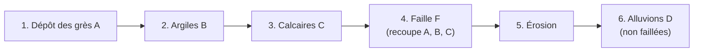

# Exercices corrigés de géologie

[← Retour au sommaire](README.md)

---

## Exercice 1. Identifier une roche

On dispose de quatre échantillons :

1. roche grise, compacte, fait effervescence à l'acide ;
2. roche blanche, se raye à l'ongle, pas d'effervescence ;
3. roche à grains visibles roses, blancs et noirs, raye le verre ;
4. roche grise, se délite dans l'eau en pâte collante.

### Correction

1. **Calcaire** (calcite → effervescence).
2. **Gypse** (dureté 2).
3. **Granite** (feldspath rose, quartz blanc, mica noir ; roche magmatique plutonique, texture grenue).
4. **Argile** ou marne (plastique dans l'eau).

---

## Exercice 2. Chronologie relative

Sur une coupe, on observe de bas en haut : des grès (A), des argiles (B), des calcaires (C). Une faille F décale A, B et C. Des alluvions (D) horizontales recouvrent le tout sans être décalées. Ordre des événements ?

### Correction

Principes utilisés : superposition (A, B, C), recoupement (F postérieure à C), D non décalée donc postérieure à F. La faille n'a pas rejoué depuis le dépôt de D : indice qu'elle est peut-être inactive (à confirmer).

---

## Exercice 3. Épaisseur d'une couche

Sur un plateau horizontal, une couche de calcaire affleure sur une largeur de 50 m, mesurée perpendiculairement à sa direction. Son pendage est de 30°. Épaisseur réelle ?

### Correction

$$e = l\sin p = 50\times\sin30° = 25\ \text{m}$$

---

## Exercice 4. Lire un pendage

Une couche est notée N45°E, 20° NW. La décrire.

### Correction

Les horizontales de la couche sont orientées à 45° du Nord vers l'Est (direction NE-SW). La couche plonge de 20° vers le Nord-Ouest, perpendiculairement à sa direction.

---

## Exercice 5. Choix de site

Un projet de route près de Gabès doit choisir entre trois tracés :

- tracé 1 : traverse une sebkha sur 2 km ;
- tracé 2 : longe le pied d'un versant marneux, avec des traces de glissements anciens ;
- tracé 3 : plus long de 1,5 km, sur un plateau à croûte calcaire.

### Correction

| Tracé | Problèmes | Solutions possibles et coût |
| --- | --- | --- |
| 1 | Sol très compressible, salé (agressif pour le béton), nappe affleurante, inondable | Remblai important, géotextile, ciment HRS, drainage : coûteux, risques de tassement |
| 2 | Instabilité de talus réactivée par les déblais et la pluie | Drainage, soutènements, surveillance : risque à long terme |
| 3 | Plus long, terrassements dans la croûte (rippage ou explosifs) | Bonne portance, matériaux réutilisables |

Le **tracé 3** est le plus sûr. Le surcoût de longueur est souvent compensé par l'économie sur les fondations de chaussée et l'entretien. La décision finale demande une reconnaissance géotechnique (sondages, essais) et une comparaison chiffrée.

---

## Exercice 6. Questions de cours

1. Pourquoi le gypse pose-t-il problème en génie civil ?
2. Différence entre nappe libre et nappe captive ?
3. Pourquoi les argiles et marnes sont-elles associées aux glissements ?

### Correction

1. Il est **soluble** (cavités, effondrements, tassements quand l'eau circule) et ses sulfates **attaquent le béton** (gonflement, fissuration) : il faut des ciments résistants aux sulfates.
2. Nappe libre : surface à la pression atmosphérique, sous une zone non saturée. Nappe captive : entre deux couches imperméables, sous pression ; dans un forage, l'eau remonte au-dessus du toit de l'aquifère.
3. Elles sont peu perméables (l'eau y fait monter la pression interstitielle), leur résistance chute quand elles se saturent (σ′ = σ − u diminue, voir la [mécanique des sols](../07-mecanique-des-sols/cours.md)) et elles ont souvent des plans de glissement anciens.

---

## Exercice 7. Sol de fondation (chapitres 1 et 2)

1. Définir une fondation.
2. Citer quatre rôles du sol de fondation.
3. Que permet de déterminer le calcul des fondations ?
4. Quelle est l'une des premières tâches de l'ingénieur avant de concevoir des fondations ? Pourquoi ?

### Correction

1. La partie inférieure d'un bâtiment ou d'un ouvrage, qui assure sa stabilité et transmet les charges au sol.
2. Il porte le poids de la structure et des équipements ; il travaille sous toutes les sollicitations pendant toute la vie de l'ouvrage ; il est en contact permanent avec la construction ; une fondation bien étudiée et bien exécutée garantit la stabilité (mal exécutée, elle met l'ouvrage en péril).
3. Les dimensions, les matériaux, les ancrages et la profondeur (qui dépend de la nature du sol).
4. Demander un **rapport géologique détaillé** du site, et parfois faire des **sondages**, car on ne peut pas concevoir des fondations sans connaître le terrain.

---

## Exercice 8. Grands ensembles structuraux (chapitre 3)

1. Quelles sont les trois structures continentales ? Qu'est-ce qu'un craton ?
2. Donner deux différences entre un bouclier et une plateforme.
3. Classer de la moins profonde à la plus profonde : plaine abyssale, plateau continental, talus continental, glacis. Donner une profondeur pour chacun.
4. Compléter : une marge ……… est le siège d'une subduction ; on y trouve des ………, des ……… et des ……… .
5. Citer les deux ceintures orogéniques actuelles. À laquelle appartient la Tunisie ?
6. Pourquoi la Méditerranée est-elle une mer intramontagneuse ? Quelle est sa profondeur maximale ?

### Correction

1. Boucliers, plateformes, chaînes de montagnes. Un craton est un bouclier : partie très ancienne, stable et rigide de la croûte continentale.
2. Le bouclier est fait de roches dures, anciennes, plissées, métamorphisées et granitisées : c'est le cœur de la croûte continentale. La plateforme est un bouclier recouvert de 10 à 15 km de couches sédimentaires marines peu ou pas plissées : zone plate et peu déformée.
3. Plateau continental (jusqu'à 150-180 m) → talus continental (jusqu'à 3 000-4 000 m, pente 4° à 5°) → glacis (jusqu'à 5 000 m) → plaine abyssale (≈ 5 000 m, plane).
4. Une marge **active** ; on y trouve des **fosses océaniques**, des **volcans actifs** et des **séismes**.
5. La ceinture péri-pacifique et la ceinture mésogéenne (Est-Ouest). La Tunisie (Atlas, Méditerranée) appartient à la ceinture **mésogéenne**.
6. Elle est entièrement entourée par des chaînes de montagnes. Profondeur maximale : 5 121 m, au sud-ouest du Péloponnèse.

---

## Exercice 9. Minéraux et cristallographie (chapitre 4)

1. Définir un minéral. Quels sont les deux grands groupes et leur part dans la croûte terrestre ?
2. Par quelles trois approches étudie-t-on un minéral ?
3. Définir la maille élémentaire et le cristal.
4. Reconnaître le système : (a) prisme droit à base carrée et à quatre faces rectangulaires ; (b) prisme oblique dont toutes les faces sont des losanges ; (c) prisme droit à six faces égales ; (d) prisme droit à base hexagonale.

### Correction

1. Une substance formée naturellement ou synthétisée artificiellement, définie par sa composition chimique et sa structure atomique. Silicatés (≈ 95 %) et non silicatés (≈ 5 %).
2. Cristallographique (géométrie, forme), physique (couleur, fracture, clivage, dureté), chimique (composition).
3. La maille élémentaire est la plus petite unité de structure cristalline qui, répétée par translation dans l'espace, reconstitue tout le cristal. Le cristal est un solide minéral naturel, homogène, de forme régulière, limité par des faces planes faisant entre elles des angles bien définis.
4. (a) quadratique ; (b) rhomboédrique ; (c) cubique ; (d) hexagonal.
