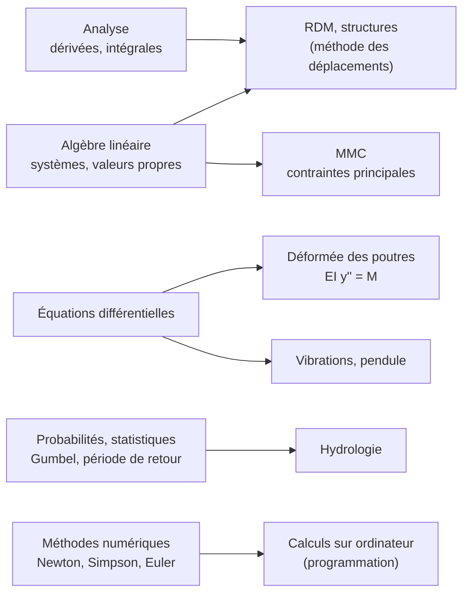

# Mathématiques et analyse numérique

Matière du programme de 1re année de l'ENIT, absente des cours du dossier. Tout le contenu est **[Complément]**, centré sur les outils dont l'ingénieur génie civil se sert dans les autres matières.

## Fichiers

| Fichier | Contenu |
| --- | --- |
| [cours.md](cours.md) | Algèbre linéaire, analyse, équations différentielles, probabilités et statistiques, méthodes numériques |
| [exercices-corriges.md](exercices-corriges.md) | Exercices types avec correction |

## Où sert chaque outil ?

