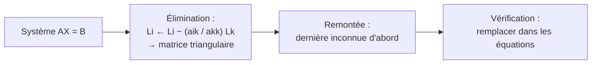

# Cours de mathématiques et d'analyse numérique

[← Retour au sommaire](README.md)

**[Complément]** : résumé des outils du programme de 1re année, avec leurs applications en génie civil.

## Sommaire

1. [Algèbre linéaire](#1-algèbre-linéaire)
2. [Analyse](#2-analyse)
3. [Équations différentielles](#3-équations-différentielles)
4. [Probabilités et statistiques](#4-probabilités-et-statistiques)
5. [Méthodes numériques](#5-méthodes-numériques)

---

## 1. Algèbre linéaire

### 1.1 Matrices

- Produit : $(AB)_{ij} = \sum_k A_{ik}B_{kj}$ ; en général $AB \ne BA$.
- Transposée $A^T$ ; matrice **symétrique** si $A^T = A$ (matrices de rigidité, tenseur des contraintes).
- **Déterminant** 2 × 2 : $\det\begin{pmatrix} a & b \\ c & d \end{pmatrix} = ad - bc$. 3 × 3 : développement selon une ligne (règle de Sarrus).
- **Inverse** : existe si et seulement si det A ≠ 0. En 2 × 2 : $A^{-1} = \dfrac{1}{ad-bc}\begin{pmatrix} d & -b \\ -c & a \end{pmatrix}$.

### 1.2 Systèmes linéaires AX = B

- Solution unique si det A ≠ 0 (système de Cramer).
- **Méthode du pivot de Gauss** : on combine les lignes pour obtenir une matrice triangulaire, puis on remonte.

- Décomposition **LU** (A = L U) : utile quand on résout plusieurs systèmes avec la même matrice (plusieurs cas de charge sur une même structure).
- Méthodes itératives (Jacobi, Gauss-Seidel) pour les très grands systèmes.

En structures, la méthode des déplacements conduit à **K U = F** (K : matrice de rigidité, U : déplacements, F : forces).

### 1.3 Valeurs et vecteurs propres

$$A\vec{v} = \lambda\vec{v} \qquad \det(A - \lambda I) = 0$$

- Une matrice symétrique réelle a des valeurs propres réelles et des vecteurs propres orthogonaux : on peut la **diagonaliser** dans une base orthonormée.
- Applications : contraintes principales ([MMC](../11-milieux-continus/cours.md)), axes principaux d'inertie, modes de vibration des structures.
- Contrôles : somme des valeurs propres = trace ; produit = déterminant.

---

## 2. Analyse

### 2.1 Dérivées et développements limités

- Dérivées usuelles : $(x^n)' = nx^{n-1}$, $(e^x)' = e^x$, $(\ln x)' = 1/x$, $(\sin x)' = \cos x$, $(\cos x)' = -\sin x$.
- **Développement de Taylor** à l'ordre n autour de a :

$$f(a+h) = f(a) + h f'(a) + \frac{h^2}{2}f''(a) + \dots + \frac{h^n}{n!}f^{(n)}(a) + o(h^n)$$

- Petits angles : $\sin x \approx x$, $\cos x \approx 1 - x^2/2$, $\tan x \approx x$ (pendule, petites rotations en RDM, flèche d'un arc).

### 2.2 Intégrales

- Primitives usuelles, intégration par parties : $\int u v' = [uv] - \int u' v$, changement de variable.
- Applications : aires, centres de gravité, moments quadratiques $I = \int y^2\,dA$, travail, volumes de terrassement.

### 2.3 Fonctions de plusieurs variables

- Dérivées partielles $\partial f/\partial x$ ; gradient $\vec{\nabla}f$ (direction de plus grande pente : écoulement de l'eau sur un MNT).
- Intégrales doubles et triples (masses, centres d'inertie, moments d'inertie).

---

## 3. Équations différentielles

| Type | Équation | Solution |
| --- | --- | --- |
| 1er ordre linéaire à coefficients constants | $y' + ay = 0$ | $y = Ce^{-ax}$ |
| Avec second membre | $y' + ay = b$ | $y = Ce^{-ax} + b/a$ |
| 2e ordre, oscillateur | $y'' + \omega^2 y = 0$ | $y = A\cos\omega t + B\sin\omega t$ |
| 2e ordre amorti | $y'' + 2\xi\omega y' + \omega^2 y = 0$ | Oscillations amorties si ξ < 1 |
| Intégration directe | $EI\,y'' = M(x)$ | Deux intégrations + conditions aux appuis |

Solution générale d'une équation linéaire = solution de l'équation homogène + une solution particulière. Les constantes viennent des **conditions initiales** (temps) ou **aux limites** (espace).

Applications : déformée des poutres, pendule et vibrations, consolidation des sols (équation de la chaleur), vidange de réservoir.

---

## 4. Probabilités et statistiques

### 4.1 Statistique descriptive

- Moyenne $\bar{x} = \dfrac1n\sum x_i$ ; variance $s^2 = \dfrac{1}{n-1}\sum(x_i - \bar{x})^2$ ; écart-type s ; coefficient de variation s / x̄.
- **Régression linéaire** (moindres carrés) : droite y = ax + b qui minimise $\sum(y_i - ax_i - b)^2$ ; $a = \dfrac{\text{cov}(x,y)}{\text{var}(x)}$, $b = \bar{y} - a\bar{x}$. Coefficient de corrélation r.

### 4.2 Lois de probabilité

| Loi | Usage en génie civil |
| --- | --- |
| **Binomiale** B(n, p) | Nombre de dépassements d'une crue en n années |
| **Normale** N(μ, σ) | Résistance du béton (fc28 = fcm − 1,64 σ : 5 % de valeurs plus faibles) |
| **Log-normale** | Pluies annuelles, perméabilités |
| **Gumbel** | Valeurs extrêmes : pluies et crues maximales annuelles |

### 4.3 Période de retour et loi de Gumbel

Probabilité de dépassement une année donnée : p = 1/T. Probabilité d'au moins un dépassement en n années :

$$R = 1 - \left(1 - \frac{1}{T}\right)^n$$

**Loi de Gumbel** (paramètres u : mode, a : échelle) :

$$F(x) = \exp\left[-\exp\left(-\frac{x - u}{a}\right)\right] \qquad x_T = u - a\ln\left[-\ln\left(1 - \frac{1}{T}\right)\right]$$

Ajustement par les moments : $a = 0{,}78\,s$, $u = \bar{x} - 0{,}577\,a$.

C'est elle qui donne les pluies de projet de l'[hydrologie](../02-hydrologie/cours.md).

---

## 5. Méthodes numériques

### 5.1 Résolution de f(x) = 0

| Méthode | Principe | Convergence |
| --- | --- | --- |
| **Dichotomie** | On coupe en deux l'intervalle [a, b] où f change de signe | Lente mais sûre |
| **Newton** | $x_{n+1} = x_n - \dfrac{f(x_n)}{f'(x_n)}$ | Très rapide près de la solution ; peut diverger si on part loin |
| Point fixe | $x_{n+1} = g(x_n)$ | Si \|g′\| < 1 |

Exemple d'usage : hauteur d'eau normale dans un canal (Manning-Strickler n'a pas de solution explicite en y).

### 5.2 Interpolation

- **Linéaire** entre deux points : $y = y_1 + (y_2 - y_1)\dfrac{x - x_1}{x_2 - x_1}$ (lecture des tables, courbe hypsométrique, courbes de niveau).
- **Lagrange** : polynôme passant par n + 1 points.

### 5.3 Intégration numérique

Sur [a, b] découpé en n intervalles de pas h = (b − a)/n :

$$\text{Trapèzes} : \int_a^b f \approx \frac{h}{2}\left[f_0 + 2(f_1 + \dots + f_{n-1}) + f_n\right]$$

$$\text{Simpson (n pair)} : \int_a^b f \approx \frac{h}{3}\left[f_0 + 4(f_1 + f_3 + \dots) + 2(f_2 + f_4 + \dots) + f_n\right]$$

Simpson est beaucoup plus précis à nombre de points égal. La formule des cubatures entre profils en travers (moyenne des aires × distance) est la méthode des trapèzes.

### 5.4 Équations différentielles : méthode d'Euler

Pour y′ = f(x, y), y(x0) = y0 :

$$y_{n+1} = y_n + h\,f(x_n, y_n)$$

Simple mais peu précise (erreur proportionnelle à h). **Runge-Kutta d'ordre 4** est la méthode standard des logiciels.

### 5.5 Erreurs

- Erreur absolue |x − x̃|, erreur relative |x − x̃| / |x|.
- Erreurs d'arrondi (machine) et de troncature (méthode).
- Toujours vérifier un résultat numérique par un ordre de grandeur ou un cas simple connu.
