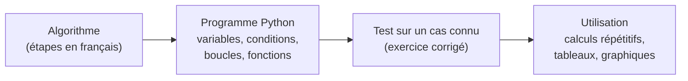

# Programmation (Python pour l'ingénieur)

Matière du programme de 1re année de l'ENIT (informatique, algorithmique), absente des cours du dossier. Tout le contenu est **[Complément]**. Le langage choisi est **Python**, le plus utilisé en école d'ingénieurs ; si ton cours utilise un autre langage (C, Matlab, Scilab), les algorithmes restent les mêmes.

## Fichiers

| Fichier | Contenu |
| --- | --- |
| [cours.md](cours.md) | Bases de Python, algorithmique, fonctions, listes, fichiers, NumPy, Matplotlib |
| [exercices-corriges.md](exercices-corriges.md) | Programmes corrigés appliqués aux autres matières (tous testés) |

## Vue d'ensemble

Pour commencer sans rien installer : Google Colab (navigateur) ; sinon installer Python avec Thonny ou VS Code.
