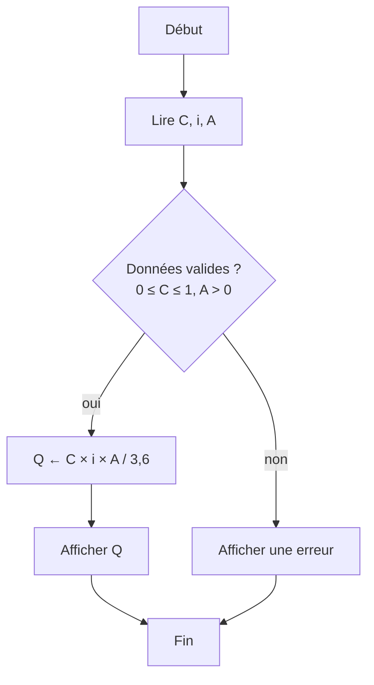

# Cours de programmation en Python

[← Retour au sommaire](README.md)

**[Complément]** : bases de Python pour un étudiant ingénieur, avec des exemples tirés des autres matières.

## Sommaire

1. [Algorithme et programme](#1-algorithme-et-programme)
2. [Variables et types](#2-variables-types-et-opérations)
3. [Entrées et sorties](#3-entrées-et-sorties)
4. [Conditions](#4-conditions)
5. [Boucles](#5-boucles)
6. [Fonctions](#6-fonctions)
7. [Listes et dictionnaires](#7-listes-et-dictionnaires)
8. [Fichiers](#8-fichiers)
9. [Algorithmes classiques](#9-algorithmes-classiques)
10. [NumPy et Matplotlib](#10-numpy-et-matplotlib)
11. [Bonnes pratiques](#11-bonnes-pratiques)

---

## 1. Algorithme et programme

Un **algorithme** est une suite finie d'instructions pour résoudre un problème. Un **programme** est sa traduction dans un langage.



---

## 2. Variables, types et opérations

```python
longueur = 6.0          # float (nombre à virgule) : on écrit un POINT
nb_poteaux = 12         # int (entier)
nom = "Poutre P1"       # str (chaîne de caractères)
est_verifie = True      # bool (True / False)
```

| Opération | Symbole | Exemple |
| --- | --- | --- |
| Addition, soustraction | `+`, `-` | `a + b` |
| Multiplication, division | `*`, `/` | `7 / 2` donne `3.5` |
| Division entière, reste | `//`, `%` | `7 // 2` donne `3`, `7 % 2` donne `1` |
| Puissance | `**` | `2 ** 3` donne `8` |
| Comparaison | `==`, `!=`, `<`, `<=`, `>`, `>=` | `a == b` |
| Logique | `and`, `or`, `not` | `a > 0 and b > 0` |

Fonctions mathématiques : `import math` puis `math.sqrt`, `math.sin` (en **radians**), `math.pi`, `math.log` (ln), `math.log10`, `math.exp`, `math.atan2`.

---

## 3. Entrées et sorties

```python
L = float(input("Portée de la poutre (m) : "))   # input renvoie du texte
q = float(input("Charge (kN/m) : "))
M = q * L ** 2 / 8
print(f"Moment maximal : {M:.2f} kN.m")          # f-string, 2 décimales
```

---

## 4. Conditions

```python
cbr = 8
if cbr < 5:
    classe = "S4"
elif cbr < 10:
    classe = "S3"
elif cbr < 25:
    classe = "S2"
else:
    classe = "S1 ou S0"
print(classe)  # S3
```

L'**indentation** (4 espaces) définit les blocs : elle est obligatoire en Python.

---

## 5. Boucles

**Boucle `for`** (nombre de répétitions connu) :

```python
for x in range(0, 7):            # x = 0, 1, ..., 6
    M = 10 * 6 / 2 * x - 10 * x ** 2 / 2
    print(x, M)
```

**Boucle `while`** (on répète tant qu'une condition est vraie) :

```python
annee = 0
trafic = 1200
while trafic < 2000:
    annee += 1
    trafic = trafic * 1.04       # croissance de 4 % par an
print(annee)                     # 14 ans pour dépasser 2000 PL/j
```

---

## 6. Fonctions

Une fonction regroupe un calcul réutilisable : on la définit une fois, on l'appelle autant qu'on veut.

```python
def debit_rationnel(C, i, A):
    """Débit de pointe (m3/s), i en mm/h, A en km2."""
    return C * i * A / 3.6

Q = debit_rationnel(0.52, 16.5, 12.5)   # 29.8 m3/s
```

- Les **paramètres** sont les entrées ; `return` renvoie le résultat.
- La chaîne entre `"""` (docstring) documente la fonction : unités, hypothèses.
- Les variables créées dans la fonction sont **locales**.

---

## 7. Listes et dictionnaires

```python
pluies = [52, 38, 61, 45, 70]          # liste
pluies.append(33)                      # ajouter
print(pluies[0], pluies[-1])           # premier, dernier
print(len(pluies), max(pluies), sum(pluies) / len(pluies))
pluies_fortes = [p for p in pluies if p > 50]   # liste en compréhension

sous_bassins = [                        # liste de tuples
    (0.30, 0.4),
    (0.20, 0.5),
    (0.50, 0.6),
]
C_eq = sum(part * C for part, C in sous_bassins)   # 0.52

beton = {"fc28": 25, "E": 30000, "nu": 0.2}         # dictionnaire
print(beton["fc28"])
```

---

## 8. Fichiers

```python
# Écrire
with open("resultats.txt", "w", encoding="utf-8") as f:
    f.write("x;M\n")
    for x in range(7):
        f.write(f"{x};{30 * x - 5 * x ** 2}\n")

# Lire un fichier CSV (une valeur par ligne après l'en-tête)
with open("pluies.csv", encoding="utf-8") as f:
    next(f)                                  # sauter l'en-tête
    pluies = [float(ligne.split(";")[1]) for ligne in f]
```

---

## 9. Algorithmes classiques

| Algorithme | Idée | Coût |
| --- | --- | --- |
| Recherche du maximum | Parcourir et garder le plus grand | n |
| Recherche séquentielle | Comparer un à un | n |
| **Recherche dichotomique** (liste triée) | Couper en deux à chaque étape | log₂ n |
| Tri par sélection, par insertion | Placer les éléments un à un | n² |
| Tri rapide, tri fusion (`sorted`) | Diviser pour régner | n log n |

```python
def maximum(liste):
    m = liste[0]
    for v in liste[1:]:
        if v > m:
            m = v
    return m
```

Les méthodes numériques du cours de [mathématiques](../13-mathematiques/cours.md) (Newton, dichotomie, Simpson, Euler) sont programmées dans les [exercices corrigés](exercices-corriges.md).

---

## 10. NumPy et Matplotlib

**NumPy** : calcul sur des tableaux entiers sans boucle, et algèbre linéaire.

```python
import numpy as np

x = np.linspace(0, 6, 61)               # 61 points de 0 à 6
M = 30 * x - 5 * x ** 2                 # calcul sur tout le tableau
print(M.max())                          # 45.0

A = np.array([[2, 1, -1], [-3, -1, 2], [-2, 1, 2]])
b = np.array([8, -11, -3])
print(np.linalg.solve(A, b))            # [ 2.  3. -1.]
print(np.linalg.eigvals([[4, 1], [2, 3]]))   # [5. 2.]
```

**Matplotlib** : graphiques.

```python
import matplotlib.pyplot as plt

plt.plot(x, M)
plt.gca().invert_yaxis()                # convention : moment positif vers le bas
plt.xlabel("x (m)")
plt.ylabel("M (kN.m)")
plt.title("Moment fléchissant, q = 10 kN/m, L = 6 m")
plt.grid()
plt.savefig("moment.png")
plt.show()
```

---

## 11. Bonnes pratiques

- Noms de variables clairs (`portee`, pas `p2`) et **unités en commentaire**.
- Une fonction = une tâche ; la tester sur un cas dont on connaît la réponse.
- Ne jamais comparer deux `float` avec `==` : utiliser `abs(a - b) < 1e-9`.
- Attention aux angles : `math.sin` attend des **radians** ; grades → radians : × π / 200.
- Lire les messages d'erreur : la dernière ligne dit le type d'erreur, les lignes au-dessus disent où.
