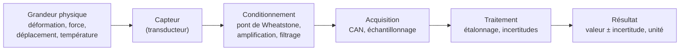

# Mesure et instrumentation

Matière de 1re année (ESSAT Gabès, cours du vendredi). Aucun support de l'enseignant n'est encore dans le dossier : tout le contenu est **[Complément]**, construit sur le programme usuel. À compléter avec le cours.

## Fichiers

| Fichier | Contenu |
| --- | --- |
| [cours.md](cours.md) | Grandeurs et unités, erreurs et incertitudes, chaîne de mesure, caractéristiques des capteurs, instruments de mesure, capteurs du génie civil, acquisition numérique, étalonnage, auscultation des ouvrages |
| [exercices-corriges.md](exercices-corriges.md) | Exercices types avec correction |

## Vue d'ensemble

Liens : [Matériaux](../08-materiaux/cours.md) (essais), [Mécanique des sols](../07-mecanique-des-sols/cours.md) (essais de laboratoire), [Topographie](../09-topographie/cours.md) (mesures de terrain).
