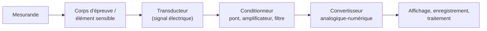

# Cours de mesure et instrumentation

[← Retour au sommaire](README.md)

**[Complément]** : cours construit sur le programme usuel, à vérifier avec l'enseignant.

## Sommaire

1. [Grandeurs et unités](#1-grandeurs-et-unités)
2. [Erreurs et incertitudes](#2-erreurs-et-incertitudes)
3. [La chaîne de mesure](#3-la-chaîne-de-mesure)
4. [Caractéristiques d'un capteur](#4-caractéristiques-dun-capteur)
5. [Instruments de mesure de longueur](#5-instruments-de-mesure-de-longueur)
6. [Capteurs utilisés en génie civil](#6-capteurs-utilisés-en-génie-civil)
7. [Jauges de déformation et pont de Wheatstone](#7-jauges-de-déformation-et-pont-de-wheatstone)
8. [Acquisition numérique](#8-acquisition-numérique)
9. [Étalonnage](#9-étalonnage)
10. [Auscultation des ouvrages](#10-auscultation-des-ouvrages)

---

## 1. Grandeurs et unités

**Mesurer**, c'est comparer une grandeur (le **mesurande**) à une grandeur de même nature prise comme unité. Un résultat de mesure s'écrit toujours : **valeur ± incertitude, unité** (ex. L = 12,46 ± 0,02 m).

| Grandeur de base (SI) | Unité | Symbole |
| --- | --- | --- |
| Longueur | mètre | m |
| Masse | kilogramme | kg |
| Temps | seconde | s |
| Intensité électrique | ampère | A |
| Température | kelvin | K |
| Quantité de matière | mole | mol |
| Intensité lumineuse | candela | cd |

Unités dérivées utiles : newton (N = kg·m/s²), pascal (Pa = N/m², 1 MPa = 1 N/mm²), joule (J), watt (W), volt (V), ohm (Ω).

Préfixes : µ (10⁻⁶), m (10⁻³), k (10³), M (10⁶), G (10⁹). Une **microdéformation** vaut 1 µm/m = 10⁻⁶.

---

## 2. Erreurs et incertitudes

### 2.1 Types d'erreurs

| Erreur | Origine | Comment la réduire |
| --- | --- | --- |
| **Systématique** | Toujours dans le même sens : zéro mal réglé, appareil mal étalonné, dilatation | Étalonnage, correction |
| **Aléatoire** | Varie d'une mesure à l'autre : lecture, vibrations, bruit | Répéter les mesures et faire la moyenne |
| **Grossière** (faute) | Erreur de lecture ou de recopie | Contrôle, mesure redondante |

**Justesse** : absence d'erreur systématique. **Fidélité** : faible dispersion. **Exactitude** = justesse + fidélité.

### 2.2 Incertitude absolue et relative

- Incertitude absolue : ΔX (même unité que X).
- Incertitude relative : ΔX / X (sans unité, souvent en %).

### 2.3 Série de mesures

Pour n mesures x₁ … xₙ :

$$\bar{x} = \frac{1}{n}\sum x_i \qquad s = \sqrt{\frac{\sum (x_i-\bar{x})^2}{n-1}} \qquad u(\bar{x}) = \frac{s}{\sqrt{n}}$$

On donne souvent une incertitude élargie $U = k\,u$ avec k = 2 (niveau de confiance ≈ 95 %).

Pour un appareil gradué de résolution r (une seule lecture) : $u = r/\sqrt{12}$ (ou plus simplement ±r/2).

### 2.4 Propagation des incertitudes (méthode simple, majorante)

| Relation | Incertitude |
| --- | --- |
| Y = A + B ou A − B | ΔY = ΔA + ΔB |
| Y = A × B ou A / B | ΔY / Y = ΔA / A + ΔB / B |
| Y = Aⁿ | ΔY / Y = \|n\| ΔA / A |

Avec des incertitudes indépendantes (méthode statistique), on additionne les **carrés** : pour un produit, $(u_Y/Y)^2 = (u_A/A)^2 + (u_B/B)^2$.

**Chiffres significatifs** : on arrondit l'incertitude à 1 ou 2 chiffres, puis la valeur au même rang (12,4637 ± 0,021 → 12,464 ± 0,021, ou 12,46 ± 0,02).

---

## 3. La chaîne de mesure

- **Capteur actif** : produit lui-même un signal (thermocouple, piézoélectrique).
- **Capteur passif** : son impédance varie et il faut l'alimenter (jauge, thermistance, LVDT).

---

## 4. Caractéristiques d'un capteur

| Caractéristique | Définition |
| --- | --- |
| **Étendue de mesure** (EM) | Plage entre la plus petite et la plus grande valeur mesurable |
| **Sensibilité** S | Variation de la sortie / variation de l'entrée (ex. 2 mV/V, 10 mV/mm) |
| **Résolution** | Plus petite variation détectable |
| **Précision** | Souvent donnée en % de la pleine échelle (ex. ±0,5 % EM) |
| **Linéarité** | Écart maximal à la droite d'étalonnage |
| **Hystérésis** | Écart entre montée et descente de la grandeur |
| **Temps de réponse**, bande passante | Rapidité à suivre une variation |
| Dérive | Variation de la sortie dans le temps ou avec la température |

---

## 5. Instruments de mesure de longueur

| Instrument | Résolution courante | Usage |
| --- | --- | --- |
| Règle, mètre ruban | 1 mm | Chantier |
| **Pied à coulisse** (vernier au 1/10, 1/20, 1/50) | 0,1 à 0,02 mm | Éprouvettes, granulats, armatures |
| **Micromètre** (Palmer) | 0,01 mm | Épaisseurs fines |
| **Comparateur** à cadran | 0,01 mm | Tassements à l'œdomètre, flèches |
| Télémètre laser, station totale | mm | Topographie |

**Lecture d'un vernier au 1/50** : lire les millimètres entiers sur la règle avant le zéro du vernier, puis chercher le trait du vernier qui coïncide avec un trait de la règle : n° du trait × 0,02 mm. Ex. 23 mm + 17 × 0,02 = 23,34 mm.

---

## 6. Capteurs utilisés en génie civil

| Grandeur | Capteur | Exemple d'usage |
| --- | --- | --- |
| Déformation | **Jauge électrique** (extensomètre), corde vibrante, fibre optique | Béton, acier, ouvrages d'art |
| Déplacement | **LVDT**, potentiomètre, comparateur | Essais de compression, flèche de poutre |
| Force | **Capteur de force** (peson à jauges), anneau dynamométrique | Presse, essais CBR, tirants |
| Pression | Capteur de pression, **piézomètre** | Pression interstitielle, nappes |
| Température | **Thermocouple**, thermistance, sonde Pt100 | Prise du béton, dilatation |
| Inclinaison | **Inclinomètre** | Glissement de talus, murs de soutènement |
| Vibration | **Accéléromètre** | Séismes, ponts, battage de pieux |
| Fissure | Fissuromètre | Pathologie des bâtiments |

---

## 7. Jauges de déformation et pont de Wheatstone

Une jauge est une piste résistive collée sur la pièce. Quand la pièce s'allonge, la résistance R varie :

$$\frac{\Delta R}{R} = K\,\varepsilon$$

avec **K ≈ 2** (facteur de jauge) et ε la déformation.

La variation ΔR est très faible : on la mesure avec un **pont de Wheatstone** alimenté sous une tension E. Pour un **quart de pont** (une seule jauge active) :

$$V_s \approx \frac{E}{4}\,K\,\varepsilon$$

Demi-pont (deux jauges actives opposées) : $V_s \approx \frac{E}{2} K \varepsilon$. Pont complet : $V_s \approx E K \varepsilon$. Une jauge « compensatrice » non chargée dans le pont corrige l'effet de la température.

Ensuite, pour un matériau élastique : σ = E_mat · ε (loi de Hooke, voir la [RDM](../06-rdm/cours.md)).

---

## 8. Acquisition numérique

- **Convertisseur analogique-numérique (CAN)** sur n bits, de plage V_max : quantum $q = V_{max} / 2^n$. Ex. 10 V sur 12 bits : q = 10 / 4096 ≈ 2,44 mV.
- **Échantillonnage** : on prend une mesure toutes les Tₑ secondes, soit fₑ = 1/Tₑ.
- **Théorème de Shannon** : $f_e > 2 f_{max}$, sinon le signal est déformé (repliement). En pratique on prend 5 à 10 fois f_max.

---

## 9. Étalonnage

Étalonner, c'est comparer l'appareil à un **étalon** de référence et établir la relation sortie = f(entrée), le plus souvent une **droite** y = a·x + b obtenue par moindres carrés :

$$a = \frac{n\sum x_i y_i - \sum x_i \sum y_i}{n\sum x_i^2 - (\sum x_i)^2} \qquad b = \bar{y} - a\,\bar{x}$$

La pente a est la sensibilité. On vérifie la linéarité avec l'écart maximal entre les points et la droite. Un appareil de laboratoire (presse, balance) doit avoir un **certificat d'étalonnage** valide.

---

## 10. Auscultation des ouvrages

L'**auscultation** (monitoring) consiste à suivre dans le temps le comportement d'un ouvrage : barrages (piézomètres, pendules, extensomètres), ponts (flèches, vibrations), talus (inclinomètres), bâtiments anciens (fissuromètres), tunnels (convergences).

Démarche : définir les grandeurs à suivre et les seuils d'alerte → choisir et installer les capteurs → mesure initiale (« point zéro ») → mesures régulières → interprétation et alerte.
