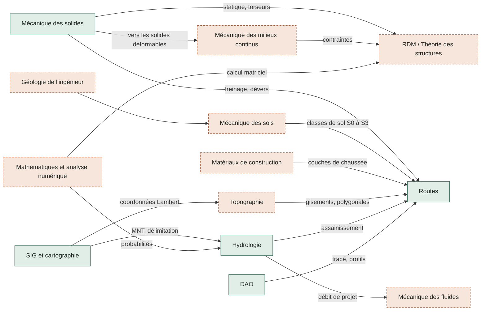

# Cours de génie civil, 1re année

Ce dépôt contient un dossier par matière. Chaque dossier contient un cours complet en Markdown, avec des schémas (Mermaid), des formules et des exemples chiffrés.

> **Légende.** Le contenu vient de mes cours (ESSAT Gabès) quand ils existent. Les passages marqués **[Complément]** ont été ajoutés pour expliquer ou combler un manque. Ils sont à vérifier avec l'enseignant avant un examen.

## Carte des matières

Vert : matière présente dans mes cours. Orange en pointillé : matière du programme de 1re année de l'ENIT, absente de mes cours.

## Sommaire

| Dossier | Matière | Source |
| --- | --- | --- |
| [01-routes](01-routes/README.md) | Routes | Mon cours + compléments |
| [02-hydrologie](02-hydrologie/README.md) | Hydrologie | Mon cours + compléments |
| [03-sig-cartographie](03-sig-cartographie/README.md) | SIG et cartographie | Mon cours + compléments |
| [04-mecanique-des-solides](04-mecanique-des-solides/README.md) | Mécanique des solides | Mon cours + compléments |
| [05-dao](05-dao/README.md) | Dessin assisté par ordinateur | Consigne du dossier + compléments |
| [06-rdm](06-rdm/README.md) | RDM / Théorie des structures | Programme ENIT |
| [07-mecanique-des-sols](07-mecanique-des-sols/README.md) | Mécanique des sols | Programme ENIT |
| [08-materiaux](08-materiaux/README.md) | Matériaux de construction | Programme ENIT |
| [09-topographie](09-topographie/README.md) | Topographie | Programme ENIT |
| [10-mecanique-des-fluides](10-mecanique-des-fluides/README.md) | Mécanique des fluides | Programme ENIT |
| [11-milieux-continus](11-milieux-continus/README.md) | Mécanique des milieux continus | Programme ENIT |
| [12-geologie](12-geologie/README.md) | Géologie de l'ingénieur | Programme ENIT |
| [13-mathematiques](13-mathematiques/README.md) | Mathématiques et analyse numérique | Programme ENIT |
| [14-programmation](14-programmation/README.md) | Programmation | Programme ENIT |

## Ordre de travail conseillé

1. Mécanique des solides, chapitres 1 et 2 (paramétrage, torseurs, statique).
2. SIG et cartographie, chapitre 2 (coordonnées, projections).
3. Routes, chapitres 2 à 4, avec les exercices de tracé.
4. Hydrologie, bassin versant puis débits.
5. Routes, chapitres 5 à 9.
6. Les matières ENIT, en commençant par la RDM et la mécanique des sols.
